# NeoFlash Design System (NF2): complete reference

> Audience: OpenAI Codex (and any coding agent) that has to **implement NeoFlash's UI in code** or keep code in sync
> with the design. Start with `../AGENTS.md` (short brief); this file is the exhaustive reference.
> Use the generated tokens in `../tokens/` instead of copying hex values. The human version is the PDF in `pdf/`.
> Generated parts (tokens, styles, components, icons, cursors, exports, outlines) are rebuilt from the Figma file
> by `tools/build-docs.py`. Do not hand-edit this file; edit `docs/source/NeoFlash-Design-System.src.md` and rebuild.

Generated: 2026-10-31 · Figma file: `Interface test` (key `BUz3pseopiuOg2Uiy3Fog7`).

---

## 0. TL;DR for Codex

- **Implementing UI?** Read §3 (foundations), §4–§9 (layout, timeline, panels, dialogs), §10 (component API) and
  §13 (implementation guide). Colours, spacing, radii and type come from `../tokens/tokens.css` / `tokens.json`;
  never hard-code values. Pixel references: `../exports/{interface,panels}/{dark,light}/{png,svg}/`.
- **Changing the design itself** happens in Figma, not in this repo. If you have the Figma MCP server, follow §11;
  otherwise describe the change and leave the Figma edit to a designer.

- **What it is.** NeoFlash is a desktop vector-animation editor in the tradition of Macromedia / Adobe Flash:
  stage + timeline + layers + nested symbols (movie clip / graphic / button) + ActionScript-style scripting,
  publishing to HTML5 (Rust / WebAssembly runtime), video, images and audio.
- **Two designs live in one Figma file.** `v1` is a faithful vector reconstruction of the current app
  (NF1 components, `NF1 · Tokens`). `v2` is the redesign (NF2 components, `NF2 · Tokens`, Dark + Light modes).
  **They never share a variable, style or component.** Editing one must not change the other.
- **Source of truth is the Figma file**, edited through the Figma MCP `use_figma` tool (Plugin API).
  The old generator plugin in `figma-plugin/` is history; never re-run it on this file.
- **Bind every v2 colour/spacing/radius to `NF2 · Tokens`** and every v2 text to an `NF2/*` text style.
  Never hard-code a hex in v2 except translucent tints (see §11 gotchas).
- **Red is reserved for errors** (and the playhead / frame labels, which are Flash conventions). Breakpoints are orange,
  warnings amber, strings green, tags blue.
- **Timeline geometry:** 12 px per frame (Normal view), rows 28 px, ruler 32 px, frame `n` starts at `x = (n − 1) × 12`.
- **Icons:** monochrome, 16 px (UI) and 20 px (tools), components `NF2 Icon/16/*` and `NF2 Icon/20/*`, recoloured by token.
- **Exports and data** live next to this file: `../exports/` (PNG @2x + SVG, Dark and Light), `data/figma-dump.json`,
  `data/outline/*.txt` (text outline of every exported frame). Re-export with `tools/export-plugin` (no MCP limits).

---

## 1. Product and principles

NeoFlash keeps the mental model Flash animators already have, and modernises the chrome around it.

| Principle | What it means in the UI |
|---|---|
| One primary path | Every screen has one obvious primary action (Publish, Play, Save, Apply). Everything else is secondary and never competes in weight. |
| Group by task | Transport, onion skin, zoom, layer actions are grouped controls, not scattered rows. |
| Surfaces, not borders | Depth comes from background levels (`bg/app → panel → raised → field`); borders are separators only. |
| Systematic | Own variables (colour, spacing, radius), text styles and components; two themes on one collection. |
| Accessible | Text contrast ≥ 4.5:1, focus ring 2 px, hit areas ≥ 32 px, every tool tooltip shows its shortcut. |
| Isolated from v1 | No v2 variable, style or component references v1. |
| Flash-literate | Layer kinds, frame states, keyframe glyphs, symbol types, menus and shortcuts follow Flash semantics so that a Flash user is instantly at home. |

### 1.1 Audit v1 → v2 (summary)

The audit board (`Audit · v1 → v2`) lists 14 findings: 5 High, 7 Medium, 2 Low. Key numbers: disabled text contrast
in v1 is 2.16:1 (norm 4.5:1); 20 tool buttons had no labels or tooltips.

| # | Area | Severity | v1 problem | v2 solution |
|---|---|---|---|---|
| 1 | Action hierarchy | High | "Test Movie" is a small link; "Publish HTML5…" hidden at the bottom of Properties. No primary action. | Top bar: Test Movie (secondary) + **Publish** (primary, accent). Project title + unsaved badge centred. |
| 2 | Timeline controls | High | Scene/FPS/duration on top, Play and onion skin at the bottom, zoom on a third row. Transport next to add/delete layer. | One control bar above the grid: transport + timecode + scene / FPS / duration + frame tools + onion + zoom on the right. |
| 3 | Layer column | Med | Three unlabelled header icons; 60 % empty; add/delete detached from the list. | Add/delete in the layer column; 28 px rows with colour dot; lock/eye with tooltips. |
| 4 | Timeline bottom row | Med | Onion skin checkboxes, fields and slider in one ungrouped line. | Onion skin is one toggle + range handles on the ruler; options in a popover and Preferences ▸ Timeline. |
| 5 | Tools palette | High | 20 icons, no labels, no shortcuts, grey group captions. | 56 px rail, groups split by dividers, accent active tool, tooltip "Name  key", flyouts for tool groups. |
| 6 | Typography & contrast | High | 14 px base, 11–12 px secondary, disabled 2.16:1. | Scale 11/12/13/14/16/18/20, ≥ 12 px for running text, all text tokens ≥ 4.5:1 (except disabled). |
| 7 | Surfaces & borders | Med | Every control outlined 1 px #6D7690; no depth. | Surface levels; borders only as separators; radii 4/6/8/12 from tokens. |
| 8 | Property fields | Med | FPS/Frames/Alpha look like buttons; no units, steppers or scrub. | One Field: inline prefix label, units in value, hover/focus/disabled, linked W × H. |
| 9 | Library | Med | Search + Clear + Sort + A–Z take two rows; 500 px empty; no empty state. | Search with clear, sort in header menu, footer actions, preview and empty state. |
| 10 | Bottom dock | Low | Actions/Accessibility/Output as a permanent 186 px panel showing one line. | One dock with tabs: Timeline · Actions · Output · Accessibility. |
| 11 | Unsaved changes dialog | High | Save/Discard/Cancel equal weight; two different dialog title styles. | One Dialog: Save primary, Discard danger-ghost left, Cancel secondary, consequence text, Esc/Enter. |
| 12 | Convert to Symbol dialog | Med | Eight fields in one column, linkage expanded, disabled fields look active. | Name / Type / Folder first, compact registration picker, linkage under Advanced, Convert primary. |
| 13 | Status line | Low | Hints and shortcuts in one 12 px grey line; broken glyph "⌘□". | 24 px status bar: state left, shortcut chips (F5/F6/F7/⌘↵) right. |
| 14 | Accessibility & themes | Med | Selection by colour + 1 px border, weak focus, 24–28 px targets, no dark theme. | 2 px focus ring, ≥ 32 px targets, Dark/Light on one variable collection. |

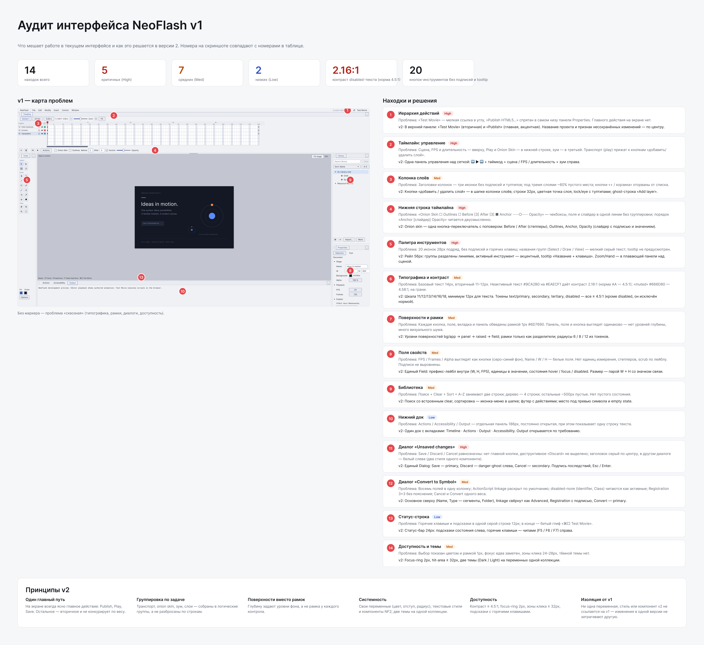

### 1.2 Functional coverage

The board `Functional coverage — v2` checks v2 against what a Flash-style editor needs (drawing, nested symbols,
timeline animation, scripting, import / export of graphics, video and sound): **33 of 33 covered**. The table in §9
maps every capability to the frame that shows it.

---

## 2. Figma file map

| Page | Id | Top-level frames |
|---|---|---|
| v1 · Components | 1:2842 | Shelf / Icons · 16px (1:2887), Shelf / Button · Text (1:3094), Shelf / Button · Icon / Tool (1:3105), Shelf / Checkbox (1:3119), Shelf / Field · Text / Number / Select (1:3130), Shelf / Slider (1:3145), Shelf / Panel tab / header (1:3151), Shelf / Section header (1:3168), Shelf / Library tree item (1:3179), Shelf / Timeline layer row (1:3204), Shelf / Swatch · Registration cell · Scrollbar (1:3229), Shelf / Menu item · Dialog header (1:3240), Shelf / Code editor (Actions) (1:3249), Shelf / Timeline · Frame cell / Row / Ruler / Playhead (1:3254) |
| v1 · Interface | 1:2843 | NF1 / Editor — Main window (1:3542), NF1 / Panel — Actions (1:4767), NF1 / Editor — Unsaved changes dialog (1:4805), NF1 / Editor — Convert to Symbol dialog (1:5078) |
| Audit · v1 → v2 | 1:2844 | Audit / v1 → v2 (1:7272), Functional coverage — v2 (61:1026) |
| v2 · System & Components | 1:2845 | Colors / Dark (1:8742), Colors / Light (1:8887), Type scale (1:9032), Spacing and radius (1:9058), Shelf / Icons · 16 and 20 px (1:9092), Shelf / Button (1:9503), Shelf / Icon button (1:9566), Shelf / Segmented control (1:9605), Shelf / Field · Search · Select (1:9617), Shelf / Checkbox · Slider · Swatch · Badge (1:9658), Shelf / Dock tab · Section header · Panel header (1:9690), Shelf / Tree item (1:9726), Shelf / Kbd · Tooltip · Dialog header · Zoom control · Logo (1:9778), Shelf / Code editor (1:9816) … |
| Icons | 35:31 | v2 · NF2 icons (71:1407), v1 · NF1 icons (as built) (71:4069) |
| v2 · Panels | 22:31 | Panels — Dark (22:431), Menus — Dark (44:5714), Preferences (45:6580), Timeline frame views — Dark (55:6837), Menus — Light (60:10332), Preferences — Light (60:10559), Timeline frame views — Light (60:11121), Panels — Light (69:15209) |
| v2 · Interface — Dark | 1:2846 | NF2 / Editor — Main (1:10114), NF2 / Editor — Actions tab (1:11378), NF2 / Editor — Unsaved changes dialog (1:11790), NF2 / Editor — Convert to Symbol dialog (1:12024), NF2 / Timeline — states legend (12:11901), NF2 / Editor — View settings open (33:26705), NF2 / Editor — Swatches open (33:27679), NF2 / Editor — Ease panel open (33:31667), NF2 / Editor — Edit menu open (46:36610), NF2 / Editor — Editing symbol in place (47:34191), NF2 / Editor — Video on timeline (59:46641), NF2 / Editor — Motion tween path (67:51373), Frame 30 (67:55259) |
| v2 · Interface — Light | 59:50907 | NF2 / Editor — Main (59:50910), NF2 / Editor — Actions tab (59:51153), NF2 / Editor — Unsaved changes dialog (59:51375), NF2 / Editor — Convert to Symbol dialog (59:51632), NF2 / Timeline — states legend (59:51899), NF2 / Editor — View settings open (59:52051), NF2 / Editor — Swatches open (59:52295), NF2 / Editor — Ease panel open (59:52540), NF2 / Editor — Edit menu open (59:52828), NF2 / Editor — Editing symbol in place (59:53105), NF2 / Editor — Video on timeline (59:53374), NF2 / Editor — Motion tween path (67:55347) |


Page roles:

- **v1 · Components / v1 · Interface** — reconstruction of the shipped app. Touch only when asked.
- **Audit · v1 → v2** — findings, annotated v1 map, principles, functional coverage table.
- **v2 · System & Components** — tokens boards (Colors Dark/Light, Type scale, Spacing and radius) and component
  *shelves* (`Shelf / …` frames). Every NF2 component lives here.
- **Icons** — every NF2 / NF1 icon grouped with "where used", the Cursors section and the list of unused icons.
  Regenerate it after adding icons (see §11).
- **v2 · Panels** — every floating panel, dialog, menu, preferences page and timeline view mode, in a Dark board and a
  Light twin board (`Panels — Light`, `Menus — Light`, `Preferences — Light`, `Timeline frame views — Light`).
- **v2 · Interface — Dark / Light** — full 1920 × 1080 editor screens in each state. The Light page holds clones of the
  Dark frames with the NF2 collection set to Light mode on the frame. **After changing a Dark screen, re-clone it to
  Light** (delete the old twin, clone, set explicit mode Light).

---

## 3. Foundations

### 3.1 Colour tokens (`NF2 · Tokens`, modes Dark / Light)

All colours are variables in one collection with two modes. Themes switch by setting the explicit mode of a frame
(`frame.setExplicitVariableModeForCollection(collection, lightModeId)`); nothing else changes.

**Semantic rules**

- Surfaces stack: `bg/app` (window) → `bg/panel` (docked panels, inspector) → `bg/raised` (popovers, cards, menus,
  floating panels) → `bg/field` (inputs). Hover = `bg/hover`, selected row = `bg/selected`.
- `bg/canvas` is the pasteboard around the stage; `bg/stage` is the *document* background (user content, so it is the
  same in both modes).
- Borders: `border/subtle` separators inside panels, `border/default` control outlines where needed,
  `border/strong` emphasised outlines, `border/focus` focus ring (2 px).
- Text: `text/primary` content, `text/secondary` labels, `text/tertiary` hints and metadata, `text/disabled`,
  `text/on-accent` on accent fills, `text/inverse` on the tooltip.
- `accent/*` is the only interactive colour (primary buttons, selection, active tool, toggles on, focus).
- `danger/*` = destructive actions and errors. `warning/*` = warnings, unsaved badge. `success/default` = OK states.
- `brand/orange` = logo, breakpoints family. `layer/*` = layer colour dots (outline colour of a layer).
- `timeline/*` = everything inside the timeline grid (see §5). `syntax/*` = code editor (see §7).
- `guide`, `guide-selected`, `stage-grid` = canvas aids. `overlay` = modal scrim (has alpha). `tooltip/bg`.

#### Surfaces

| Token | Dark | Light |
|---|---|---|
| `color/bg/app` | `#0d1016` | `#eef0f5` |
| `color/bg/panel` | `#12151c` | `#f6f7fa` |
| `color/bg/raised` | `#171b24` | `#ffffff` |
| `color/bg/field` | `#0d1016` | `#ffffff` |
| `color/bg/hover` | `#1e2330` | `#e9ecf3` |
| `color/bg/selected` | `#1f2a48` | `#e3ebff` |
| `color/bg/canvas` | `#0a0c11` | `#dadde6` |
| `color/bg/stage` | `#131824` | `#131824` |

#### Borders & focus

| Token | Dark | Light |
|---|---|---|
| `color/border/subtle` | `#232938` | `#e1e4ec` |
| `color/border/default` | `#2e3547` | `#cfd4e0` |
| `color/border/strong` | `#444d63` | `#a9b0c2` |
| `color/border/focus` | `#6c93ff` | `#3c6bf0` |

#### Text

| Token | Dark | Light |
|---|---|---|
| `color/text/primary` | `#e7eaf2` | `#171b26` |
| `color/text/secondary` | `#9aa3b6` | `#5b6477` |
| `color/text/tertiary` | `#8790a4` | `#667086` |
| `color/text/disabled` | `#566073` | `#a2a9b8` |
| `color/text/on-accent` | `#0b1020` | `#ffffff` |
| `color/text/inverse` | `#0d1016` | `#f6f7fa` |

#### Accent (interactive)

| Token | Dark | Light |
|---|---|---|
| `color/accent/default` | `#6c93ff` | `#3c6bf0` |
| `color/accent/hover` | `#86a5ff` | `#2f59d6` |
| `color/accent/subtle` | `#1f2a48` | `#e3ebff` |

#### Brand

| Token | Dark | Light |
|---|---|---|
| `color/brand/orange` | `#ff9a5c` | `#e8731f` |

#### Danger / error

| Token | Dark | Light |
|---|---|---|
| `color/danger/default` | `#ff6b6b` | `#d92d2d` |
| `color/danger/subtle` | `#3a1d22` | `#fde8e8` |

#### Warning

| Token | Dark | Light |
|---|---|---|
| `color/warning/default` | `#f5b94a` | `#b26a00` |
| `color/warning/subtle` | `#38300f` | `#fef3d6` |

#### Success

| Token | Dark | Light |
|---|---|---|
| `color/success/default` | `#3dd68c` | `#168a57` |

#### Layer colours

| Token | Dark | Light |
|---|---|---|
| `color/layer/green` | `#3dd68c` | `#168a57` |
| `color/layer/red` | `#ff6b6b` | `#d92d2d` |
| `color/layer/blue` | `#6c93ff` | `#3c6bf0` |

#### Timeline

| Token | Dark | Light |
|---|---|---|
| `color/timeline/cell` | `#12151c` | `#ffffff` |
| `color/timeline/cell-alt` | `#151922` | `#f6f7fa` |
| `color/timeline/line` | `#1c2130` | `#e8ebf2` |
| `color/timeline/row-selected` | `#1a2236` | `#e8eeff` |
| `color/timeline/playhead` | `#ff5c6c` | `#e5334a` |
| `color/timeline/empty` | `#141820` | `#ffffff` |
| `color/timeline/empty-5th` | `#181d26` | `#edf0f5` |
| `color/timeline/grid` | `#222833` | `#d5dae4` |
| `color/timeline/static` | `#363d4b` | `#cbd0da` |
| `color/timeline/classic-tween` | `#4b3f92` | `#d9d2ff` |
| `color/timeline/shape-tween` | `#1d6a4c` | `#c8eed6` |
| `color/timeline/motion-tween` | `#2a5b9e` | `#cde0ff` |
| `color/timeline/selected` | `#3550b8` | `#3c6bf0` |
| `color/timeline/marker` | `#d9dee8` | `#171b26` |
| `color/timeline/marker-inverse` | `#ffffff` | `#ffffff` |
| `color/timeline/label` | `#ff6b6b` | `#d92d2d` |
| `color/timeline/comment` | `#3dd68c` | `#168a57` |
| `color/timeline/folder` | `#171b23` | `#e6e9f0` |
| `color/timeline/onion` | `#6c93ff` | `#3c6bf0` |

#### Code syntax

| Token | Dark | Light |
|---|---|---|
| `color/syntax/function` | `#8aadf4` | `#2f5bd8` |
| `color/syntax/string` | `#a6da95` | `#3d7a2a` |
| `color/syntax/keyword` | `#c6a0f6` | `#7e3fc2` |
| `color/syntax/type` | `#8bd5ca` | `#0b7f72` |
| `color/syntax/comment` | `#6e7891` | `#8a93a6` |
| `color/syntax/number` | `#f5a97f` | `#b5521b` |
| `color/syntax/tag` | `#7dc4e4` | `#0b6e99` |
| `color/syntax/attr` | `#eed49f` | `#8a6500` |
| `color/syntax/error` | `#ff6b6b` | `#d92d2d` |
| `color/syntax/warning` | `#f5b94a` | `#b26a00` |
| `color/syntax/breakpoint` | `#ff9a5c` | `#e8731f` |
| `color/syntax/selection` | `#2a3a63` | `#d5e2ff` |
| `color/syntax/current-line` | `#171c27` | `#f2f5fb` |

#### Canvas aids & overlays

| Token | Dark | Light |
|---|---|---|
| `color/overlay` | `#05070bb3` | `#10131a66` |
| `color/guide` | `#2ec4e6` | `#0b93bf` |
| `color/guide-selected` | `#8be7fb` | `#05698a` |
| `color/stage-grid` | `#ffffff` | `#1b2233` |


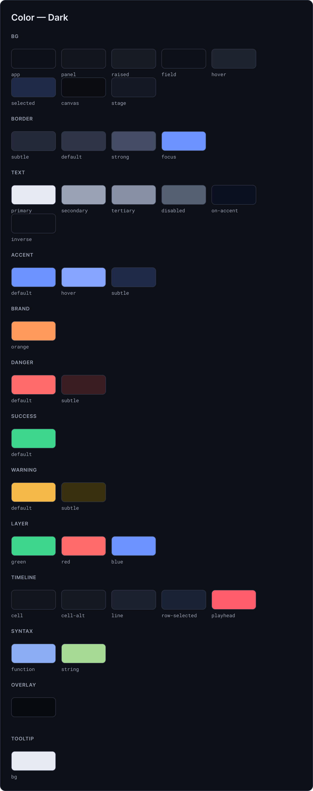
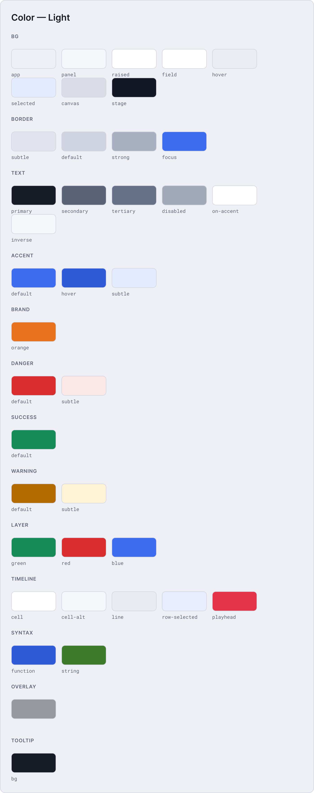

### 3.2 Spacing and radius tokens

| Token | Value |
|---|---|
| `space/1` | 4 px |
| `space/2` | 8 px |
| `space/3` | 12 px |
| `space/4` | 16 px |
| `space/5` | 24 px |
| `space/6` | 32 px |
| `radius/sm` | 4 px |
| `radius/md` | 6 px |
| `radius/lg` | 8 px |
| `radius/xl` | 12 px |
| `radius/full` | 999 px |


Usage:

- Panel padding 12 (`space/3`) horizontally, 12 between groups; field rows gap 8; dialog padding 24 (`space/5`).
- Control heights: 32 (fields, selects, buttons, icon buttons SM), 28 (tree rows, menu items, layer rows,
  breadcrumb), 40 (dock tabs, primary play button MD), 36 (panel tabs, floating panel header), 24 (status bar).
- Radii: `radius/sm` 4 (chips, swatches, kbd), `radius/md` 6 (fields, buttons, menu items), `radius/lg` 8
  (cards, popovers, panels), `radius/xl` 12 (dialogs, floating panels), `radius/full` pills / switches.

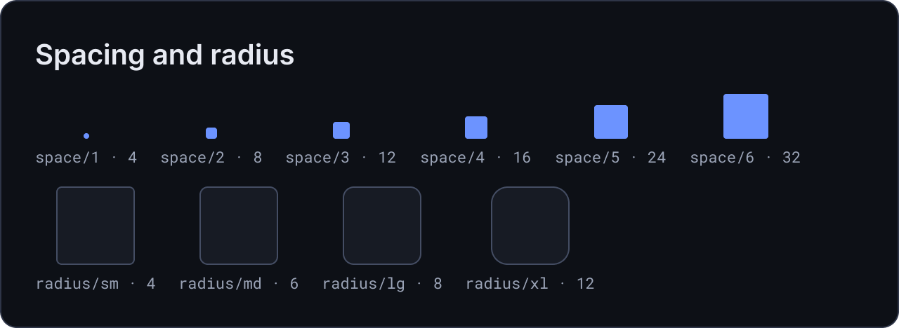

### 3.3 Typography

Fonts: **Inter** (UI) and **Roboto Mono** (code, timecode, numbers in rulers, hex values). Minimum running-text size is
12 px; 11 px only for overlines and mono metadata.

| Name | Font | Size | Line height | Letter spacing | Case |
|---|---|---|---|---|---|
| `NF2/Heading` | Inter Semi Bold | 20 | 28px | 0 | — |
| `NF2/Title` | Inter Semi Bold | 16 | 24px | 0 | — |
| `NF2/Body` | Inter Regular | 13 | 20px | 0 | — |
| `NF2/Body Strong` | Inter Medium | 13 | 20px | 0 | — |
| `NF2/Small` | Inter Regular | 12 | 16px | 0 | — |
| `NF2/Small Strong` | Inter Medium | 12 | 16px | 0 | — |
| `NF2/Overline` | Inter Semi Bold | 11 | 16px | 6% | UPPER |
| `NF2/Mono` | Roboto Mono Regular | 12 | 20px | 0 | — |
| `NF2/Mono Small` | Roboto Mono Regular | 11 | 14px | 0 | — |
| `NF2/Dialog Title` | Inter Semi Bold | 18 | 26px | 0 | — |
| `NF2/Dialog Body` | Inter Regular | 14 | 22px | 0 | — |


Usage:

- `NF2/Heading` page/board titles, `NF2/Title` panel titles and section titles in big panels,
  `NF2/Dialog Title` + `NF2/Dialog Body` in dialogs.
- `NF2/Body` default UI text (field values, menu items, tree rows). `NF2/Body Strong` labels that need weight
  (selected tab, project title).
- `NF2/Small` secondary text, descriptions, hints; `NF2/Small Strong` field prefixes and badges.
- `NF2/Overline` section headers inside panels (uppercase, +6 % tracking).
- `NF2/Mono` code editor, timecode; `NF2/Mono Small` ruler numbers, hex, IDs, file paths.

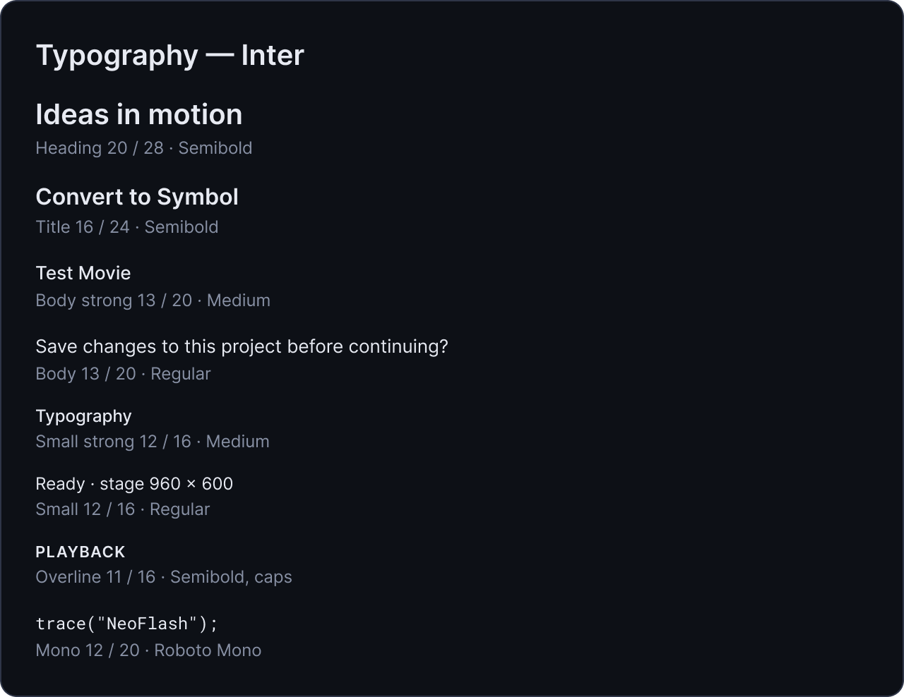

### 3.4 Iconography

- Two grids: **16 px** for UI (panels, menus, timeline, dialogs) and **20 px** for tools (Tools panel, colour
  controls). Stroke icons (≈1.3 px on the 16 grid, 1.5 px on the 20 grid, round caps), no colour of their own:
  the instance is recoloured by token
  (`text/secondary` default, `text/primary` hover, `accent/default` active, `text/on-accent` on primary buttons).
- Names: `NF2 Icon/16/<name>`, `NF2 Icon/20/<name>`; tools are `NF2 Icon/20/tool-<name>`, colour controls
  `NF2 Icon/20/color-<name>`.
- The **Icons** page lists every icon with where it is used, grouped like the table below. Unused icons are listed
  as cleanup candidates (kept on purpose for upcoming features).

**304 icons** (16 px and 20 px).

| Group | # | Icons |
|---|---|---|
| Tools (20 px) | 31 | 20/color-default, 20/color-none, 20/color-swap, 20/tool-bind, 20/tool-bone, 20/tool-brush, 20/tool-bucket, 20/tool-deco, 20/tool-eraser, 20/tool-eyedropper, 20/tool-gradient, 20/tool-hand, 20/tool-ink, 20/tool-lasso, 20/tool-line, 20/tool-oval, 20/tool-oval-primitive, 20/tool-pen, 20/tool-pencil, 20/tool-polystar, 20/tool-rect, 20/tool-rect-primitive, 20/tool-select, 20/tool-smooth, 20/tool-snap, 20/tool-spray, 20/tool-straighten, 20/tool-subselect, 20/tool-text, 20/tool-transform, 20/tool-zoom |
| Layers & timeline | 47 | 16/anchor, 16/armature, 16/blankkey-add, 16/centerframe, 16/ease, 16/editmulti, 16/eye, 16/eyeoff, 16/film, 16/flag, 16/folder, 16/folderopen, 16/folderplus, 16/frame-add, 16/guide, 16/guideplus, 16/joint, 16/keyframe-add, 16/keyframe-remove, 16/layer, 16/layerplus, 16/layers, 16/lock, 16/markers, 16/mask, 16/masked, 16/motion-editor, 16/motion-path, 16/motionguide, 16/onion, 16/onionoutline, 16/pencil, 16/trash, 16/tween-classic, 16/tween-motion, 16/tween-shape, 16/unlock, 20/eye, 20/eyeoff, 20/film, 20/folder, 20/layers, 20/lock, 20/onion, 20/pencil, 20/trash, 20/unlock |
| Playback, sound & video | 19 | 16/first, 16/last, 16/loop, 16/pause, 16/play, 16/sound, 16/sound-file, 16/stepback, 16/stepfwd, 16/stop, 16/video, 16/waveform, 20/first, 20/last, 20/loop, 20/pause, 20/play, 20/stepback, 20/stepfwd |
| Align & transform | 28 | 16/align-bottom, 16/align-hcenter, 16/align-left, 16/align-right, 16/align-top, 16/align-vmiddle, 16/angle, 16/dist-bottom, 16/dist-hcenter, 16/dist-left, 16/dist-right, 16/dist-top, 16/dist-vmiddle, 16/flip-h, 16/flip-v, 16/link, 16/match-both, 16/match-h, 16/match-w, 16/reset-transform, 16/rotate-ccw, 16/rotate-cw, 16/scale, 16/skew, 16/space-h, 16/space-v, 16/to-stage, 20/link |
| Stroke | 6 | 16/cap-none, 16/cap-round, 16/cap-square, 16/join-bevel, 16/join-miter, 16/join-round |
| Text | 19 | 16/embed, 16/font, 16/html, 16/indent, 16/letter-spacing, 16/line-spacing, 16/margin-left, 16/margin-right, 16/selectable, 16/subscript, 16/superscript, 16/talign-center, 16/talign-justify, 16/talign-left, 16/talign-right, 16/text, 16/text-border, 16/text-orientation, 20/text |
| Colour | 13 | 16/bitmap-fill, 16/bucket, 16/colorwheel, 16/eyedropper16, 16/flow-extend, 16/flow-reflect, 16/flow-repeat, 16/lock-fill, 16/mixer, 16/nocolor, 16/recent, 16/swatches, 20/bucket |
| View & canvas | 16 | 16/fit, 16/grid, 16/guides, 16/hand, 16/lock-guides, 16/origin, 16/ruler, 16/snap-grid, 16/snap-guides, 16/view-settings, 16/zoomin, 16/zoomout, 20/fit, 20/hand, 20/zoomin, 20/zoomout |
| Library & symbols | 9 | 16/bitmap, 16/button-symbol, 16/class, 16/graphic, 16/movieclip, 16/package, 16/scene, 16/symbol, 20/symbol |
| Code, debug & diagnostics | 36 | 16/autoformat, 16/bookmark, 16/breakpoint, 16/callstack, 16/code, 16/codehint, 16/collapse, 16/comment-block, 16/comment-line, 16/debug, 16/debug-continue, 16/error, 16/exec-arrow, 16/expand, 16/file-code, 16/find-replace, 16/fold-closed, 16/fold-open, 16/frame, 16/help, 16/info, 16/pin, 16/sidebar, 16/snippet, 16/step-into, 16/step-out, 16/step-over, 16/target, 16/terminal, 16/tree, 16/uncomment, 16/variable, 16/wand, 16/warning, 20/code, 20/terminal |
| App, menus & publishing | 27 | 16/access, 16/copy, 16/desktop, 16/globe, 16/history, 16/info-panel, 16/keyboard, 16/new-file, 16/open, 16/paste, 16/pen, 16/publish, 16/redo, 16/save, 16/scissors, 16/select-all, 16/settings, 16/speed, 16/submenu, 16/undo, 16/upload, 20/access, 20/pen, 20/save, 20/settings, 20/undo, 20/upload |
| Interface & other | 53 | 16/brush, 16/check, 16/chevdown, 16/chevright, 16/chevup, 16/detach, 16/eraser, 16/external, 16/eyedropper, 16/filter, 16/gradient, 16/grip, 16/grip-h, 16/lasso, 16/line, 16/minus, 16/more, 16/oval, 16/plus, 16/rect, 16/search, 16/select, 16/stamp, 16/subselect, 16/transform, 16/tridown, 16/triright, 16/x, 20/brush, 20/check, 20/chevdown, 20/chevright, 20/chevup, 20/eraser, 20/external, 20/eyedropper, 20/gradient, 20/grip, 20/lasso, 20/line, 20/minus, 20/more, 20/oval, 20/plus, 20/rect, 20/search, 20/select, 20/stamp, 20/subselect, 20/transform, 20/tridown, 20/triright, 20/x |


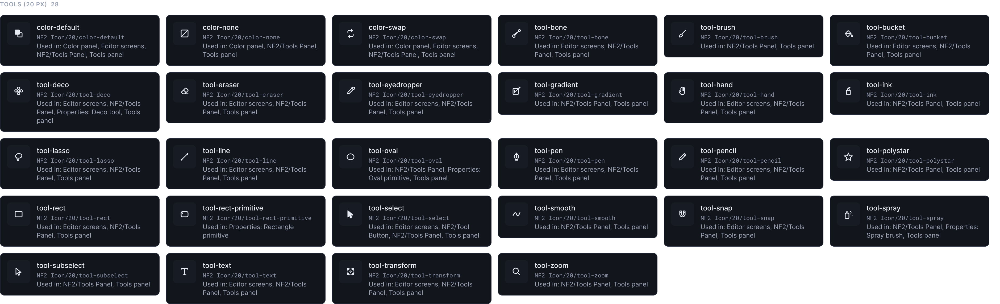

### 3.5 Cursors

39 cursor components `NF2 Cursor/<name>`, 24 × 24, black glyph with white outline (readable on any stage colour).
The hotspot is stored in each component's description (`Hotspot at x N, y N`) and must be used when implementing.

| Name | Hotspot (x, y) | Name | Hotspot (x, y) |
|---|---|---|---|
| arrow | 4, 2 | pen-add | 6, 21 |
| arrow-move | 4, 2 | pen-close | 6, 21 |
| arrow-reshape-corner | 4, 2 | pen-convert | 6, 21 |
| arrow-reshape-curve | 4, 2 | pen-remove | 6, 21 |
| brush | 3, 21 | pencil | 3, 21 |
| brush-size | 12, 12 | resize-d1 | 12, 12 |
| bucket | 19, 20 | resize-d2 | 12, 12 |
| col-resize | 12, 12 | resize-h | 12, 12 |
| crosshair | 12, 12 | resize-v | 12, 12 |
| drag-copy | 4, 2 | rotate | 12, 12 |
| drag-link | 4, 2 | row-resize | 12, 12 |
| eraser | 12, 12 | skew-h | 12, 9 |
| eyedropper | 5, 19 | skew-v | 9, 12 |
| hand-closed | 12, 12 | subselect | 4, 2 |
| hand-open | 12, 12 | subselect-point | 4, 2 |
| ink-bottle | 15, 3 | text-ibeam | 12, 12 |
| lasso | 10, 20 | wait | 12, 12 |
| move | 12, 12 | zoom-in | 10, 10 |
| not-allowed | 12, 12 | zoom-out | 10, 10 |
| pen | 6, 21 |  |  |


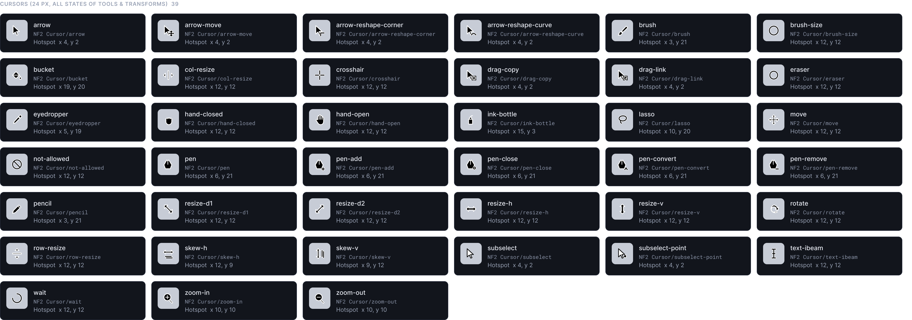

### 3.6 Elevation, focus and states

- Floating panels and popovers: `bg/raised`, radius 12, 1 px `border/subtle`, drop shadow **y 12, blur 32,
  black 35 %** (same in both themes). Dialogs: drop shadow **y 16, blur 48, black 45 %**, on the `overlay` scrim.
  (Values read from the SVG exports.)
- Focus: 2 px `border/focus` ring, 2 px outside the control radius (`NF2/Focus Ring`). Shown only for keyboard focus.
- Hover: background `bg/hover` (ghost controls) or `accent/hover` (primary). Pressed / on = the `Selected` variant.
- Disabled: `State=Disabled` variants use `text/disabled` and lose hover; never rely on colour alone.
- Selection: `bg/selected` fill + `accent/default` text/icon; on the timeline `timeline/selected`.
- Tooltips: `NF2/Tooltip`, `tooltip/bg` with `text/inverse`, label + `NF2/Kbd` shortcut (e.g. "Selection  V").

---

## 4. Main window


Frame `NF2 / Editor — Main`, 1920 × 1080. Regions (top to bottom, left to right):

| Region | Size | Content |
|---|---|---|
| Top bar | 1920 × 48 | `NF2/Logo` + "NeoFlash"; menu bar File · Edit · View · Modify · Insert · Control · Window (ghost buttons, open as dropdowns, §8); centred project title "Ideas in motion" + `Badge` "Unsaved" (warning); right: workspace `Select` "Classic workspace", **Test Movie** (secondary button with play icon), **Publish** (primary button with upload icon). |
| Tools rail | 56 × 588 | `NF2/Tools Panel` Layout=1 Column. Tool groups split by dividers, flyout corner on grouped tools, fill/stroke chip, swap/default colours, snap toggle at the bottom. |
| Canvas | 1544 × 588 | Pasteboard `bg/canvas`; stage 960 × 600 shown at 75 % (720 × 452) with `NF2/Stage Grid`; horizontal + vertical `NF2/Stage Ruler` (20 px) and `NF2/Ruler Corner`; `NF2/Guide` lines; breadcrumb (floating, top-left, 34 px); stage-size badge (top-right); `NF2/Zoom Control` floating bottom-centre (hand, −, 75 %, +, fit, rulers, guides, grid, snap to guides, view settings ⚙). |
| Inspector | 320 × 588 | **Properties** (`Panel Header`, `Segmented Control` Selection / Tool; sections Stage: Name, W × H with link, Background swatch + hex + α; Playback: FPS, Frames; Publish: target badge "HTML5 · Rust / WebAssembly" + "Publish settings…") and **Library** (search, tree). Content changes with the selection (see §6 Properties variants). |
| Bottom dock | 1920 × 420 | Dock tabs (40): Timeline · Actions · Output · Accessibility, collapse ⌄ and more ⋯. Timeline controls (44). Timeline body (336). |
| Status bar | 1920 × 24 | "Ready" + document summary "Stage 960 × 600 · 24 fps · 120 frames" left; shortcut hints right: `F5` frame, `F6` keyframe, `F7` blank keyframe, `⌘↵` Test Movie. |

**Timeline controls bar** (left → right, gap 8): layer actions (new layer, new folder, add motion guide, spacer, delete)
· transport (first, step back, **play** = primary icon button MD 40 px, step forward, last) · loop toggle (Selected
style when on) · timecode `00:01.21` + `30 / 120 F` (mono) · Scene `Select` · `Field` FPS · `Field` Duration ·
`Icon Group` frame insert (frame F5, keyframe F6, blank keyframe F7) · `Icon Group` tweens (classic, shape, motion) ·
ease · sound · onion group (onion skin on/off, outlines, edit multiple frames, modify markers) · centre playhead ·
frame view ⋯ · zoom − slider +.

### 4.1 Editor states (all exported in Dark and Light)

| Frame | Shows |
|---|---|
| Editor — Main | Default state, guides and grid visible, tooltip on the Selection tool. |
| Editor — Actions tab | Bottom dock switched to the docked Actions editor. |
| Editor — Unsaved changes dialog | Modal on `overlay`: Save (primary), Discard (danger ghost, left), Cancel. |
| Editor — Convert to Symbol dialog | F8 dialog over the stage. |
| Timeline — states legend | Legend of every layer type, column toggle and frame state (§5). |
| Editor — View settings open | Rulers / guides / grid popover opened from the ⚙ in the zoom control. |
| Editor — Swatches open | Quick colour popover opened from the fill chip. |
| Editor — Ease panel open | Floating Ease panel over the canvas for the selected classic tween. |
| Editor — Edit menu open | Main menu dropdown with the Timeline submenu. |
| Editor — Editing symbol in place | Breadcrumb Scene 1 ▸ orbit ▸ planet, faded parent content, symbols & scenes popover for large projects (search, sections Scenes · Matches · Recent · Browse, keyboard hint). |
| Editor — Video on timeline | Video layer `intro.mp4` with filmstrip span, video on stage, Properties — Video floating. |
| Editor — Motion tween path | Motion path on stage with frame dots, property keyframes ◆ on the hand layer. |

| Screen | Dark | Light | Figma |
|---|---|---|---|
| Editor — Main | [PNG](../exports/interface/dark/png/editor-main.png) · [SVG](../exports/interface/dark/svg/editor-main.svg) | [PNG](../exports/interface/light/png/editor-main.png) · [SVG](../exports/interface/light/svg/editor-main.svg) | `1:10114` / `59:50910` |
| Editor — Actions tab | [PNG](../exports/interface/dark/png/editor-actions-tab.png) · [SVG](../exports/interface/dark/svg/editor-actions-tab.svg) | [PNG](../exports/interface/light/png/editor-actions-tab.png) · [SVG](../exports/interface/light/svg/editor-actions-tab.svg) | `1:11378` / `59:51153` |
| Editor — Unsaved changes dialog | [PNG](../exports/interface/dark/png/editor-unsaved-changes-dialog.png) · [SVG](../exports/interface/dark/svg/editor-unsaved-changes-dialog.svg) | [PNG](../exports/interface/light/png/editor-unsaved-changes-dialog.png) · [SVG](../exports/interface/light/svg/editor-unsaved-changes-dialog.svg) | `1:11790` / `59:51375` |
| Editor — Convert to Symbol dialog | [PNG](../exports/interface/dark/png/editor-convert-to-symbol-dialog.png) · [SVG](../exports/interface/dark/svg/editor-convert-to-symbol-dialog.svg) | [PNG](../exports/interface/light/png/editor-convert-to-symbol-dialog.png) · [SVG](../exports/interface/light/svg/editor-convert-to-symbol-dialog.svg) | `1:12024` / `59:51632` |
| Timeline — states legend | [PNG](../exports/interface/dark/png/timeline-states-legend.png) · [SVG](../exports/interface/dark/svg/timeline-states-legend.svg) | [PNG](../exports/interface/light/png/timeline-states-legend.png) · [SVG](../exports/interface/light/svg/timeline-states-legend.svg) | `12:11901` / `59:51899` |
| Editor — View settings open | [PNG](../exports/interface/dark/png/editor-view-settings-open.png) · [SVG](../exports/interface/dark/svg/editor-view-settings-open.svg) | [PNG](../exports/interface/light/png/editor-view-settings-open.png) · [SVG](../exports/interface/light/svg/editor-view-settings-open.svg) | `33:26705` / `59:52051` |
| Editor — Swatches open | [PNG](../exports/interface/dark/png/editor-swatches-open.png) · [SVG](../exports/interface/dark/svg/editor-swatches-open.svg) | [PNG](../exports/interface/light/png/editor-swatches-open.png) · [SVG](../exports/interface/light/svg/editor-swatches-open.svg) | `33:27679` / `59:52295` |
| Editor — Ease panel open | [PNG](../exports/interface/dark/png/editor-ease-panel-open.png) · [SVG](../exports/interface/dark/svg/editor-ease-panel-open.svg) | [PNG](../exports/interface/light/png/editor-ease-panel-open.png) · [SVG](../exports/interface/light/svg/editor-ease-panel-open.svg) | `33:31667` / `59:52540` |
| Editor — Edit menu open | [PNG](../exports/interface/dark/png/editor-edit-menu-open.png) · [SVG](../exports/interface/dark/svg/editor-edit-menu-open.svg) | [PNG](../exports/interface/light/png/editor-edit-menu-open.png) · [SVG](../exports/interface/light/svg/editor-edit-menu-open.svg) | `46:36610` / `59:52828` |
| Editor — Editing symbol in place | [PNG](../exports/interface/dark/png/editor-editing-symbol-in-place.png) · [SVG](../exports/interface/dark/svg/editor-editing-symbol-in-place.svg) | [PNG](../exports/interface/light/png/editor-editing-symbol-in-place.png) · [SVG](../exports/interface/light/svg/editor-editing-symbol-in-place.svg) | `47:34191` / `59:53105` |
| Editor — Video on timeline | [PNG](../exports/interface/dark/png/editor-video-on-timeline.png) · [SVG](../exports/interface/dark/svg/editor-video-on-timeline.svg) | [PNG](../exports/interface/light/png/editor-video-on-timeline.png) · [SVG](../exports/interface/light/svg/editor-video-on-timeline.svg) | `59:46641` / `59:53374` |
| Editor — Motion tween path | [PNG](../exports/interface/dark/png/editor-motion-tween-path.png) · [SVG](../exports/interface/dark/svg/editor-motion-tween-path.svg) | [PNG](../exports/interface/light/png/editor-motion-tween-path.png) · [SVG](../exports/interface/light/svg/editor-motion-tween-path.svg) | `67:51373` / `67:55347` |


---

## 5. Timeline (Flash semantics)


### 5.1 Geometry

| Item | Value |
|---|---|
| Frame width | 12 px (Normal). View modes: Tiny 6, Small 9, Normal 12, Medium 16, Large 22 px/frame. |
| Row height | 28 px (Short mode: 18 px). |
| Ruler | `NF2/TL Ruler`, 32 px: seconds row on top (`0s 1s 2s …` at 24 fps), frame numbers row below (1, 5, 10, …) with ticks. |
| Layer column | 280 px (`NF2/TL Layers Header` + `NF2/TL Layer` rows). |
| Grid | `NF2/TL Grid` 1440 px = 120 frames; every 5th frame shaded (`timeline/empty-5th`); `NF2/TL Grid Lines` overlay keeps filled frames countable. |
| Marker position | Frame `n` → `x = (n − 1) × 12`; spans resize to `frames × 12`. |

### 5.2 Layers

`NF2/TL Layer` variants `Type` = Layer · Masked · Folder Open · Folder Closed · Guide · Motion Guide · Mask · Sound ·
Video · Armature, `Selected` = True/False; booleans `Indent 1`, `Indent 2` (nesting under folders, guides, masks),
`Editing` (pencil = current layer); text `Label`.

| Type | Icon | Rule |
|---|---|---|
| Layer | page | Normal layer. |
| Folder Open / Closed | folder (brand orange) + chevron | Children indent 1 level; collapsed folder row shows a flat strip in the grid (`TL Grid` Kind=Folder). |
| Motion Guide | curved path | Guided layers sit under it, indented. |
| Guide | pencil-ruler | Reference only, **not exported**. |
| Mask / Masked | mask / masked | Masked layers indent under the mask. |
| Sound | waveform (green) | Grid shows the waveform span (`TL Span` Type=Sound). |
| Video | film | Grid shows a filmstrip span (`TL Span` Type=Video). |
| Armature | bone | IK poses as property keyframes ◆. |

Columns (`NF2/TL Toggle`): Visibility (dot / red ✕ hidden), Lock (dot / lock), Outline (solid layer-colour square /
outline-only square). Header icons eye, lock, outline toggle all rows.

### 5.3 Frames and markers

| State | Token | Dark | Light | Look |
|---|---|---|---|---|
| Empty frames | `timeline/empty` | `#141820` | `#ffffff` | grid, every 5th frame shaded (`timeline/empty-5th`) |
| Static frames | `timeline/static` | `#363d4b` | `#cbd0da` | frames holding content after a keyframe ●, ends with ▯ |
| Blank keyframe | `timeline/empty` | `#141820` | `#ffffff` | hollow ○; following empty frames stay empty |
| Classic tween | `timeline/classic-tween` | `#4b3f92` | `#d9d2ff` | violet span with a solid arrow between keyframes |
| Shape tween | `timeline/shape-tween` | `#1d6a4c` | `#c8eed6` | green span with a solid arrow |
| Motion tween | `timeline/motion-tween` | `#2a5b9e` | `#cde0ff` | blue span, property keyframes ◆, no arrow |
| Broken tween | `timeline/classic-tween` | `#4b3f92` | `#d9d2ff` | dashed arrow: end keyframe missing |
| Selected frames | `timeline/selected` | `#3550b8` | `#3c6bf0` | markers switch to Tone = On Selection |
| Sound | `timeline/static` | `#363d4b` | `#cbd0da` | waveform drawn in the span (`success/default`) |
| Video | `timeline/static` | `#363d4b` | `#cbd0da` | filmstrip of the clip in the span |
| Frame label / comment | `timeline/label` | `#ff6b6b` | `#d92d2d` | red flag label, green // comment (`timeline/comment`), ⚓ anchor |
| Playhead | `timeline/playhead` | `#ff5c6c` | `#e5334a` | line through all rows + frame chip + time chip |
| Onion skin range | `timeline/onion` | `#6c93ff` | `#3c6bf0` | handles on the ruler around the playhead |


`NF2/TL Marker` kinds: Keyframe ● (filled), Blank Keyframe ○, Span End ▯, Property Keyframe ◆ (motion tween / armature),
Action Keyframe "a" (script on frame); `Tone=On Selection` inverts colours on selected frames.
`NF2/TL Frame Label` kinds: Label (red flag, `timeline/label`), Comment (green `//`, `timeline/comment`),
Anchor (⚓, named anchor).

`NF2/TL Playhead`: red line through all rows; frame number chip on the frame row; current time as a quiet chip on the
seconds row (e.g. `1.21s`). `NF2/TL Onion Range`: draggable before/after handles on the ruler.

### 5.4 Frame view menu (⋯ in the timeline controls)

Placement ▸ Bottom (docked) · Top · Left · Right · Floating window; Tiny · Small · Normal · Medium · Large ·
Preview (thumbnails per span) · Preview in context (object inside full stage) · Short (18 px rows) ·
Tinted frames (off = spans not colour-coded, only arrows) · Show seconds on ruler · Snap playhead to keyframes ·
Help F1 · Close panel.


### 5.5 Nesting and large projects

Breadcrumb (`NF2/Breadcrumb Item` Type = Scene / Movie clip / Graphic / Button, State = Link / Current, optional ▾ menu;
`Breadcrumb Separator`, `Breadcrumb Overflow` "…" when the path is long). Clicking an item goes up; ▾ lists siblings.
The Symbols & scenes popover handles hundreds of symbols: search, sections *Scenes · N*, *Matches in symbols · 3 of 248*,
*Recent*, *Browse* (folders with counts), footer hint `↑↓ move · ↵ edit · ⌥↵ edit in place · ⌘↵ new window`.

Button symbols get the 4-frame timeline Up · Over · Down · Hit (Hit is never drawn, it defines the clickable area).


---

## 6. Panels

All detached panels share `NF2/Floating Panel Header` (drag grip, up to 3 `Panel Tab`s via `Tab 2` / `Tab 3`
booleans, panel menu ⋯, collapse, close), `bg/raised`, radius 12, 1 px border, shadow. Bodies use 12 px padding and
`NF2/Section Header` (collapsible, Overline style) between groups. Docked versions use `NF2/Panel Header`.

### Tools


`NF2/Tools Panel` in a floating window. Layout = **1 Column** (docked rail, 56 px: related tools behind flyouts — Selection/Subselection, Free/Gradient transform, Line/Pen, Rectangle/Oval/PolyStar/primitives, Pencil/Brush/Spray, Bucket/Ink, Eyedropper, Eraser, Bone, Deco, Hand/Zoom) or **2 Columns** (every tool visible, sections Tools · View · Colors · Options). Tool = `NF2/Tool Button` 32 × 32 with a 20 px monochrome icon, `Flyout` marks a group (long-press opens it), `State` Default / Hover / Selected (accent). Colours: `Fill Stroke Chip` (click → Swatches popover), default colours, no colour, swap. Options area shows the active tool's modifiers (snap, smooth / straighten). Tooltips show name + key.

Files: [Dark PNG](../exports/panels/dark/png/panel-tools-floating.png) · [SVG](../exports/panels/dark/svg/panel-tools-floating.svg) · [Light PNG](../exports/panels/light/png/panel-tools-floating.png) · [SVG](../exports/panels/light/svg/panel-tools-floating.svg) · Figma node `22:728`

### Align


Align to **Selection / Stage** (segmented). Groups, each an `NF2/Icon Group`: **Align** (left, h-centre, right · top, v-middle, bottom), **Distribute** (left, h-centre, right edges · top, v-middle, bottom), **Spacing** (horizontal, vertical + `Gap` field, e.g. 16 px), **Match size** (width, height, both). Width 264.

Files: [Dark PNG](../exports/panels/dark/png/panel-align.png) · [SVG](../exports/panels/dark/svg/panel-align.svg) · [Light PNG](../exports/panels/light/png/panel-align.png) · [SVG](../exports/panels/light/svg/panel-align.svg) · Figma node `22:432`

### Transform


**Position and size** X, Y, W, H with link (constrain) toggle; **Scale** W % / H % (linked); **Rotate and skew** rotation ↻ and Skew fields; icon group: rotate 90° CCW / CW, flip horizontal / vertical, reset transform. Fields support scrubbing on the prefix, arrow keys step, ⇧ = ×10.

Files: [Dark PNG](../exports/panels/dark/png/panel-transform.png) · [SVG](../exports/panels/dark/svg/panel-transform.svg) · [Light PNG](../exports/panels/light/png/panel-transform.png) · [SVG](../exports/panels/light/svg/panel-transform.svg) · Figma node `22:621`

### Color — Solid


Tabs Color / Swatches. Scope **Selection / Drawing** + selection count ("1 object"). Stroke and Fill `NF2/Color Well`s (the active one is edited) + swap. Type select **Solid colour**. `NF2/Color Picker` (saturation/brightness area, hue strip, alpha strip), RGB / HSB segmented with R G B fields, `Color Field` hex + alpha. Stroke section: width, line style.

Files: [Dark PNG](../exports/panels/dark/png/panel-color-solid.png) · [SVG](../exports/panels/dark/svg/panel-color-solid.svg) · [Light PNG](../exports/panels/light/png/panel-color-solid.png) · [SVG](../exports/panels/light/svg/panel-color-solid.svg) · Figma node `24:773`

### Color — Radial gradient


Same as Solid plus: **Flow** (extend / reflect / repeat icon group), **Linear RGB** checkbox, `NF2/Gradient Bar` with draggable `Gradient Stop`s (click the bar to add, drag off to remove; the selected stop is edited by the picker). Linear gradient is identical with a linear preview. The gradient is edited on stage with `NF2/Gradient Transform`.

Files: [Dark PNG](../exports/panels/dark/png/panel-color-radial-gradient.png) · [SVG](../exports/panels/dark/svg/panel-color-radial-gradient.svg) · [Light PNG](../exports/panels/light/png/panel-color-radial-gradient.png) · [SVG](../exports/panels/light/svg/panel-color-radial-gradient.svg) · Figma node `24:884`

### Color — type menu


Fill type menu: None · Solid colour · Linear gradient · Radial gradient · Bitmap fill.

Files: [Dark PNG](../exports/panels/dark/png/color-type-menu-open.png) · [SVG](../exports/panels/dark/svg/color-type-menu-open.svg) · [Light PNG](../exports/panels/light/png/color-type-menu-open.png) · [SVG](../exports/panels/light/svg/color-type-menu-open.svg) · Figma node `24:1180`

### Color — panel menu


Panel ⋯ menu: Add swatch · Help (F1) · Close (⌘W) · Close group. Every floating panel has the same menu skeleton.

Files: [Dark PNG](../exports/panels/dark/png/color-panel-menu-open.png) · [SVG](../exports/panels/dark/svg/color-panel-menu-open.svg) · [Light PNG](../exports/panels/light/png/color-panel-menu-open.png) · [SVG](../exports/panels/light/svg/color-panel-menu-open.svg) · Figma node `24:1363`

### Swatches popover (quick colours)


Opens from the fill/stroke chip in Tools, from any colour well and colour field. Hex + alpha input, eyedropper, no colour, colour wheel (→ Color panel), then sections **Recent**, **Document**, **Palette** (`NF2/Swatch Cell` grid, selected cell ringed) and **Gradients**. Width 300.

Files: [Dark PNG](../exports/panels/dark/png/swatches-popover.png) · [SVG](../exports/panels/dark/svg/swatches-popover.svg) · [Light PNG](../exports/panels/light/png/swatches-popover.png) · [SVG](../exports/panels/light/svg/swatches-popover.svg) · Figma node `32:2945`

### View settings (rulers, guides & grid)


`NF2/View Settings` popover, opened from ⚙ in the canvas zoom control and from View ▸ Rulers, guides & grid…. **Rulers**: Show rulers, Units (Pixels), Labels **Auto / Every** N px (Auto picks 10 / 50 / 100 / 500 units so labels never overlap at the current zoom). **Guides**: Show, Snap, Lock, guide colour (#2EC4E6 · 100 %), snap accuracy. **Grid**: Show, Snap, Over objects, spacing ↔ / ↕ (20 px, linked), grid colour (white · 14 %), snap accuracy. Footer: Clear guides · Save as default.

Files: [Dark PNG](../exports/panels/dark/png/view-settings.png) · [SVG](../exports/panels/dark/svg/view-settings.svg) · [Light PNG](../exports/panels/light/png/view-settings.png) · [SVG](../exports/panels/light/svg/view-settings.svg) · Figma node `32:3232`

### Properties — Text


Header: text engine (Classic text), type (**Static / Dynamic / Input**), orientation. **Position and size** X Y W H. **Character**: family, style, Embed…, size (pt), tracking, colour field, Auto kern, anti-alias (for readability / animation / device fonts), toggles: selectable, render as HTML, border around text, superscript, subscript. **Paragraph**: align left / centre / right / justify, indent, line spacing, left / right margins, behaviour (single line / multiline / no wrap / password). **Options**, **Filters** table (Drop shadow, Glow …) with add / remove / reset.

Files: [Dark PNG](../exports/panels/dark/png/panel-properties-text.png) · [SVG](../exports/panels/dark/svg/panel-properties-text.svg) · [Light PNG](../exports/panels/light/png/panel-properties-text.png) · [SVG](../exports/panels/light/svg/panel-properties-text.svg) · Figma node `25:1179`

### Properties — Oval primitive


Type header "Oval primitive · Drawing object · layer ball". **Position and size** (X Y, link, W H). **Fill and stroke**: colour wells, stroke size `Combo Field`, `Line Style Select` (Solid, Dashed, Dotted, Ragged, Stipple, Hatched) + Custom… (Stroke style dialog), Stroke hinting switch, Scale (Normal / Horizontal / Vertical / None), Miter, **Cap** (none / round / square) and **Join** (miter / round / bevel) icon groups. **Oval options**: Start angle, End angle, Inner radius %, Close path, Reset.

Files: [Dark PNG](../exports/panels/dark/png/panel-properties-oval-primitive.png) · [SVG](../exports/panels/dark/svg/panel-properties-oval-primitive.svg) · [Light PNG](../exports/panels/light/png/panel-properties-oval-primitive.png) · [SVG](../exports/panels/light/svg/panel-properties-oval-primitive.svg) · Figma node `41:3891`

### Properties — Movie clip


Tabs Properties / Filters / Parameters. Instance name field (orbit_mc) + Swap…. **Position and size**. **Colour effect**: Style (None / Brightness / Tint / Advanced / Alpha) + value slider. **Display**: Visible, Cache as bitmap, Blending (Normal, Layer, Multiply, Screen, …), Render (Original / Export as bitmap). **Accessibility**, **Filters** collapsed.

Files: [Dark PNG](../exports/panels/dark/png/panel-properties-movie-clip.png) · [SVG](../exports/panels/dark/svg/panel-properties-movie-clip.svg) · [Light PNG](../exports/panels/light/png/panel-properties-movie-clip.png) · [SVG](../exports/panels/light/svg/panel-properties-movie-clip.svg) · Figma node `41:4097`

### Properties — Sound (frame)


Shown when a keyframe on a sound layer is selected. **Label** section (name, type). **Sound**: file select, Effect (None, Left/Right channel, Fade left→right, Fade in, Fade out, Custom) + Envelope…, Sync (Event / Start / Stop / **Stream**), Repeat / Loop + count, mini waveform, file info ("44 kHz · Stereo · 16 bit · 32.4 s · 518.6 kB"), Play, Sound properties….

Files: [Dark PNG](../exports/panels/dark/png/panel-properties-sound.png) · [SVG](../exports/panels/dark/svg/panel-properties-sound.svg) · [Light PNG](../exports/panels/light/png/panel-properties-sound.png) · [SVG](../exports/panels/light/svg/panel-properties-sound.svg) · Figma node `41:4207`

### Properties — Video


Tabs Properties / Cue points. Video preview with transport (00:07 / 00:24), instance name + Swap…, file info (intro.mp4 · H.264 · 1280×720 · 30 fps · 24.0 s). **Position and size**. **Playback**: Deployment (Embedded / External / Progressive), Autoplay, Loop, Muted, Skin, Scale (Fit / Fill / None), Volume slider. **Cue points** table (name, time, type Event / Navigation) + add / remove, Edit in timeline. On the timeline a video is a Video layer with a filmstrip span.

Files: [Dark PNG](../exports/panels/dark/png/panel-properties-video.png) · [SVG](../exports/panels/dark/svg/panel-properties-video.svg) · [Light PNG](../exports/panels/light/png/panel-properties-video.png) · [SVG](../exports/panels/light/svg/panel-properties-video.svg) · Figma node `56:7523`

### Ease


Context line ("Classic tween · ball · frames 1–40"). Property select (All / Position / Rotation / Scale / Colour / Filters) + One curve for all. Presets `NF2/Ease Preset` (Linear, Ease In, Ease Out, Ease In-Out, Back, Bounce, Elastic, Custom). `NF2/Ease Graph` (Range 0–100 %) with bezier handles, numeric X1 Y1 X2 Y2, preview track with play and the current frame / progress, Reset · Cancel · **Apply**. Opens from the timeline ease button, the frame context menu (Ease…) and Edit curve… in motion tween properties.

Files: [Dark PNG](../exports/panels/dark/png/panel-ease.png) · [SVG](../exports/panels/dark/svg/panel-ease.svg) · [Light PNG](../exports/panels/light/png/panel-ease.png) · [SVG](../exports/panels/light/svg/panel-ease.svg) · Figma node `32:2775`

### Ease — overshoot / undershoot


When a handle goes above 100 % (Back out, overshoot to 112 %) or below 0 % (anticipation, dips to −8 %) the graph switches to `Range = Overshoot` / `Undershoot`: Y axis extends to −30…130 % and the out-of-range bands are tinted; Y1 / Y2 fields accept values outside 0–1.

Files: [Dark PNG](../exports/panels/dark/png/ease-range-states.png) · [SVG](../exports/panels/dark/svg/ease-range-states.svg) · [Light PNG](../exports/panels/light/png/ease-range-states.png) · [SVG](../exports/panels/light/svg/ease-range-states.svg) · Figma node `56:7102`

### Library · Scene · History · Swatches


**Library**: document select, panel actions (new symbol, new folder, properties, delete), preview of the selected item, search, item count ("7 items"), tree with type icons (folder, movie clip, graphic, button, bitmap, sound, font), pin. **Scene**: search ("Find scene"), list of scenes with the current one highlighted, add / duplicate / delete. **History**: list of steps (Oval, Move, Fill colour, Transform, Delete) with the current position, undo / redo, clear. **Swatches** as a panel tab (the same content as the Swatches popover).

Files: [Dark PNG](../exports/panels/dark/png/panels-more.png) · [SVG](../exports/panels/dark/svg/panels-more.svg) · [Light PNG](../exports/panels/light/png/panels-more.png) · [SVG](../exports/panels/light/svg/panels-more.svg) · Figma node `43:4271`

### Output · Compiler errors · Accessibility · Info


**Output**: Show (All / Errors / Warnings / Trace), filter field, clear and copy; timestamped log with info, warning (amber) and error (red) lines. **Compiler errors**: badges "1 warning" "1 error", entries with code, message and location (scene · layer · frame · line); double-click jumps to the code. **Accessibility**: make object accessible, make child objects accessible, auto label, Name, Description, Shortcut, Tab index. **Info**: W H X Y of the selection, cursor position, colour under the cursor (R G B A).

Files: [Dark PNG](../exports/panels/dark/png/panels-more-2.png) · [SVG](../exports/panels/dark/svg/panels-more-2.svg) · [Light PNG](../exports/panels/light/png/panels-more-2.png) · [SVG](../exports/panels/light/svg/panels-more-2.svg) · Figma node `43:4272`

### Rectangle primitive · PolyStar · Armature


**Properties — Rectangle primitive**: position and size, fill and stroke, **Rectangle options**: four corner radii (linked by default, unlink to edit separately), radius slider, Reset. **PolyStar tool settings** dialog: Style (Polygon / Star), Sides, Star point size 0–1 (smaller = sharper). **Armature sample**: bone chain on stage + pose layer on the timeline; poses are property keyframes ◆ on the Armature layer; joints honour rotation limits.

Files: [Dark PNG](../exports/panels/dark/png/drawing-tools-panels.png) · [SVG](../exports/panels/dark/svg/drawing-tools-panels.svg) · [Light PNG](../exports/panels/light/png/drawing-tools-panels.png) · [SVG](../exports/panels/light/svg/drawing-tools-panels.svg) · Figma node `63:12029`

### Deco · Spray brush · IK bone


**Deco tool**: Drawing effect (Vine fill, Grid fill, Symmetry brush, …), Leaf / Flower symbols (Edit… or default shape), Advanced: branch angle, pattern scale, segment length, step, Animate pattern. **Spray brush**: symbol or default dots, W/H scale, random scaling, rotate symbol, random rotation; Brush width, height, angle. **IK bone**: bone name, Position (X, Y, length, angle), Joint: rotation (enable, constrain, min, max), Joint: X / Y translation, Spring (strength, damping), Armature (type Authortime / Runtime, style, speed, enable spring).

Files: [Dark PNG](../exports/panels/dark/png/drawing-tools-panels-2.png) · [SVG](../exports/panels/dark/svg/drawing-tools-panels-2.svg) · [Light PNG](../exports/panels/light/png/drawing-tools-panels-2.png) · [SVG](../exports/panels/light/svg/drawing-tools-panels-2.svg) · Figma node `63:12030`

### Properties — Graphic · Layer properties


**Graphic** instances have no instance name (timeline synced to the parent). Looping: Loop / Play once / Single frame / Loop reverse / Play once reverse, First and Last frame, thumbnail strip (click to set the first frame). **Layer properties** dialog: Name, Visible, Locked, Type (Normal, Guide, Guided, Mask, Masked, Folder, Armature), Outline colour swatch, View layer as outlines, Layer height (100 / 200 / 300 %).

Files: [Dark PNG](../exports/panels/dark/png/symbols-panels.png) · [SVG](../exports/panels/dark/svg/symbols-panels.svg) · [Light PNG](../exports/panels/light/png/symbols-panels.png) · [SVG](../exports/panels/light/svg/symbols-panels.svg) · Figma node `64:12881`

### Debugger · Project · Code snippets


**Debugger**: toolbar continue / stop / step over / step into / step out, Remove all breakpoints, state badge ("Paused · orbit : Frame 1 · line 18 (breakpoint)"). **Call stack**, **Variables** (expandable tree, changed values marked), **Watch** (expressions, errors shown as values), **Breakpoints** list with checkboxes. **Project**: project select, find file, file tree (unsaved ● marker), Publish; footer explains linkage ("Orbit.as is linked to symbol orbit"). **Code snippets**: search, categories (Actions, Timeline navigation, Animation, Load and unload, Audio and video, Event handlers), preview of the code, Copy, Insert at frame 1.

Files: [Dark PNG](../exports/panels/dark/png/scripting-panels.png) · [SVG](../exports/panels/dark/svg/scripting-panels.svg) · [Light PNG](../exports/panels/light/png/scripting-panels.png) · [SVG](../exports/panels/light/svg/scripting-panels.svg) · Figma node `65:13033`

### Motion editor · Motion tween properties


**Motion editor** (tab next to Timeline): columns Property · Value · Ease · Keyframe + frame ruler. Sections Basic motion (X, Y, Rotation Z), Transformation (Scale X/Y, skew), Colour effect (Alpha …), Filters; each property row has value field, ease select (No ease, Simple (slow), Bounce …), keyframe navigation (◀ ◆ ▶) and a curve. Footer: graph size slider, expanded height, visible frames. **Properties — Motion tween**: ease value (−100 in … +100 out) + Edit curve…, Rotation (count, direction CW / CCW, orient to path), Path X Y W H, show path / frame dots, Sync graphic symbols, Snap to motion guide.

Files: [Dark PNG](../exports/panels/dark/png/motion-panels.png) · [SVG](../exports/panels/dark/svg/motion-panels.svg) · [Light PNG](../exports/panels/light/png/motion-panels.png) · [SVG](../exports/panels/light/svg/motion-panels.svg) · Figma node `67:13512`

### Actions (script editor)


Floating 960 × 660 (also docked as a dock tab). Toolbar: language (ActionScript 3.0), target, Script assist, format, hints, debug, fold, comment, sidebar, help. Left sidebar: toolbox search + tree (Top level, Language elements, fl.* packages) and **Script navigator** (current selection, scenes, symbol definitions). Editor: gutter with line numbers and markers (error, warning, breakpoint, execution arrow, folds), syntax-coloured code, current line, code hint popover, inline error peek with Quick fix ⌘., overview ruler. Bottom: script tabs (pinned), status "Line 19, Col 10 · 20 lines", problems counter.

Files: [Dark PNG](../exports/panels/dark/png/panel-actions-floating.png) · [SVG](../exports/panels/dark/svg/panel-actions-floating.svg) · [Light PNG](../exports/panels/light/png/panel-actions-floating.png) · [SVG](../exports/panels/light/svg/panel-actions-floating.svg) · Figma node `27:1526`


---

## 7. Code editor and scripting

- Font Roboto Mono 13 px / line 1.6 (Preferences ▸ Code editor). Gutter with line numbers; markers in the gutter:
  error (red circle ✕), warning (amber triangle), breakpoint (orange dot), execution arrow (accent), fold ▸/▾,
  bookmark. Overview ruler on the right mirrors markers.
- Inline error peek under the line ("1120: Access of undefined property orbit_mc." + "Quick fix ⌘.").
- Code hints popover (`Menu Item` with type on the right). Script tabs (`NF2/Script Tab`, pinned state).
- Toolbar: language select (ActionScript 3.0), target, auto-format, code hint, debug, collapse/expand, comment block/line,
  uncomment, toggle sidebar, Script assist, help.

**Syntax scheme "NF2 Night"** (Dark values; the Light column is the same tokens in Light mode)

| Token | Dark | Light | Rule |
|---|---|---|---|
| Keyword | `#c6a0f6` | `#7e3fc2` | violet |
| Type / class | `#8bd5ca` | `#0b7f72` | teal |
| Function | `#8aadf4` | `#2f5bd8` | blue |
| String | `#a6da95` | `#3d7a2a` | green |
| Number | `#f5a97f` | `#b5521b` | orange-peach |
| Comment | `#6e7891` | `#8a93a6` | grey |
| XML tag | `#7dc4e4` | `#0b6e99` | blue (never red) |
| Attribute | `#eed49f` | `#8a6500` | sand |
| Error | `#ff6b6b` | `#d92d2d` | **the only red** |
| Warning | `#f5b94a` | `#b26a00` | amber |
| Breakpoint | `#ff9a5c` | `#e8731f` | orange |
| Selection | `#2a3a63` | `#d5e2ff` | |
| Current line | `#171c27` | `#f2f5fb` | |

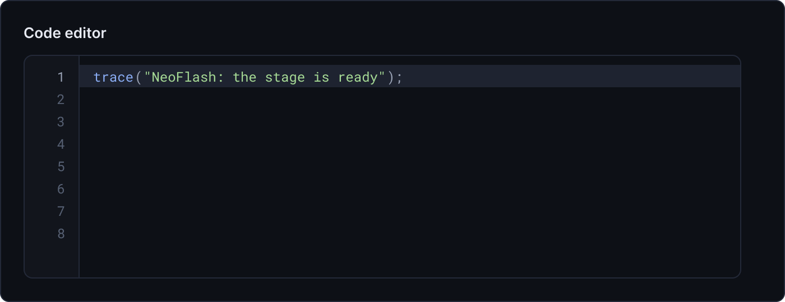

---

## 8. Menus and shortcuts

Main menu items are `NF2/Menu Bar Item` (Default / Open); dropdowns are `bg/raised` lists of `NF2/Menu Item`
(Default / Hover / Checked / Disabled, `Shortcut` text, `Submenu` boolean), `NF2/Menu Section` captions and
`NF2/Menu Separator`. Shortcuts are shown for macOS (⌘ ⌥ ⇧); Windows uses Ctrl / Alt / Shift.

#### Edit

| Item | Shortcut | Notes |
|---|---|---|
| Undo Fill colour | `⌘Z` |  |
| Redo | `⇧⌘Z` |  |
| Cut | `⌘X` |  |
| Copy | `⌘C` |  |
| Paste in centre | `⌘V` |  |
| Paste in place | `⇧⌘V` |  |
| Clear | `⌫` |  |
| Duplicate | `⌘D` |  |
| Select all | `⌘A` |  |
| Deselect | `⇧⌘A` |  |
| Find and replace | `⌘F` |  |
| Timeline |  | submenu ▸ |
| Edit symbols | `⌘E` |  |
| Edit selected |  |  |
| Edit in place |  |  |
| Preferences… | `⌘U` |  |
| Keyboard shortcuts… | `⌥⇧⌘K` |  |

#### Edit ▸ Timeline

| Item | Shortcut | Notes |
|---|---|---|
| Cut frames | `⌥⌘X` |  |
| Copy frames | `⌥⌘C` |  |
| Paste frames | `⌥⌘V` |  |
| Clear frames | `⌥⌫` |  |
| Remove frames | `⇧F5` |  |
| Select all frames | `⌥⌘A` |  |
| Reverse frames |  |  |
| Synchronise symbols |  | disabled |

#### View

| Item | Shortcut | Notes |
|---|---|---|
| Zoom in | `⌘=` |  |
| Zoom out | `⌘−` |  |
| Magnification |  | submenu ▸ |
| Preview mode |  | submenu ▸ |
| Pasteboard | `⇧⌘W` | checked ✓ |
| Rulers | `⌥⇧⌘R` | checked ✓ |
| Grid |  | submenu ▸ |
| Guides |  | submenu ▸ |
| Snapping |  | submenu ▸ |
| Rulers, guides & grid… |  |  |
| Show shape hints | `⌥⌘H` |  |

#### View ▸ Grid

| Item | Shortcut | Notes |
|---|---|---|
| Show grid | `⌘'` | checked ✓ |
| Snap to grid | `⇧⌘'` |  |
| Show over objects |  |  |
| Edit grid… | `⌥⌘G` |  |

#### File

| Item | Shortcut | Notes |
|---|---|---|
| New | `⌘N` |  |
| Open… | `⌘O` |  |
| Open recent |  | submenu ▸ |
| Close | `⌘W` |  |
| Save | `⌘S` |  |
| Save as… | `⇧⌘S` |  |
| Revert |  |  |
| Import |  | submenu ▸ |
| Export |  | submenu ▸ |
| Publish settings… | `⇧F12` |  |
| Publish | `⇧⌥F12` |  |
| Print… | `⌘P` |  |

#### Insert

| Item | Shortcut | Notes |
|---|---|---|
| New symbol… | `⌘F8` |  |
| Layer |  |  |
| Layer folder |  |  |
| Motion guide |  |  |
| Frame | `F5` |  |
| Keyframe | `F6` |  |
| Blank keyframe | `F7` |  |
| Classic tween |  |  |
| Shape tween |  |  |
| Motion tween |  |  |
| Scene |  |  |

#### Modify

| Item | Shortcut | Notes |
|---|---|---|
| Document… | `⌘J` |  |
| Convert to symbol… | `F8` |  |
| Break apart | `⌘B` |  |
| Bitmap |  | submenu ▸ |
| Symbol |  | submenu ▸ |
| Shape |  | submenu ▸ |
| Combine objects |  | submenu ▸ |
| Timeline |  | submenu ▸ |
| Transform |  | submenu ▸ |
| Arrange |  | submenu ▸ |
| Align |  | submenu ▸ |
| Group | `⌘G` |  |
| Ungroup | `⇧⌘G` |  |

#### Control

| Item | Shortcut | Notes |
|---|---|---|
| Play | `↵` |  |
| Rewind | `⌥⇧R` |  |
| Go to end | `⌥⇧.` |  |
| Step forward one frame | `.` |  |
| Step back one frame | `,` |  |
| Test movie | `⌘↵` |  |
| Test scene | `⌥⌘↵` |  |
| Loop playback |  | checked ✓ |
| Play all scenes |  |  |
| Mute sounds | `⌥⌘M` |  |
| Enable simple buttons | `⌥⌘B` |  |

#### Window

| Item | Shortcut | Notes |
|---|---|---|
| Duplicate window | `⌥⌘K` |  |
| Timeline | `⌥⌘T` | checked ✓ |
| Tools | `⌘F2` | checked ✓ |
| Properties | `⌘F3` | checked ✓ |
| Library | `⌘L` | checked ✓ |
| Actions | `F9` |  |
| Align | `⌘K` |  |
| Color | `⇧⌘F9` |  |
| Swatches | `⌘F9` |  |
| Transform | `⌘T` |  |
| Info | `⌘I` |  |
| Ease |  |  |
| History | `⌘F10` |  |
| Scene | `⇧F2` |  |
| Output | `F2` |  |
| Compiler errors | `⌥F2` |  |
| Accessibility | `⇧F11` |  |
| Workspaces |  | submenu ▸ |
| Hide panels | `F4` |  |

#### Frame (right-click)

| Item | Shortcut | Notes |
|---|---|---|
| Create motion tween |  |  |
| Create shape tween |  |  |
| Create classic tween |  |  |
| Insert frame | `F5` |  |
| Remove frames | `⇧F5` |  |
| Insert keyframe | `F6` |  |
| Insert blank keyframe | `F7` |  |
| Clear keyframe | `⇧F6` |  |
| Convert to keyframes |  |  |
| Convert to blank keyframes |  |  |
| Cut frames | `⌥⌘X` |  |
| Copy frames | `⌥⌘C` |  |
| Paste frames | `⌥⌘V` |  |
| Clear frames | `⌥⌫` |  |
| Select all frames | `⌥⌘A` |  |
| Copy motion |  |  |
| Paste motion |  |  |
| Paste motion special… |  |  |
| Reverse frames |  |  |
| Synchronise symbols |  | disabled |
| Actions | `F9` |  |
| Ease… |  |  |

#### Layer (right-click)

| Item | Shortcut | Notes |
|---|---|---|
| Show all |  |  |
| Lock others |  |  |
| Hide others |  |  |
| Insert layer |  |  |
| Delete layer |  |  |
| Duplicate layers |  |  |
| Cut layers |  |  |
| Copy layers |  |  |
| Paste layers |  |  |
| Guide |  |  |
| Add classic motion guide |  |  |
| Mask |  | checked ✓ |
| Show masking |  |  |
| Insert folder |  |  |
| Delete folder |  |  |
| Expand folder |  |  |
| Collapse all folders |  |  |
| Properties… |  |  |

#### Stage object (right-click)

| Item | Shortcut | Notes |
|---|---|---|
| Cut | `⌘X` |  |
| Copy | `⌘C` |  |
| Paste in place | `⇧⌘V` |  |
| Convert to symbol… | `F8` |  |
| Edit in place |  |  |
| Edit in new window |  |  |
| Swap symbol… |  |  |
| Duplicate symbol… |  |  |
| Create motion tween |  |  |
| Distribute to layers | `⇧⌘D` |  |
| Arrange |  | submenu ▸ |
| Align |  | submenu ▸ |
| Transform |  | submenu ▸ |
| Show in library |  |  |


---

## 9. Dialogs and preferences

Dialog anatomy: `NF2/Dialog Header` (title + close), body 24 px padding, footer right-aligned buttons
(primary last; destructive as danger-ghost on the left), `overlay` scrim, radius 12. Esc = Cancel, Enter = primary.

Preferences: 920 px dialog, left category tree (`Tree Item`) General · Code editor · Timeline · Drawing · Text ·
Clipboard · Shortcuts · Publish · Updates; right column of `Overline` sections with label + control rows;
footer Reset to defaults · Cancel · **Save**.

### Edit envelope · Sound properties · Stroke style


**Edit envelope**: effect select, Seconds / Frames units, left and right channel lanes with waveform and draggable volume handles (click a lane to add a point), time ruler, zoom, Cancel / OK. **Sound properties**: name, path, source info, Export compression (MP3 / ADPCM / Raw / Speech), bit rate, quality, convert stereo to mono, result size, Update / Import… / Test. **Stroke style**: preview, Type (Solid, Dashed, Dotted, Ragged, Stipple, Hatched), thickness, 4× zoom, dash / gap lengths, Sharp corners.

Files: [Dark PNG](../exports/panels/dark/png/dialogs-sound-stroke.png) · [SVG](../exports/panels/dark/svg/dialogs-sound-stroke.svg) · [Light PNG](../exports/panels/light/png/dialogs-sound-stroke.png) · [SVG](../exports/panels/light/svg/dialogs-sound-stroke.svg) · Figma node `42:4160`

### Convert to Symbol (F8)


Three states. **Default**: Name, Type (Movie clip / Button / Graphic), Folder, Registration — compact 28 px `NF2/Registration Picker` 3 × 3 + caption ("Centre"), helper text for the chosen type, Advanced collapsed, Cancel / **Convert**. **Type menu**: each type with a hint (own timeline · up/over/down/hit · synced to parent). **Advanced**: 9-slice guides, ActionScript linkage (Export for ActionScript, Export in frame 1, Identifier, Class, Base class), Runtime shared library (export / import, URL), Authortime sharing (source file, symbol, update automatically).

Files: [Dark PNG](../exports/panels/dark/png/dialogs-convert-to-symbol.png) · [SVG](../exports/panels/dark/svg/dialogs-convert-to-symbol.svg) · [Light PNG](../exports/panels/light/png/dialogs-convert-to-symbol.png) · [SVG](../exports/panels/light/svg/dialogs-convert-to-symbol.svg) · Figma node `54:6859`

### Import video


Preview with a trim strip (In / Out handles and fields), File + Browse…, Deployment radio: **Embed in timeline** (frames sync with the timeline; short clips) · **Load external video** (player component, keeps .nfl small) · **Progressive download** (plays while downloading). Embedding: symbol type, codec, Place on stage, Expand timeline if needed, Include audio, Match document frame rate. Footer summary "1280×720 · 30 fps → 24 fps · 24.0 s · ~6.1 MB".

Files: [Dark PNG](../exports/panels/dark/png/dialog-import-video.png) · [SVG](../exports/panels/dark/svg/dialog-import-video.svg) · [Light PNG](../exports/panels/light/png/dialog-import-video.png) · [SVG](../exports/panels/light/svg/dialog-import-video.svg) · Figma node `56:7655`

### Export image / video / audio · Import PSD


**Export image** with format segments PNG · SVG · PSD · AI · PDF and a live preview ("Frame 30 of 120 · 960 × 600"): range (current frame / frames), size W × H linked + scale, background (stage colour / transparent). PSD options: layers as Photoshop layers or flatten, folders → groups, symbols → smart objects, editable text, colour profile, resolution. SVG options: images embed/link, text as outlines or text, minify, CSS classes, include hidden & guide layers, precision, ID prefix. AI options: version, layers or keyframes → artboards, strokes as strokes, text to outlines. **Export video**: MP4 · WebM · MOV · GIF · PNG sequence, range (whole movie / scene / frames), size + scale, fps, codec, quality, render nested movie clips and scripts (runtime capture), stop at last frame / after N s, audio, transparent background, live render progress. **Export audio**: WAV · MP3 · OGG · AAC, source (timeline mix / layer), range, sample rate, bit depth, channels, bit rate, normalize, fade out, trim silence. **Import PSD to library**: layer list with checkboxes and per-layer options (bitmap with editable styles / flattened bitmap / vector shapes; create movie clip with instance name and registration; compression), placement (convert layers to timeline layers / keyframes / one layer), keep positions, set stage size to canvas.

Files: [Dark PNG](../exports/panels/dark/png/dialogs-export.png) · [SVG](../exports/panels/dark/svg/dialogs-export.svg) · [Light PNG](../exports/panels/light/png/dialogs-export.png) · [SVG](../exports/panels/light/svg/dialogs-export.svg) · Figma node `57:7729`

### Document settings · Find and replace · Movie Explorer


**Document settings (⌘J)**: stage size W × H linked, Match contents / Match printer, scale content with stage + anchor (registration picker), units, background colour, frame rate (fps → "120 frames · 5.00 s"), script version, Make default · Cancel · OK. **Find and replace (⌘F)**: search type segments (Text, Font, Colour, Symbol, Sound, Video, Bitmap), scope (current document / scene), find / replace fields, whole word, match case, regex, live edit, where to search (text fields, frames/layers/scenes, ActionScript), results table (location → found), Find all / Replace / Replace all. **Movie Explorer** panel: filter buttons, search, tree document ▸ scene ▸ layer ▸ frame ▸ instance / actions, path of the selection in the footer.

Files: [Dark PNG](../exports/panels/dark/png/document-dialogs.png) · [SVG](../exports/panels/dark/svg/document-dialogs.svg) · [Light PNG](../exports/panels/light/png/document-dialogs.png) · [SVG](../exports/panels/light/svg/document-dialogs.svg) · Figma node `66:13302`

### Bitmap fill · Publish settings · Font embedding · Test Movie


**Color — Bitmap fill**: bitmap grid + Import…, Lock fill. **Publish settings**: profile, targets with checkboxes (HTML5 · Rust / WebAssembly, Desktop app, Video MP4, Image sequence / sprite sheet, SVG animation); per target: output file, HTML wrapper + template, runtime (WASM optimisation), scale mode, loop, autoplay, preloader, source maps, JPEG quality, audio, sprite sheets, embed fonts (subset), scripts (strict, include trace(), minify); estimated size; Cancel · OK · **Publish**. **Font embedding**: font list + add/remove, name / family / style, character ranges with counts (Latin, Cyrillic, Greek, …), extra characters, Export for ActionScript + class, glyph count badge. **Test Movie window**: title + fps/memory badge, stage, transport (first, step, play/pause, last, loop, frame / time), speed select, Output drawer with trace lines.

Files: [Dark PNG](../exports/panels/dark/png/publish-misc-dialogs.png) · [SVG](../exports/panels/dark/svg/publish-misc-dialogs.svg) · [Light PNG](../exports/panels/light/png/publish-misc-dialogs.png) · [SVG](../exports/panels/light/svg/publish-misc-dialogs.svg) · Figma node `69:13727`

### Preferences — General


Interface: Theme Dark / Light (or follow system), UI scale, Accent colour, Language. Workspace: on launch (Welcome screen / New document / Last documents), undo levels, Autosave every N min, tooltips with shortcuts. Selection: Shift-select behaviour, highlight colour (layer colour / custom).

Files: [Dark PNG](../exports/panels/dark/png/dialog-preferences-general.png) · [SVG](../exports/panels/dark/svg/dialog-preferences-general.svg) · [Light PNG](../exports/panels/light/png/dialog-preferences-general.png) · [SVG](../exports/panels/light/svg/dialog-preferences-general.svg) · Figma node `45:6581`

### Preferences — Code editor


Font (Roboto Mono), size, line height. Editing: line numbers, word wrap, auto-close brackets, code hints + delay slider (300 ms), tab size, format on save, highlight current line. Colour scheme select (NF2 Night) + Duplicate / Import…, colour table for every syntax token (hex editable) with the note "Red is reserved for errors only. Breakpoints use orange, warnings amber.", live preview with gutter.

Files: [Dark PNG](../exports/panels/dark/png/dialog-preferences-code-editor.png) · [SVG](../exports/panels/dark/svg/dialog-preferences-code-editor.svg) · [Light PNG](../exports/panels/light/png/dialog-preferences-code-editor.png) · [SVG](../exports/panels/light/svg/dialog-preferences-code-editor.svg) · Figma node `45:6771`

### Preferences — Timeline


Selection & view: span-based selection, default frame view (Tiny … Large / Preview), row height, show seconds on ruler, snap playhead to keyframes, named anchor on each scene. Onion skin defaults: before / after range, tint colours before / after, opacity falloff (70 → 15 %). Animation: auto keyframe on transform, default ease, tween type on drag.

Files: [Dark PNG](../exports/panels/dark/png/dialog-preferences-timeline.png) · [SVG](../exports/panels/dark/svg/dialog-preferences-timeline.svg) · [Light PNG](../exports/panels/light/png/dialog-preferences-timeline.png) · [SVG](../exports/panels/light/svg/dialog-preferences-timeline.svg) · Figma node `59:8085`

### Preferences — Drawing


Default mode for new shapes: Merge drawing / Object drawing. Pen tool: show pen preview, show solid points, precise cursors. Recognition: connect lines, smooth curves, recognise lines, recognise shapes, click accuracy. Snapping: tolerance (px), snap to pixels, snap align.

Files: [Dark PNG](../exports/panels/dark/png/dialog-preferences-drawing.png) · [SVG](../exports/panels/dark/svg/dialog-preferences-drawing.svg) · [Light PNG](../exports/panels/light/png/dialog-preferences-drawing.png) · [SVG](../exports/panels/light/svg/dialog-preferences-drawing.svg) · Figma node `59:8300`

### Preferences — Text


Defaults: font, size, anti-alias, font substitution warning. Behaviour: embed used glyphs automatically, spell check, vertical text right-to-left, no kerning for vertical, input method.

Files: [Dark PNG](../exports/panels/dark/png/dialog-preferences-text.png) · [SVG](../exports/panels/dark/svg/dialog-preferences-text.svg) · [Light PNG](../exports/panels/light/png/dialog-preferences-text.png) · [SVG](../exports/panels/light/svg/dialog-preferences-text.svg) · Figma node `59:8503`

### Preferences — Clipboard


Copying: bitmap resolution, gradient quality, copy as SVG to other apps, keep layer names. Pasting: default paste In centre / In place, import vector paste as editable paths, ask before pasting large bitmaps.

Files: [Dark PNG](../exports/panels/dark/png/dialog-preferences-clipboard.png) · [SVG](../exports/panels/dark/svg/dialog-preferences-clipboard.svg) · [Light PNG](../exports/panels/light/png/dialog-preferences-clipboard.png) · [SVG](../exports/panels/light/svg/dialog-preferences-clipboard.svg) · Figma node `59:8681`

### Preferences — Shortcuts


Shortcut set (NeoFlash default) + Duplicate / Rename / Delete, search, command filter, table command → keys (`NF2/Kbd` chips), recording state "Press keys…", conflict badge ("Conflicts with Insert ▸ Keyframe"), Reset command, Export as HTML….

Files: [Dark PNG](../exports/panels/dark/png/dialog-preferences-shortcuts.png) · [SVG](../exports/panels/dark/svg/dialog-preferences-shortcuts.svg) · [Light PNG](../exports/panels/light/png/dialog-preferences-shortcuts.png) · [SVG](../exports/panels/light/svg/dialog-preferences-shortcuts.svg) · Figma node `59:8846`

### Preferences — Publish


Default target (HTML5 · Rust / WebAssembly), output folder + Browse…, HTML wrapper, assets folder, source maps. Compression: image quality (JPEG 80), audio (MP3 128 kbps), acceleration (GPU WebGL). Scripts: strict mode, treat warnings as errors, publish on save.

Files: [Dark PNG](../exports/panels/dark/png/dialog-preferences-publish.png) · [SVG](../exports/panels/dark/svg/dialog-preferences-publish.svg) · [Light PNG](../exports/panels/light/png/dialog-preferences-publish.png) · [SVG](../exports/panels/light/svg/dialog-preferences-publish.svg) · Figma node `59:9050`

### Preferences — Updates


Version ("NeoFlash 2.0.0 · build 412 · up to date") + Check now / Release notes, channel Stable / Beta, automatic checks, background download. Privacy: anonymous usage statistics, crash reports. Extensions: installed count + updates, Manage….

Files: [Dark PNG](../exports/panels/dark/png/dialog-preferences-updates.png) · [SVG](../exports/panels/dark/svg/dialog-preferences-updates.svg) · [Light PNG](../exports/panels/light/png/dialog-preferences-updates.png) · [SVG](../exports/panels/light/svg/dialog-preferences-updates.svg) · Figma node `59:9244`


### 9.1 Functional coverage map

| Area | Capability | Where in the file |
|---|---|---|
| Drawing | Tools: selection, subselection, lasso, pen, text, line, oval, rectangle, pencil, brush, transform, gradient, ink, bucket, eyedropper, eraser, hand, zoom | NF2/Tools Panel · 1/2 columns |
| Drawing | Tool options (snap, smooth/straighten), merge vs object drawing, recognition settings | Tools panel · Preferences › Drawing |
| Drawing | Stroke settings: size, style, custom dash, hinting, scale, caps, joins, miter | Properties — Oval primitive · Stroke style dialog |
| Drawing | Path editing: anchors, bezier handles, reshape cursors, shape selection mesh, marquee | Canvas editing chrome · Cursors |
| Drawing | Rectangle primitive (corner radii), PolyStar, Deco / spray brush, Bone / IK | Tools panel · Properties — Rectangle primitive / Deco / Spray / IK bone · PolyStar settings · Armature sample |
| Drawing | Bitmap fill & lock fill | Panel / Color — Bitmap fill |
| Symbols & nesting | Convert to symbol (types, folder, registration, 9-slice, linkage, sharing) | Convert to Symbol (3 states) |
| Symbols & nesting | Edit in place, nested breadcrumb, scene / symbol search for large projects | Editor — Editing symbol in place |
| Symbols & nesting | Library with types, preview, search, folders | Library panel · Empty state |
| Symbols & nesting | Movie clip instance props: name, swap, colour effect, blending, cache, filters | Properties — Movie clip |
| Symbols & nesting | Graphic instance looping (loop / play once / single frame, first frame) | Properties — Graphic |
| Symbols & nesting | Button symbol timeline (Up / Over / Down / Hit) | Timeline — Button symbol (cta_btn) |
| Timeline | Layer types: normal, folder, guide, motion guide, mask/masked, sound, video | NF2/TL Layer · legend |
| Timeline | Frame states, tweens, labels/comments/anchors, onion skin, loop, frame view modes | Timeline · legend · Frame views board |
| Timeline | Frame / layer / stage context menus, copy & paste motion | Menus — Context menus |
| Timeline | Custom ease incl. overshoot / undershoot | Ease panel (3 states) |
| Timeline | Motion editor (per-property curves) and on-stage motion path for motion tweens | Panel / Motion editor · Editor — Motion tween path · Properties — Motion tween |
| Timeline | Layer properties dialog (name, type, colour, outline, height) | Dialog / Layer properties |
| Scripting | Actions panel: toolbox, navigator, hints, folding, errors, breakpoints, script tabs | Actions (floating / docked) |
| Scripting | Output, Compiler errors, syntax schemes, editor preferences | Output · Compiler errors · Preferences › Code editor |
| Scripting | Debugger: variables, call stack, step over/into/out | Panel / Debugger |
| Scripting | External class files / project panel, code snippets panel | Panel / Project · Panel / Code snippets |
| Import / export | Import PSD (layers, options), import video, sound properties | Import PSD · Import video · Sound properties |
| Import / export | Export image (PNG/SVG/PSD/AI/PDF), video (MP4/WebM/MOV/GIF), audio | Dialogs — Export |
| Import / export | Import AI options, Publish settings dialog, Test movie player window | Dialog / Publish settings · Window / Test Movie · Import PSD (AI options) |
| Video & sound | Video layer with filmstrip, video props & cue points, sound layer, envelope | Editor — Video on timeline · Properties — Video / Sound |
| Text | Text properties, text box handles, font defaults | Properties — Text · Selection Box |
| Text | Font embedding dialog | Dialog / Font embedding |
| Colour | Mixer, gradients, swatches, quick colours, gradient transform | Color panel · Swatches · Gradient Transform |
| Workspace | Floating panels, docking zones/compass, splitters, drag & drop, scrollbars | Panels board · Technical shelf |
| Workspace | Rulers, guides, grid, settings popover, cursors, toasts, progress, focus ring | Editor screens · Technical shelf |
| Workspace | Main menu with shortcuts, Preferences (9 pages), shortcuts editor, Dark/Light | Menus · Preferences · Interface Dark/Light |
| Workspace | Document settings dialog (⌘J), Find & replace, Movie explorer / outline | Dialog / Document settings · Find and replace · Panel / Movie Explorer |


---

## 10. Components (catalogue)

Every NF2 component, grouped by its shelf on `v2 · System & Components`. `set` = component set (variants);
property types: VARIANT (options), TEXT (default), BOOLEAN (default), INSTANCE_SWAP.

#### Button

| Component | Kind | Size | Properties | Description |
|---|---|---|---|---|
| `NF2/Button` | set · 12 variants | 66×32 | Label: text ("Button"); Icon: bool (off); Type = Primary / Secondary / Ghost / Danger; State = Default / Hover / Disabled |  |

#### Icon button

| Component | Kind | Size | Properties | Description |
|---|---|---|---|---|
| `NF2/Icon Button` | set · 12 variants | 32×32 | Type = Ghost / Selected / Primary; Size = SM / MD; State = Default / Hover |  |

#### Segmented control

| Component | Kind | Size | Properties | Description |
|---|---|---|---|---|
| `NF2/Segment` | set · 2 variants | 78×28 | Label: text ("Segment"); Selected = True / False |  |
| `NF2/Segmented Control` | component | 162×34 | — |  |

#### Field · Search · Select

| Component | Kind | Size | Properties | Description |
|---|---|---|---|---|
| `NF2/Field` | set · 4 variants | 160×32 | Label: text ("960"); Prefix: text ("W"); Show prefix: bool (on); State = Default / Hover / Focus / Disabled |  |
| `NF2/Search` | set · 2 variants | 240×32 | Label: text ("Search"); State = Empty / Filled |  |
| `NF2/Select` | set · 3 variants | 200×32 | Label: text ("Option"); State = Default / Hover / Disabled |  |

#### Checkbox · Slider · Swatch · Badge

| Component | Kind | Size | Properties | Description |
|---|---|---|---|---|
| `NF2/Checkbox` | set · 2 variants | 88×20 | Label: text ("Checkbox"); Checked = False / True |  |
| `NF2/Slider` | component | 140×20 | — |  |
| `NF2/Swatch` | component | 22×22 | — |  |
| `NF2/Registration Cell` | set · 2 variants | 28×28 | Selected = True / False |  |
| `NF2/Badge` | set · 3 variants | 65×22 | Label: text ("Badge"); Type = Neutral / Accent / Warning |  |

#### Dock tab · Section header · Panel header

| Component | Kind | Size | Properties | Description |
|---|---|---|---|---|
| `NF2/Dock Tab` | set · 3 variants | 76×40 | Label: text ("Tab"); State = Active / Inactive / Hover |  |
| `NF2/Section Header` | set · 2 variants | 288×32 | Label: text ("Section"); State = Expanded / Collapsed |  |
| `NF2/Panel Header` | component | 320×40 | — |  |

#### Tree item

| Component | Kind | Size | Properties | Description |
|---|---|---|---|---|
| `NF2/Tree Item` | set · 5 variants | 288×32 | Label: text ("Item"); Type = Folder Open / Folder Closed / Symbol; Selected = True / False |  |

#### Kbd · Tooltip · Dialog header · Zoom control · Logo

| Component | Kind | Size | Properties | Description |
|---|---|---|---|---|
| `NF2/Kbd` | component | 28×20 | — |  |
| `NF2/Tooltip` | component | 99×30 | — |  |
| `NF2/Dialog Header` | component | 520×60 | — |  |
| `NF2/Zoom Control` | component | 365×42 | — |  |
| `NF2/Logo` | component | 28×28 | — |  |

#### Code editor

| Component | Kind | Size | Properties | Description |
|---|---|---|---|---|
| `NF2/Code Editor` | component | 640×200 | — |  |

#### Timeline 2.0 — layers

| Component | Kind | Size | Properties | Description |
|---|---|---|---|---|
| `NF2/TL Toggle` | set · 6 variants | 20×28 | Kind = Visibility / Lock / Outline; Value = Visible / Hidden / Unlocked / Locked / Solid / Outline | Layer column toggle: Visibility (dot / red X), Lock (dot / lock), Outline (solid swatch / outline-only swatch, recolour Swatch per layer). |
| `NF2/TL Layer` | set · 20 variants | 280×28 | Label: text ("Layer"); Indent 1: bool (off); Indent 2: bool (off); Editing: bool (off); Type = Layer / Masked / Folder Open / Folder Closed / Guide / Motion Guide / Mask / Sound / Video / Armature; Selected = False / True | Timeline layer row. Type = Flash layer kinds (normal, masked, folder, guide, motion guide, mask). Indent 1/2 nest rows under folders, masks and motion guides. Editing shows the pencil on the current layer. Column toggles are nested NF2/TL Toggle instances: switch Value to hide / lock / outline the layer. |
| `NF2/TL Layers Header` | component | 280×32 | — |  |

#### Timeline 2.0 — frames

| Component | Kind | Size | Properties | Description |
|---|---|---|---|---|
| `NF2/TL Grid` | set · 2 variants | 1440×28 | Kind = Layer / Folder | Empty-frame grid of one row: a cell per frame, every 5th frame shaded. Folder rows show a flat strip. |
| `NF2/TL Grid Lines` | component | 1440×28 | — | Per-frame dividers drawn over spans, so filled frames stay countable. |
| `NF2/TL Span` | set · 8 variants | 120×27 | Type = Static / Classic Tween / Shape Tween / Motion Tween / Broken Tween / Selected / Sound / Video | Frame span. Resize horizontally to frame count × 12 px. Static = frames holding content (grey), Classic / Shape tween = purple / green with arrow, Motion tween = blue (property keyframes as markers), Broken tween = dashed, Selected = frame selection. |
| `NF2/TL Marker` | set · 10 variants | 12×27 | Kind = Keyframe / Blank Keyframe / Span End / Property Keyframe / Action Keyframe; Tone = Default / On Selection | One-frame marker placed at x = (frame − 1) × 12. Keyframe ●, Blank keyframe ○, Span end ▯, Property keyframe ◆ (motion tween), Action keyframe (a over ●). Use Tone = On Selection over selected frames. |
| `NF2/TL Frame Label` | set · 3 variants | 49×27 | Label: text ("intro"); Kind = Label / Comment / Anchor | Frame label (red flag), comment (green //) or anchor on a keyframe; sits on top of the span that starts at that keyframe. |
| `NF2/TL Ruler` | component | 1440×32 | — | Two-row ruler at 24 fps: seconds on top, frame numbers + ticks below (12 px per frame). |
| `NF2/TL Onion Range` | component | 60×24 | — | Onion-skin range on the ruler: drag the handles to set frames before / after the playhead. |
| `NF2/TL Playhead` | component | 24×480 | Frame: text ("1"); Time: text ("1.21s") | Playhead: frame number on the frame row, current time (s) as a quiet chip on the seconds row; line through all layers. |

#### Panels & Tools — components

| Component | Kind | Size | Properties | Description |
|---|---|---|---|---|
| `NF2/Tool Button` | set · 3 variants | 32×32 | Flyout: bool (off); State = Default / Hover / Selected | Tool in the Tools panel: 32×32, 20 px monochrome icon. Flyout marks a tool group (long-press opens the group). |
| `NF2/Fill Stroke Chip` | component | 36×36 | — | Current fill (front) and stroke (back). Recolour Fill / Stroke per use. |
| `NF2/Color Well` | set · 4 variants | 74×32 | Target = Stroke / Fill; Active = True / False | Stroke / fill colour target. Active = the target the colour mixer edits. |
| `NF2/Panel Tab` | set · 2 variants | 52×36 | Label: text ("Panel"); State = Active / Inactive |  |
| `NF2/Floating Panel Header` | component | 280×36 | Tab 2: bool (off); Tab 3: bool (off) | Header of a detached (floating) panel: drag grip, panel tabs, panel menu, collapse, close. |
| `NF2/Icon Group` | set · 3 variants | 68×34 | Count = 2 / 3 / 4 | Grouped icon buttons (align, distribute, transform, text align…). Swap nested icons; switch a nested item to Type=Selected for toggles. |
| `NF2/Radio` | set · 2 variants | 61×16 | Label: text ("Option"); Selected = True / False |  |
| `NF2/Color Field` | component | 200×32 | Hex: text ("233043"); Alpha: text ("100 %") | Colour value: swatch, hex, alpha. Click swatch → colour popover. |
| `NF2/Gradient Stop` | set · 2 variants | 12×16 | Selected = True / False |  |
| `NF2/Gradient Bar` | component | 232×40 | — | Gradient preview with colour stops (drag to move, click the bar to add, drag off to remove). |
| `NF2/Color Picker` | component | 248×150 | — | Colour mixer: saturation/brightness area, hue strip, alpha strip. |
| `NF2/Menu Item` | set · 4 variants | 200×28 | Label: text ("Menu item"); Shortcut: text (" "); Submenu: bool (off); State = Default / Hover / Checked / Disabled |  |
| `NF2/Menu Separator` | component | 200×9 | — |  |
| `NF2/Script Tab` | set · 2 variants | 96×30 | Label: text ("Script"); Pinned: bool (on); State = Active / Inactive |  |
| `NF2/Table Row` | set · 3 variants | 288×28 | Property: text ("Property"); Value: text ("Value"); Kind = Header / Row / Selected |  |
| `NF2/Divider` | set · 2 variants | 1×20 | Direction = Vertical / Horizontal |  |
| `NF2/Tools Panel` | set · 2 variants | 56×588 | Layout = 1 Column / 2 Columns | Tools panel. 1 Column (docked rail): related tools grouped behind flyouts — Selection/Subselection, Free/Gradient transform, Rectangle/Oval, Pencil/Brush, Paint bucket/Ink bottle. 2 Columns (floating, Flash layout): every tool visible, plus View, Colors (fill/stroke, default, none, swap) and Options (snap, tool options). Icons are monochrome 20 px. |

#### Rulers, guides, grid

| Component | Kind | Size | Properties | Description |
|---|---|---|---|---|
| `NF2/Stage Ruler` | set · 2 variants | 1600×20 | Orientation = Horizontal / Vertical | Stage ruler in stage units at 75 % zoom. The "0" mark sits 375 px from the start (horizontal) / 225 px from the top (vertical): place the instance so 0 meets the stage origin. Drag out of a ruler to create a guide. |
| `NF2/Ruler Corner` | component | 20×20 | — | Ruler origin: drag to move the zero point, double-click to reset. |
| `NF2/Guide` | set · 6 variants | 400×9 | Orientation = Horizontal / Vertical; State = Default / Selected / Locked | Ruler guide. Resize along its axis to span the canvas. Selected shows the drag handle; Locked guides are dashed and cannot be moved. |
| `NF2/Stage Grid` | component | 720×452 | — | Stage grid overlay (20 px spacing, every 5th line stronger) drawn above the stage background, below content unless "Show over objects" is on. |
| `NF2/View Settings` | component | 320×542 | — | View settings popover for rulers, guides and grid. Opens from the settings button in the canvas view bar (next to the rulers / guides / grid / snap toggles) and from View ▸ Rulers, Guides & Grid… |

#### Quick colours & easing

| Component | Kind | Size | Properties | Description |
|---|---|---|---|---|
| `NF2/Swatch Cell` | set · 2 variants | 18×18 | Selected = False / True |  |
| `NF2/Swatches Popover` | component | 300×430 | — | Quick colour access. Opens from the fill/stroke chip in Tools, from any colour well and colour field. Hex + alpha, no colour, eyedropper, open full mixer; recent colours, document swatches (+ add), palette (switchable), gradient presets. |
| `NF2/Ease Preset` | set · 16 variants | 72×64 | Preset = Linear / Ease In / Ease Out / Ease In-Out / Back / Bounce / Elastic / Custom; Selected = False / True |  |
| `NF2/Ease Graph` | set · 3 variants | 336×224 | Range = 0–100% / Overshoot (above 100%) / Undershoot (below 0%) | Ease curve graph. Overshoot / Undershoot variants extend the Y axis to −30…130 % and tint the out-of-range bands; handles outside 0–100 % turn amber (back / anticipation easing). |

#### Inputs, menus, breadcrumb

| Component | Kind | Size | Properties | Description |
|---|---|---|---|---|
| `NF2/Stepper Field` | set · 2 variants | 120×32 | Label: text ("2.0"); Prefix: text ("Size"); State = Default / Focus | Numeric field with ▲▼ steppers; drag the prefix to scrub, ↑/↓ steps, ⇧ = ×10. |
| `NF2/Combo Field` | component | 96×32 | Label: text ("2") | Editable value + preset menu (stroke size, angles, inner radius…). |
| `NF2/Switch` | set · 2 variants | 80×20 | Label: text ("Switch"); On = True / False |  |
| `NF2/Line Style Select` | set · 6 variants | 200×32 | Style = Solid / Dashed / Dotted / Ragged / Stipple / Hatched |  |
| `NF2/Menu Section` | component | 200×24 | Label: text ("Section") |  |
| `NF2/Menu Bar Item` | set · 2 variants | 55×28 | Label: text ("Menu"); State = Default / Open |  |
| `NF2/Breadcrumb Item` | set · 8 variants | 61×28 | Label: text ("Item"); Menu: bool (off); Type = Scene / Movie clip / Graphic / Button; State = Link / Current | Editing path: Scene ▸ symbol ▸ nested symbol. Click an item to go back up; the ▾ menu lists siblings (scenes / symbols) with search. |
| `NF2/Breadcrumb Overflow` | component | 28×28 | — |  |
| `NF2/Breadcrumb Separator` | component | 12×28 | — |  |
| `NF2/Registration Picker` | set · 9 variants | 28×28 | Point = Top left / Top / Top right / Left / Center / Right / Bottom left / Bottom / Bottom right | Compact 3×3 registration / transformation point picker (28 px). Click a dot; arrow keys move it. |

#### Canvas editing chrome

| Component | Kind | Size | Properties | Description |
|---|---|---|---|---|
| `NF2/Selection Box` | set · 5 variants | 160×100 | Kind = Group / Symbol / Text static / Text dynamic / Primitive | Object selection on stage: Group (thin), Symbol instance (registration + transformation point), Static text (round handle = auto width), Dynamic/input text (square handle = fixed size), Primitive (extra control points for angles / inner radius). Resize to the object bounds. |
| `NF2/Transform Box` | set · 2 variants | 160×100 | Mode = Scale / Rotate & skew | Free transform: Scale mode (8 square handles; ⇧ keeps proportions, ⌥ from centre), Rotate & skew (round corner handles rotate, edge bars skew). White circle = transformation point. |
| `NF2/Anchor Point` | set · 3 variants | 12×12 | State = Unselected / Selected / Hover |  |
| `NF2/Bezier Handle` | component | 60×8 | — | Direction line from an anchor to its control point. Rotate/resize along the tangent. |
| `NF2/Marquee` | component | 160×100 | — |  |
| `NF2/Shape Selection` | component | 240×240 | — | Raw (ungrouped) shape selected: hatch mesh over the selected fill / stroke. Place clipped inside the shape outline. |
| `NF2/Gradient Transform` | component | 200×200 | — | Gradient transform tool: centre (move), focal triangle (radial focus), square (width / aspect), circle (size), filled circle (rotation). |
| `NF2/Snap Ring` | component | 14×14 | — | Snap to objects indicator: thick ring at the registration point while dragging; it jumps to a larger ring when snapped. |

#### Technical

| Component | Kind | Size | Properties | Description |
|---|---|---|---|---|
| `NF2/Scrollbar` | set · 4 variants | 12×160 | Orientation = Vertical / Horizontal; State = Default / Hover |  |
| `NF2/Splitter` | set · 6 variants | 8×120 | Orientation = Vertical / Horizontal; State = Default / Hover / Drag |  |
| `NF2/Dock Zone` | component | 240×160 | — | Drop target shown while dragging a panel over a dock area. |
| `NF2/Dock Compass` | component | 112×112 | — | Docking compass: drop on an edge to dock beside, centre to add as a tab. |
| `NF2/Drag Ghost` | component | 73×30 | Label: text ("Align") |  |
| `NF2/Drop Indicator` | component | 240×8 | — | Insertion line for reordering layers, library items, tabs. |
| `NF2/Toast` | set · 4 variants | 380×46 | Type = Info / Success / Warning / Error |  |
| `NF2/Spinner` | component | 20×20 | — |  |
| `NF2/Progress` | set · 2 variants | 280×28 | Mode = Determinate / Indeterminate |  |
| `NF2/Focus Ring` | component | 120×36 | — | Keyboard focus ring: 2 px, 2 px outside the control radius. Place over any control when focused via Tab. |
| `NF2/Empty State` | component | 280×204 | — |  |


Shelf illustrations:

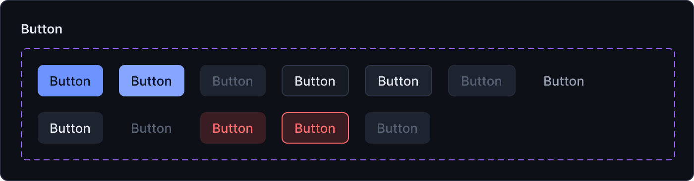

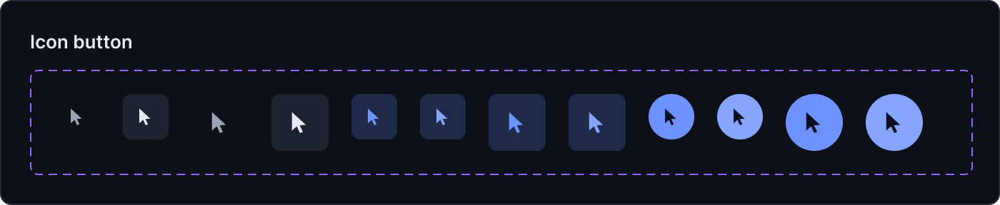

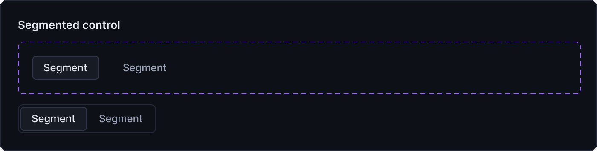

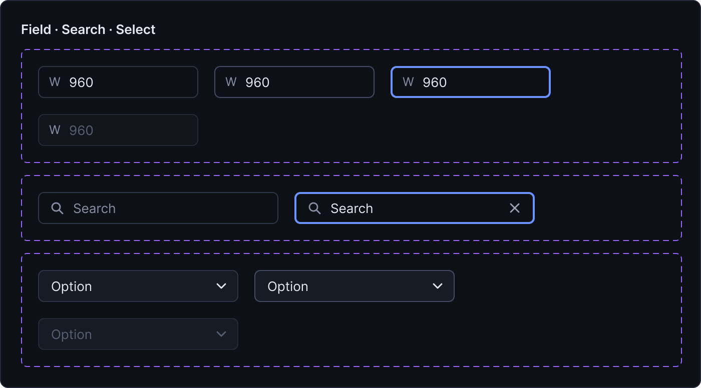

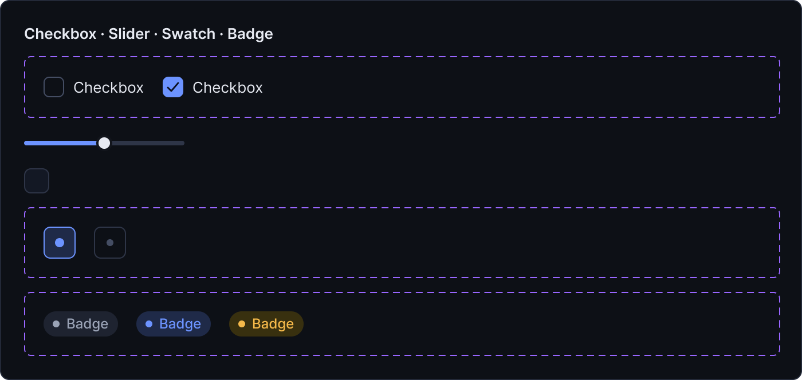

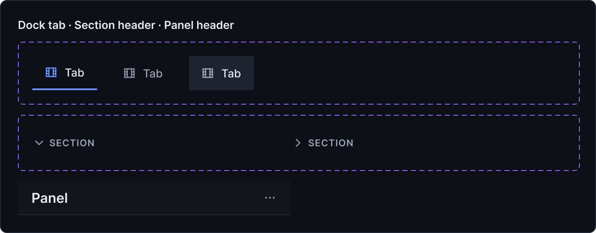

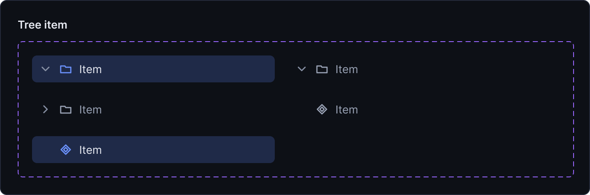

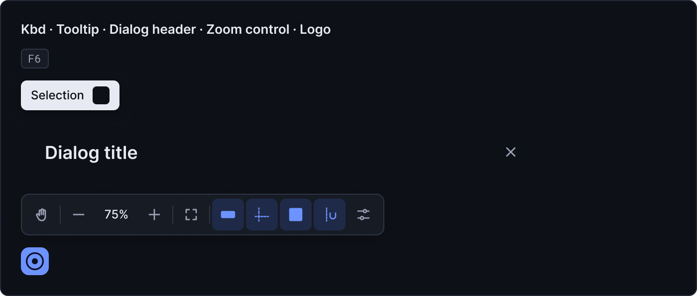


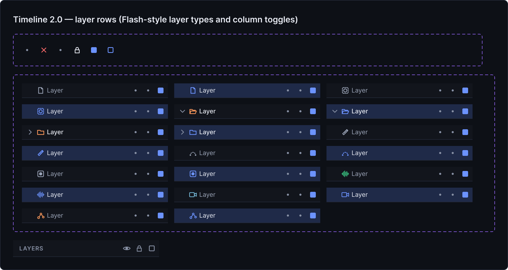

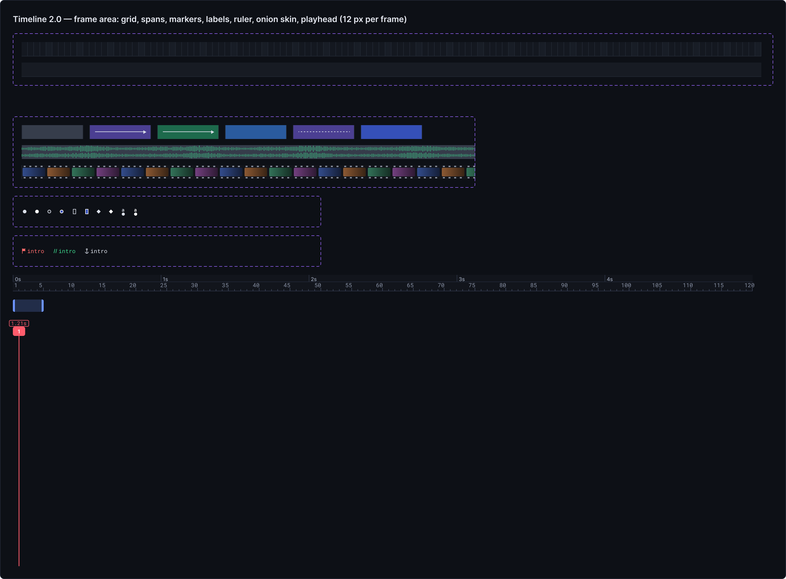

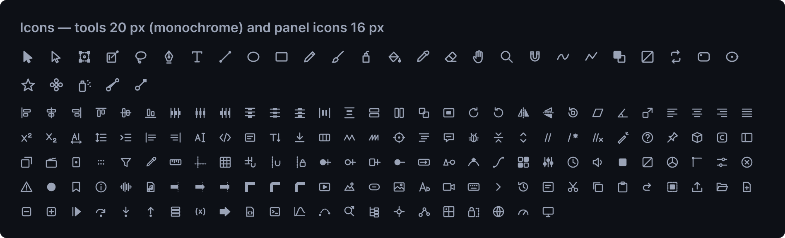

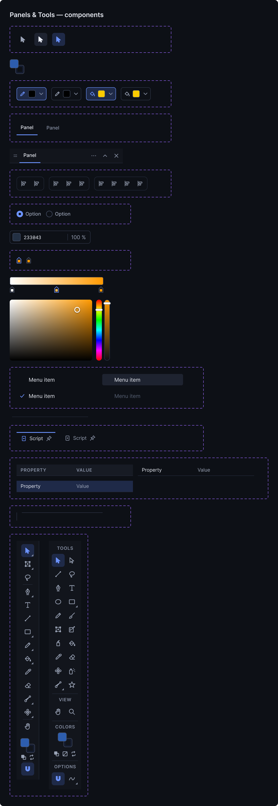

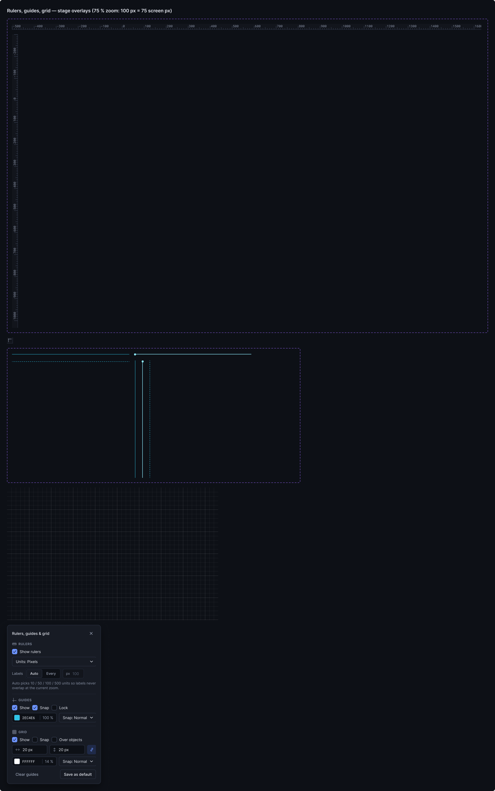

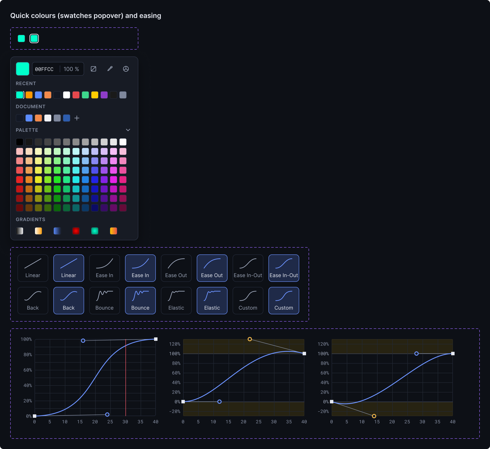

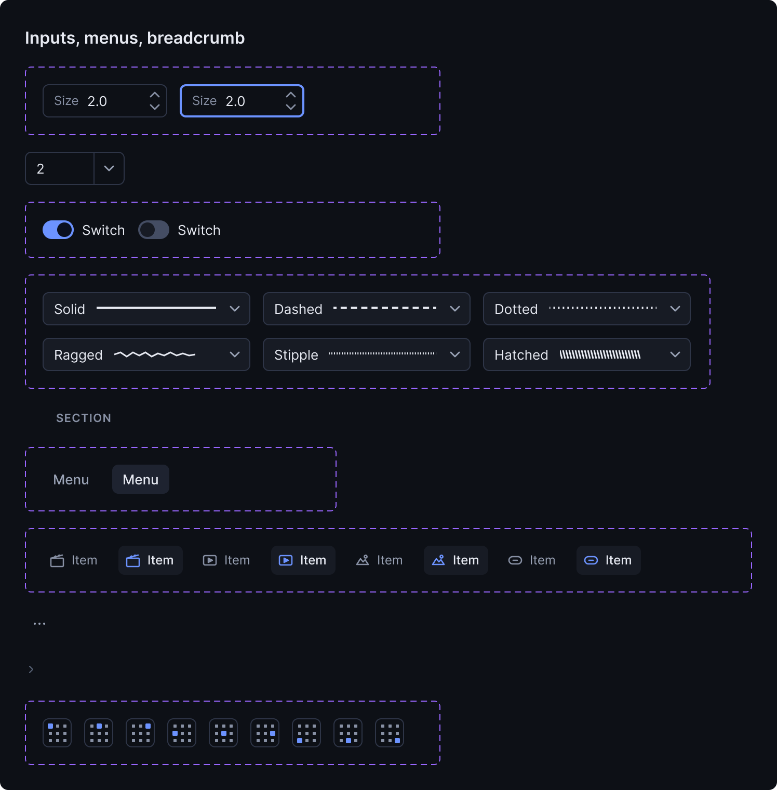

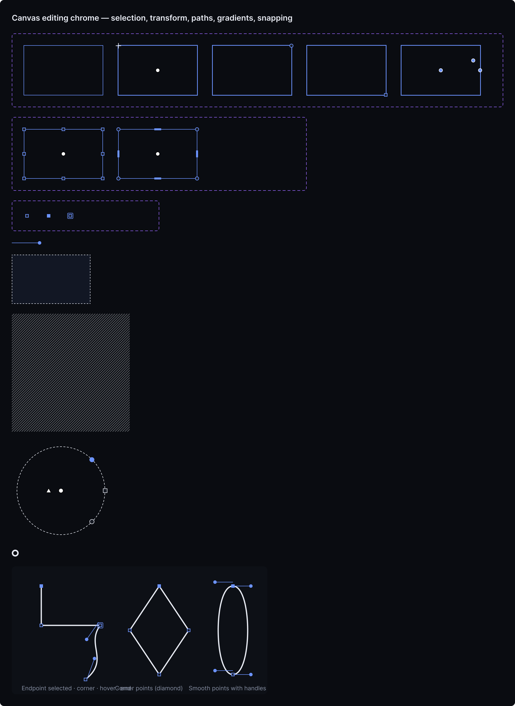

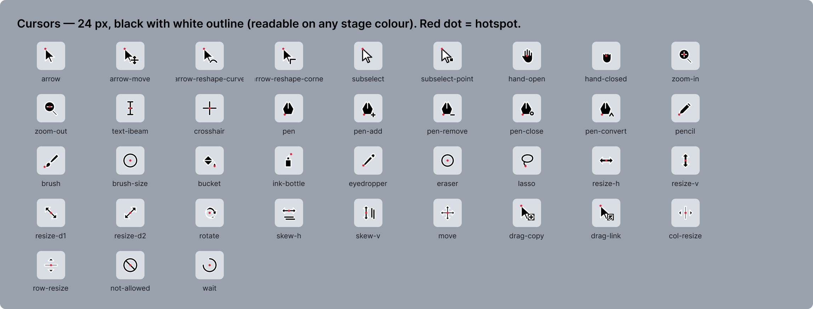

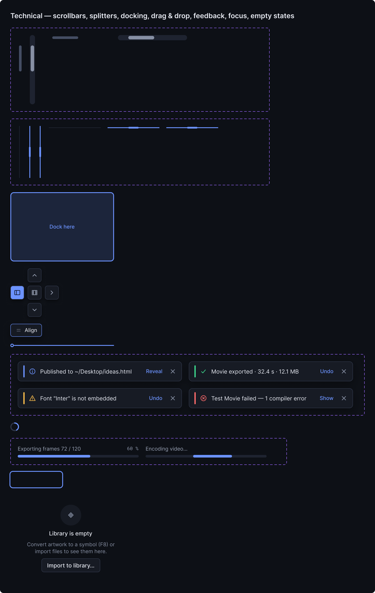

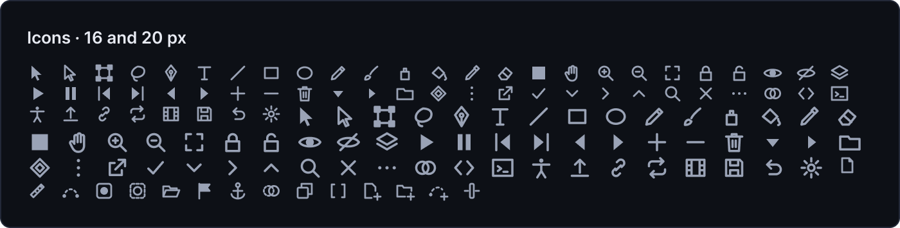

---

## 11. Working on the Figma file (rules for agents)

### 11.1 Access

- Figma MCP tools, `fileKey: BUz3pseopiuOg2Uiy3Fog7`. Writes go through `use_figma` (Plugin API, JS, 50 KB per
  call, no state between calls, `return` a value; `figma.notify` and `fetch` are unavailable).
- **Rate limit:** Organization / Full seat = 200 MCP calls a day, 15 a minute (reads count; `use_figma` counted
  too in practice). Batch work into few large `use_figma` calls; never export assets through MCP — use
  `tools/export-plugin` (see §12).

### 11.2 Standard helpers (repeat in each call)

```js
const coll = (await figma.variables.getLocalVariableCollectionsAsync()).find(c => c.name === 'NF2 · Tokens');
const V = {}; for (const id of coll.variableIds) { const v = await figma.variables.getVariableByIdAsync(id); V[v.name] = v; }
const P = n => figma.variables.setBoundVariableForPaint({ type: 'SOLID', color: { r: 0, g: 0, b: 0 } }, 'color', V[n]);
const styles = {}; for (const s of await figma.getLocalTextStylesAsync()) { styles[s.name] = s; await figma.loadFontAsync(s.fontName); }
async function T(str, style, token) { const t = figma.createText(); t.fontName = styles[style].fontName; t.characters = str;
  await t.setTextStyleIdAsync(styles[style].id); t.fills = [P(token)]; return t; }
const IC = {}; (await figma.getNodeByIdAsync('1:2845')).findAll(n => n.type === 'COMPONENT' && n.name.startsWith('NF2 Icon/')).forEach(c => IC[c.name] = c);
const recolor = (node, token) => node.findAll(() => true).forEach(x => { if ('fills' in x && x.fills.length) x.fills = [P(token)]; if ('strokes' in x && x.strokes.length) x.strokes = [P(token)]; });
const variant = (set, props) => set.children.find(c => Object.entries(props).every(([k, v]) => c.name.split(', ').includes(`${k}=${v}`)));
const setP = (inst, name, val) => { const key = Object.keys(inst.componentProperties).find(k => k === name || k.startsWith(name + '#')); inst.setProperties({ [key]: val }); };
const al = (name, dir, gap) => { const f = figma.createAutoLayout(dir, { name, itemSpacing: gap }); f.fills = []; return f; };
```

### 11.3 Gotchas (all hit in practice)

1. **Bound paint drops opacity.** `setBoundVariableForPaint` ignores paint `opacity`; for translucent tints use node
   opacity or an unbound colour (e.g. breakpoint line tint = unbound colour at 0.12).
2. **Per-side stroke weights** make `strokeWeight` = `figma.mixed`; read per-side values instead.
3. **`resize()` sets both sizing modes to FIXED.** Reset `primaryAxisSizingMode = 'AUTO'` / `counterAxisSizingMode`
   when content must hug, or frames collapse.
4. **Instances are named after the set** (`NF2/Panel Tab`), not the variant.
5. **Nested instances are only found reliably on the current page**: `await figma.setCurrentPageAsync(page)` before
   `findAll` / `findAllWithCriteria`. `createNodeFromSvg` creates on the current page; grouping needs nodes on the
   current page.
6. Page roots may contain TEXT nodes (titles): skip them before calling `findOne` / `findAll` on children.
7. Lines and vectors inside components need constraints STRETCH / SCALE and an instance re-resize to stretch.
8. Cross-page copy: `node.clone()` then `targetPage.appendChild(clone)`.
9. Light twin: `frame.setExplicitVariableModeForCollection(coll, coll.modes[1].modeId)`.
10. Fonts: only Inter and Roboto Mono (Helvetica broke `setProperties` in the past).
11. Descriptions: the API returns straight quotes and `&` HTML-escaped (`&quot;`, `&amp;`). Write typographic
    quotes “…” and the word “and” in component descriptions instead.

### 11.4 Rules

- New v2 work: NF2 components only; colours via `P(token)`; text via NF2 styles; spacing/radius values from tokens.
- New component → put it on a `Shelf / …` frame on `v2 · System & Components`, give it a description (what, when,
  interaction), then use instances in panels/screens. Add Light twins for new panels/screens.
- New icon → `NF2 Icon/16/<name>` (or 20), stroke-only, then regenerate the Icons page.
- Keep the coverage table and this document in sync: run the export plugin, then `tools/build-docs.py`.

---

## 12. Exports and folder layout

```
design-system/
  AGENTS.md                          ← short brief for Codex / coding agents (generated)
  tokens/                            ← tokens.css, typography.css, tokens.json (generated)
  docs/
    NeoFlash-Design-System.md        ← reference for Claude (generated)
    NeoFlash-Design-System.codex.md  ← same reference, Codex framing (generated)
    pdf/NeoFlash-Design-System-EN.pdf
    pdf/NeoFlash-Design-System-RU.pdf
    illustrations/                   ← shelves, tokens, audit, icons (PNG @2x)
    data/figma-dump.json             ← variables (all modes), styles, components, pages
    data/outline/*.txt               ← text outline of every exported frame
    data/*.psv                       ← token / style tables (pipe-separated)
    source/                          ← doc sources (md + html templates)
  exports/
    manifest.json                    ← node id → file paths
    interface/{dark,light}/{png,svg}/
    panels/{dark,light}/{png,svg}/
    icons/{16,20}/*.svg               ← every NF2 icon
    cursors/*.svg                     ← every NF2 cursor
  tools/
    export-plugin/                   ← Figma dev plugin: exports + dump + outlines
    receiver.py                      ← local receiver for the plugin
    build-docs.py                    ← builds both MDs, AGENTS.md, tokens and the PDF HTML
    build-pdf.sh                     ← HTML → PDF with headless Chrome
```

Re-export: `python3 tools/receiver.py`, run **NeoFlash Export** in Figma Desktop, then
`python3 tools/build-docs.py && tools/build-pdf.sh`. PNG are @2x and include drop shadows (frame effect bounds);
SVG text is outlined.

| Folder | Files |
|---|---|
| `exports/cursors/` | 39 |
| `exports/icons/16/` | 215 |
| `exports/icons/20/` | 89 |
| `exports/interface/dark/png/` | 12 |
| `exports/interface/dark/svg/` | 12 |
| `exports/interface/light/png/` | 12 |
| `exports/interface/light/svg/` | 12 |
| `exports/panels/dark/png/` | 42 |
| `exports/panels/dark/svg/` | 42 |
| `exports/panels/light/png/` | 42 |
| `exports/panels/light/svg/` | 42 |


---

## 13. Implementing in code

### 13.1 Tokens

`tools/build-docs.py` writes code-ready tokens from the Figma variables:

| File | Content |
|---|---|
| `tokens/tokens.css` | CSS custom properties. `:root` = Dark (default), `[data-theme="light"]` = Light. Names: `color/bg/panel` → `--nf-color-bg-panel`, `space/3` → `--nf-space-3`, `radius/md` → `--nf-radius-md`. |
| `tokens/typography.css` | One class per text style: `.nf-text-body`, `.nf-text-overline`, … (font family, weight, size, line height, tracking, case). |
| `tokens/tokens.json` | W3C Design Tokens format (`$type`, `$value`) with `dark` and `light` groups; text styles under `typography`. |

```css
@import "tokens/tokens.css";
.panel { background: var(--nf-color-bg-raised); border: 1px solid var(--nf-color-border-subtle);
         border-radius: var(--nf-radius-xl); padding: var(--nf-space-3); }
```

Switch theme by setting `data-theme="light"` on the root (or on a subtree, like Figma's per-frame mode).

### 13.2 Mapping components

- One code component per NF2 component **set**; Figma variant properties become props with the same option names
  (`Type="Primary" | "Secondary" | "Ghost" | "Danger"`, `State` is runtime state — hover / focus / disabled are
  pseudo-classes, not props, except `Selected` / `Checked` / `Active` which are real props).
- TEXT properties → string props / children; BOOLEAN properties → boolean props (e.g. `Icon`, `Flyout`, `Submenu`,
  `Indent 1/2`, `Editing`); nested icon instances → an `icon` prop taking an icon name (`"16/align-left"`).
- Sizes in §10 are the default instance size. Heights are fixed (32 / 28 / 40 / 36 / 24 px); widths hug content or
  fill the parent as in the outlines (`[H gap 8]` = horizontal auto layout with 8 px gap → `display:flex; gap:8px`).
- Timeline must be virtualised: 12 px × frame count per row, markers absolutely positioned at `(frame − 1) × 12`,
  spans as single elements of `frames × 12` px width, the grid drawn as a repeating background (every 5th cell
  `--nf-color-timeline-empty-5th`), not one element per frame.

### 13.3 Icons and cursors

- Icons: `exports/icons/16/*.svg`, `exports/icons/20/*.svg` (one file per `NF2 Icon/*` component, exported by the
  plugin). They are monochrome strokes; replace the stroke colour with `currentColor` so the token colour of the
  parent applies.
- Cursors: `exports/cursors/*.svg` (24 × 24) with the hotspot from §3.5 →
  `cursor: url(exports/cursors/pen.svg) 6 21, crosshair;`.

### 13.4 Interaction rules to preserve

- Numeric fields: drag the prefix label to scrub, ↑/↓ steps, ⇧ = ×10, units shown in the value.
- Tool buttons with `Flyout`: long-press (or right-click) opens the tool group; tooltip = name + shortcut.
- Panels: floating panels can dock (dock zones + docking compass), splitters resize docks, tabs drag between panels.
- Keyboard: all shortcuts in §8; Esc = cancel / close popover, Enter = primary action in dialogs; focus ring only on
  keyboard focus.
- Red only for errors; never use `--nf-color-danger-*` for anything decorative.

---

## Appendix A. Panel and screen outlines (condensed)

Condensed from `data/outline/*.txt`: `§` = container, `[Component "texts"]` = instance, quoted = text.
Use the full outlines for exact structure (auto layout direction and gap, sizes, property values).

### interface-editor-actions-tab

```
§NF2 / Editor — Actions tab · §Top bar · [Logo] · "NeoFlash" · [Button "File"] · [Button "Edit"] · [Button "View"] · [Button "Modify"] · [Button "Insert"] · [Button "Control"] · [Button "Window"] · [Select "Classic workspace"] · [Button "Test Movie"] · [Button "Publish"] · §Project title · "Ideas in motion" · [Badge "Unsaved"] · [Tools Panel] · §Canvas · §Stage — "Ideas in motion" (user content, vector) · "NEOFLASH / MOTION STUDY 01" · "Ideas in motion." · "One symbol. Many possibilities." · "A familiar timeline. A modern canvas." · "BUILT TO BE INTERACTIVE" · "CLICK THE ORBIT IN WEB PREVIEW" · "EDIT A SYMBOL  ·  SCRUB THE TIMELINE  ·  EXPORT HTML5" · [Stage Grid] · §Guides · [Guide] · §Rulers · [Stage Ruler "-200" "-100" "0" "100" "200" "300" "400" "500" "600" "700" "800" "900"] · [Stage Ruler "-500" "-400" "-300" "-200" "-100" "0" "100" "200" "300" "400" "500" "600"] · [Ruler Corner] · §Breadcrumb · "Scene 1" · §Stage info · [Badge "960 × 600"] · [Zoom Control "75%"] · §Inspector · §Properties · [Panel Header "Properties"] · [Segmented Control "Selection" "Tool"] · [Section Header "Stage"] · [Field "Name" "Ideas in motion"] · §Size · [Field "W" "960"] · [Field "H" "600"] · [Icon Button] · §Background · [Swatch] · [Field "W" "#131824"] · [Field "α" "100 %"] · [Section Header "Playback"] · §Playback row · [Field "FPS" "24"] · [Field "Frames" "120"] · [Section Header "Publish"] · §Publish row · [Badge "HTML5 · Rust / WebAssembly"] · [Button "Publish settings…"] · §Library · [Panel Header "Library"] · [Search "Search library"] · [Tree Item "Library root"] · [Tree Item "Orbit"] · [Tree Item "Spark"] · [Tree Item "Resource files (0)"] · §Bottom dock · §Dock tabs · [Dock Tab "Timeline"] · [Dock Tab "Actions"] · [Dock Tab "Output"] · [Dock Tab "Accessibility"] · §Actions (docked) · §Toolbar · [Select "ActionScript 3.0"] · [Button "Script assist"] · §Main · §Sidebar · [Search "Search toolbox"] · §Toolbox · [Tree Item "Top level"] · [Tree Item "Language elements"] · [Tree Item "fl.controls"] · [Tree Item "fl.events"] · [Tree Item "fl.motion"] · [Tree Item "Animator"] · [Tree Item "Motion"] · §Script navigator · "Script navigator" · [Tree Item "Current selection"] · [Tree Item "orbit : Frame 1"] · [Tree Item "Scene 1"] · [Tree Item "labels : Frame 1"] · [Tree Item "Symbol definitions"] · §Editor · §Gutter · "7" · "8" · "9" · "10" · "11" · "12" · "13" · "14" · "15" · "16" · "17" · "18" · "19" · "20" · §Code · §Line 7 · "            </dimensions>" · §Line 8 · "        </Source>" · §Line 9 · "    </source>" · §Line 10 · "    <Keyframe index="0" tweenSnap="true">" · §Line 11 · "        <SimpleEase ease="0"/>" · §Line 12 · "    </Keyframe>" · §Line 13 · "    <Keyframe index="19" x="364.95"/>" · §Line 14 · "</Motion>;" · §Line 15 · " " · §Line 16 · "// play the orbit once the stage is ready" · §Line 17 · "var animator:Animator = new Animator(orbitXML, orbit_mc);" · §Line 18 · "animator.play();" · §Line 19 · "animator." · §Line 20 · "trace("NeoFlash: the stage is ready");" · §Code hint · [Menu Item "play()" "void"] · [Menu Item "pause()" "void"] · [Menu Item "rewind()" "void"] · [Menu Item "stop()" "void"] · [Menu Item "time" "int"] · §Script bar · [Script Tab "orbit : Frame 1"] · [Script Tab "labels : Frame 1"] · "Line 19, Col 10  ·  20 lines  ·  No errors" · §Status bar · "Ready" · "Stage 960 × 600 · 24 fps · 120 frames" · §Hint · [Kbd "F5"] · "frame" · §Hint · [Kbd "F6"] · "keyframe" · §Hint · [Kbd "F7"] · "blank keyframe" · §Hint · [Kbd "⌘ ↵"] · "Test Movie" · [Tooltip "Selection" "V"]
```

### interface-editor-convert-to-symbol-dialog

```
§NF2 / Editor — Convert to Symbol dialog · §Top bar · [Logo] · "NeoFlash" · [Button "File"] · [Button "Edit"] · [Button "View"] · [Button "Modify"] · [Button "Insert"] · [Button "Control"] · [Button "Window"] · [Select "Classic workspace"] · [Button "Test Movie"] · [Button "Publish"] · §Project title · "Ideas in motion" · [Badge "Unsaved"] · [Tools Panel] · §Canvas · §Stage — "Ideas in motion" (user content, vector) · "NEOFLASH / MOTION STUDY 01" · "Ideas in motion." · "One symbol. Many possibilities." · "A familiar timeline. A modern canvas." · "BUILT TO BE INTERACTIVE" · "CLICK THE ORBIT IN WEB PREVIEW" · "EDIT A SYMBOL  ·  SCRUB THE TIMELINE  ·  EXPORT HTML5" · [Stage Grid] · §Guides · [Guide] · §Rulers · [Stage Ruler "-200" "-100" "0" "100" "200" "300" "400" "500" "600" "700" "800" "900"] · [Stage Ruler "-500" "-400" "-300" "-200" "-100" "0" "100" "200" "300" "400" "500" "600"] · [Ruler Corner] · §Breadcrumb · "Scene 1" · §Stage info · [Badge "960 × 600"] · [Zoom Control "75%"] · §Inspector · §Properties · [Panel Header "Properties"] · [Segmented Control "Selection" "Tool"] · [Section Header "Stage"] · [Field "Name" "Ideas in motion"] · §Size · [Field "W" "960"] · [Field "H" "600"] · [Icon Button] · §Background · [Swatch] · [Field "W" "#131824"] · [Field "α" "100 %"] · [Section Header "Playback"] · §Playback row · [Field "FPS" "24"] · [Field "Frames" "120"] · [Section Header "Publish"] · §Publish row · [Badge "HTML5 · Rust / WebAssembly"] · [Button "Publish settings…"] · §Library · [Panel Header "Library"] · [Search "Search library"] · [Tree Item "Library root"] · [Tree Item "Orbit"] · [Tree Item "Spark"] · [Tree Item "Resource files (0)"] · §Bottom dock · §Dock tabs · [Dock Tab "Timeline"] · [Dock Tab "Actions"] · [Dock Tab "Output"] · [Dock Tab "Accessibility"] · §Timeline controls · §Layer actions · §Timecode · "00:01.21" · "30 / 120 F" · [Select "Scene 1"] · [Field "Duration" "5.00 s"] · [Icon Group] · §Onion skin · [Slider] · §Timeline body · [TL Layers Header "Layers"] · [TL Layer "labels"] · [TL Span] · [TL Marker "a"] · [TL Marker] · [TL Frame Label "intro"] · [TL Frame Label "loop"] · [TL Frame Label "outro"] · [TL Layer "character"] · [TL Layer "Guide: path"] · [TL Layer "ball"] · [TL Layer "mask"] · [TL Layer "arm"] · [TL Layer "hand"] · [TL Layer "body"] · [TL Layer "background"] · [TL Layer "Guide: sketch"] · [TL Layer "music.mp3"] · [TL Ruler "1" "5" "10" "15" "20" "25" "30" "35" "40" "45" "50" "55"] · [TL Onion Range] · [TL Playhead "30" "1.21s"] · §Status bar · "Ready" · "Stage 960 × 600 · 24 fps · 120 frames" · §Hint · [Kbd "F5"] · "frame" · §Hint · [Kbd "F6"] · "keyframe" · §Hint · [Kbd "F7"] · "blank keyframe" · §Hint · [Kbd "⌘ ↵"] · "Test Movie" · [Tooltip "Selection" "V"] · §Dialog / Convert to Symbol · [Dialog Header "Convert to Symbol"] · §Name · "Name" · [Field "W" "Badge symbol"] · §Type · "Type" · [Select "Movie clip"] · §Folder · "Folder" · [Select "Library root"] · §Registration · "Registration" · [Registration Picker] · "Centre" · "Movie clips have their own timeline and can be scripted." · [Section Header "Advanced"] · §Footer · [Button "Cancel"] · [Button "Convert"]
```

### interface-editor-ease-panel-open

```
§NF2 / Editor — Ease panel open · §Top bar · [Logo] · "NeoFlash" · [Button "File"] · [Button "Edit"] · [Button "View"] · [Button "Modify"] · [Button "Insert"] · [Button "Control"] · [Button "Window"] · [Select "Classic workspace"] · [Button "Test Movie"] · [Button "Publish"] · §Project title · "Ideas in motion" · [Badge "Unsaved"] · [Tools Panel] · §Canvas · §Stage — "Ideas in motion" (user content, vector) · "NEOFLASH / MOTION STUDY 01" · "Ideas in motion." · "One symbol. Many possibilities." · "A familiar timeline. A modern canvas." · "BUILT TO BE INTERACTIVE" · "CLICK THE ORBIT IN WEB PREVIEW" · "EDIT A SYMBOL  ·  SCRUB THE TIMELINE  ·  EXPORT HTML5" · [Stage Grid] · §Guides · [Guide] · §Rulers · [Stage Ruler "-200" "-100" "0" "100" "200" "300" "400" "500" "600" "700" "800" "900"] · [Stage Ruler "-500" "-400" "-300" "-200" "-100" "0" "100" "200" "300" "400" "500" "600"] · [Ruler Corner] · §Breadcrumb · "Scene 1" · §Stage info · [Badge "960 × 600"] · [Zoom Control "75%"] · §Inspector · §Properties · [Panel Header "Properties"] · [Segmented Control "Selection" "Tool"] · [Section Header "Stage"] · [Field "Name" "Ideas in motion"] · §Size · [Field "W" "960"] · [Field "H" "600"] · [Icon Button] · §Background · [Swatch] · [Field "W" "#131824"] · [Field "α" "100 %"] · [Section Header "Playback"] · §Playback row · [Field "FPS" "24"] · [Field "Frames" "120"] · [Section Header "Publish"] · §Publish row · [Badge "HTML5 · Rust / WebAssembly"] · [Button "Publish settings…"] · §Library · [Panel Header "Library"] · [Search "Search library"] · [Tree Item "Library root"] · [Tree Item "Orbit"] · [Tree Item "Spark"] · [Tree Item "Resource files (0)"] · §Bottom dock · §Dock tabs · [Dock Tab "Timeline"] · [Dock Tab "Actions"] · [Dock Tab "Output"] · [Dock Tab "Accessibility"] · §Timeline controls · §Layer actions · §Timecode · "00:01.21" · "30 / 120 F" · [Select "Scene 1"] · [Field "Duration" "5.00 s"] · [Icon Group] · §Onion skin · [Slider] · §Timeline body · [TL Layers Header "Layers"] · [TL Layer "labels"] · [TL Span] · [TL Marker "a"] · [TL Marker] · [TL Frame Label "intro"] · [TL Frame Label "loop"] · [TL Frame Label "outro"] · [TL Layer "character"] · [TL Layer "Guide: path"] · [TL Layer "ball"] · [TL Layer "mask"] · [TL Layer "arm"] · [TL Layer "hand"] · [TL Layer "body"] · [TL Layer "background"] · [TL Layer "Guide: sketch"] · [TL Layer "music.mp3"] · [TL Ruler "1" "5" "10" "15" "20" "25" "30" "35" "40" "45" "50" "55"] · [TL Onion Range] · [TL Playhead "30" "1.21s"] · §Status bar · "Ready" · "Stage 960 × 600 · 24 fps · 120 frames" · §Hint · [Kbd "F5"] · "frame" · §Hint · [Kbd "F6"] · "keyframe" · §Hint · [Kbd "F7"] · "blank keyframe" · §Hint · [Kbd "⌘ ↵"] · "Test Movie" · [Tooltip "Selection" "V"] · §Panel / Ease · [Floating Panel Header "Ease" "Panel" "Panel"] · "Classic tween · ball · frames 1–40" · [Select "Property: All"] · [Checkbox "One curve for all"] · §Presets · [Ease Preset "Linear"] · [Ease Preset "Ease In"] · [Ease Preset "Ease Out"] · [Ease Preset "Ease In-Out"] · [Ease Preset "Back"] · [Ease Preset "Bounce"] · [Ease Preset "Elastic"] · [Ease Preset "Custom"] · [Ease Graph "0%" "20%" "40%" "60%" "80%" "100%" "0" "5" "10" "15" "20" "25"] · [Field "X1" "0.60"] · [Field "Y1" "0.02"] · [Field "X2" "0.40"] · [Field "Y2" "0.98"] · §Preview track · "Frame 30 / 40  ·  88 %" · [Button "Reset"] · [Button "Cancel"] · [Button "Apply"]
```

### interface-editor-edit-menu-open

```
§NF2 / Editor — Edit menu open · §Top bar · [Logo] · "NeoFlash" · [Button "File"] · [Button "Edit"] · [Button "View"] · [Button "Modify"] · [Button "Insert"] · [Button "Control"] · [Button "Window"] · [Select "Classic workspace"] · [Button "Test Movie"] · [Button "Publish"] · §Project title · "Ideas in motion" · [Badge "Unsaved"] · [Tools Panel] · §Canvas · §Stage — "Ideas in motion" (user content, vector) · "NEOFLASH / MOTION STUDY 01" · "Ideas in motion." · "One symbol. Many possibilities." · "A familiar timeline. A modern canvas." · "BUILT TO BE INTERACTIVE" · "CLICK THE ORBIT IN WEB PREVIEW" · "EDIT A SYMBOL  ·  SCRUB THE TIMELINE  ·  EXPORT HTML5" · [Stage Grid] · §Guides · [Guide] · §Rulers · [Stage Ruler "-200" "-100" "0" "100" "200" "300" "400" "500" "600" "700" "800" "900"] · [Stage Ruler "-500" "-400" "-300" "-200" "-100" "0" "100" "200" "300" "400" "500" "600"] · [Ruler Corner] · §Breadcrumb · "Scene 1" · §Stage info · [Badge "960 × 600"] · [Zoom Control "75%"] · §Inspector · §Properties · [Panel Header "Properties"] · [Segmented Control "Selection" "Tool"] · [Section Header "Stage"] · [Field "Name" "Ideas in motion"] · §Size · [Field "W" "960"] · [Field "H" "600"] · [Icon Button] · §Background · [Swatch] · [Field "W" "#131824"] · [Field "α" "100 %"] · [Section Header "Playback"] · §Playback row · [Field "FPS" "24"] · [Field "Frames" "120"] · [Section Header "Publish"] · §Publish row · [Badge "HTML5 · Rust / WebAssembly"] · [Button "Publish settings…"] · §Library · [Panel Header "Library"] · [Search "Search library"] · [Tree Item "Library root"] · [Tree Item "Orbit"] · [Tree Item "Spark"] · [Tree Item "Resource files (0)"] · §Bottom dock · §Dock tabs · [Dock Tab "Timeline"] · [Dock Tab "Actions"] · [Dock Tab "Output"] · [Dock Tab "Accessibility"] · §Timeline controls · §Layer actions · §Timecode · "00:01.21" · "30 / 120 F" · [Select "Scene 1"] · [Field "Duration" "5.00 s"] · [Icon Group] · §Onion skin · [Slider] · §Timeline body · [TL Layers Header "Layers"] · [TL Layer "labels"] · [TL Span] · [TL Marker "a"] · [TL Marker] · [TL Frame Label "intro"] · [TL Frame Label "loop"] · [TL Frame Label "outro"] · [TL Layer "character"] · [TL Layer "Guide: path"] · [TL Layer "ball"] · [TL Layer "mask"] · [TL Layer "arm"] · [TL Layer "hand"] · [TL Layer "body"] · [TL Layer "background"] · [TL Layer "Guide: sketch"] · [TL Layer "music.mp3"] · [TL Ruler "1" "5" "10" "15" "20" "25" "30" "35" "40" "45" "50" "55"] · [TL Onion Range] · [TL Playhead "30" "1.21s"] · §Status bar · "Ready" · "Stage 960 × 600 · 24 fps · 120 frames" · §Hint · [Kbd "F5"] · "frame" · §Hint · [Kbd "F6"] · "keyframe" · §Hint · [Kbd "F7"] · "blank keyframe" · §Hint · [Kbd "⌘ ↵"] · "Test Movie" · [Tooltip "Selection" "V"] · §Edit + Timeline submenu · §Menu / Edit · [Menu Item "Undo Fill colour" "⌘Z"] · [Menu Item "Redo" "⇧⌘Z"] · [Menu Item "Cut" "⌘X"] · [Menu Item "Copy" "⌘C"] · [Menu Item "Paste in centre" "⌘V"] · [Menu Item "Paste in place" "⇧⌘V"] · [Menu Item "Clear" "⌫"] · [Menu Item "Duplicate" "⌘D"] · [Menu Item "Select all" "⌘A"] · [Menu Item "Deselect" "⇧⌘A"] · [Menu Item "Find and replace" "⌘F"] · [Menu Item "Timeline" " "] · [Menu Item "Edit symbols" "⌘E"] · [Menu Item "Edit selected" " "] · [Menu Item "Edit in place" " "] · [Menu Item "Preferences…" "⌘U"] · [Menu Item "Keyboard shortcuts…" "⌥⇧⌘K"] · §Menu / Edit ▸ Timeline · [Menu Item "Cut frames" "⌥⌘X"] · [Menu Item "Copy frames" "⌥⌘C"] · [Menu Item "Paste frames" "⌥⌘V"] · [Menu Item "Clear frames" "⌥⌫"] · [Menu Item "Remove frames" "⇧F5"] · [Menu Item "Select all frames" "⌥⌘A"] · [Menu Item "Reverse frames" " "] · [Menu Item "Synchronise symbols" " "]
```

### interface-editor-editing-symbol-in-place

```
§NF2 / Editor — Editing symbol in place · §Top bar · [Logo] · "NeoFlash" · [Button "File"] · [Button "Edit"] · [Button "View"] · [Button "Modify"] · [Button "Insert"] · [Button "Control"] · [Button "Window"] · [Select "Classic workspace"] · [Button "Test Movie"] · [Button "Publish"] · §Project title · "Ideas in motion" · [Badge "Unsaved"] · [Tools Panel] · §Canvas · §Stage — "Ideas in motion" (user content, vector) · "NEOFLASH / MOTION STUDY 01" · "Ideas in motion." · "One symbol. Many possibilities." · "A familiar timeline. A modern canvas." · "BUILT TO BE INTERACTIVE" · "CLICK THE ORBIT IN WEB PREVIEW" · "EDIT A SYMBOL  ·  SCRUB THE TIMELINE  ·  EXPORT HTML5" · [Selection Box] · [Transform Box] · [Stage Grid] · §Guides · [Guide] · §Rulers · [Stage Ruler "-200" "-100" "0" "100" "200" "300" "400" "500" "600" "700" "800" "900"] · [Stage Ruler "-500" "-400" "-300" "-200" "-100" "0" "100" "200" "300" "400" "500" "600"] · [Ruler Corner] · §Breadcrumb · [Breadcrumb Item "Scene 1"] · [Breadcrumb Separator] · [Breadcrumb Item "orbit"] · [Breadcrumb Item "planet"] · §Stage info · [Badge "960 × 600"] · [Zoom Control "75%"] · §Inspector · §Properties · [Panel Header "Properties"] · [Segmented Control "Selection" "Tool"] · [Section Header "Stage"] · [Field "Name" "Ideas in motion"] · §Size · [Field "W" "960"] · [Field "H" "600"] · [Icon Button] · §Background · [Swatch] · [Field "W" "#131824"] · [Field "α" "100 %"] · [Section Header "Playback"] · §Playback row · [Field "FPS" "24"] · [Field "Frames" "120"] · [Section Header "Publish"] · §Publish row · [Badge "HTML5 · Rust / WebAssembly"] · [Button "Publish settings…"] · §Library · [Panel Header "Library"] · [Search "Search library"] · [Tree Item "Library root"] · [Tree Item "Orbit"] · [Tree Item "Spark"] · [Tree Item "Resource files (0)"] · §Bottom dock · §Dock tabs · [Dock Tab "Timeline"] · [Dock Tab "Actions"] · [Dock Tab "Output"] · [Dock Tab "Accessibility"] · §Timeline controls · §Layer actions · §Timecode · "00:01.21" · "30 / 120 F" · [Select "Scene 1"] · [Field "Duration" "5.00 s"] · [Icon Group] · §Onion skin · [Slider] · §Timeline body · [TL Layers Header "Layers"] · [TL Layer "labels"] · [TL Span] · [TL Marker "a"] · [TL Marker] · [TL Frame Label "intro"] · [TL Frame Label "loop"] · [TL Frame Label "outro"] · [TL Layer "character"] · [TL Layer "Guide: path"] · [TL Layer "ball"] · [TL Layer "mask"] · [TL Layer "arm"] · [TL Layer "hand"] · [TL Layer "body"] · [TL Layer "background"] · [TL Layer "Guide: sketch"] · [TL Layer "music.mp3"] · [TL Ruler "1" "5" "10" "15" "20" "25" "30" "35" "40" "45" "50" "55"] · [TL Onion Range] · [TL Playhead "30" "1.21s"] · §Status bar · "Ready" · "Stage 960 × 600 · 24 fps · 120 frames" · §Hint · [Kbd "F5"] · "frame" · §Hint · [Kbd "F6"] · "keyframe" · §Hint · [Kbd "F7"] · "blank keyframe" · §Hint · [Kbd "⌘ ↵"] · "Test Movie" · [Tooltip "Selection" "V"] · §Symbols & scenes popover · [Search "pla"] · [Menu Section "Scenes · 4"] · [Tree Item "Scene 1"] · [Menu Section "Matches in symbols · 3 of 248"] · [Tree Item "planet"] · [Tree Item "planet_shadow"] · [Tree Item "planets_bg"] · [Menu Section "Recent"] · [Tree Item "orbit"] · [Tree Item "cta_btn"] · [Menu Section "Browse"] · [Tree Item "Backgrounds  (41)"] · [Tree Item "Characters  (96)"] · [Tree Item "UI  (111)"] · §Hint · "↑↓ move  ·  ↵ edit  ·  ⌥↵ edit in place  ·  ⌘↵ new window"
```

### interface-editor-main

```
§NF2 / Editor — Main · §Top bar · [Logo] · "NeoFlash" · [Button "File"] · [Button "Edit"] · [Button "View"] · [Button "Modify"] · [Button "Insert"] · [Button "Control"] · [Button "Window"] · [Select "Classic workspace"] · [Button "Test Movie"] · [Button "Publish"] · §Project title · "Ideas in motion" · [Badge "Unsaved"] · [Tools Panel] · §Canvas · §Stage — "Ideas in motion" (user content, vector) · "NEOFLASH / MOTION STUDY 01" · "Ideas in motion." · "One symbol. Many possibilities." · "A familiar timeline. A modern canvas." · "BUILT TO BE INTERACTIVE" · "CLICK THE ORBIT IN WEB PREVIEW" · "EDIT A SYMBOL  ·  SCRUB THE TIMELINE  ·  EXPORT HTML5" · [Stage Grid] · §Guides · [Guide] · §Rulers · [Stage Ruler "-200" "-100" "0" "100" "200" "300" "400" "500" "600" "700" "800" "900"] · [Stage Ruler "-500" "-400" "-300" "-200" "-100" "0" "100" "200" "300" "400" "500" "600"] · [Ruler Corner] · §Breadcrumb · "Scene 1" · §Stage info · [Badge "960 × 600"] · [Zoom Control "75%"] · §Inspector · §Properties · [Panel Header "Properties"] · [Segmented Control "Selection" "Tool"] · [Section Header "Stage"] · [Field "Name" "Ideas in motion"] · §Size · [Field "W" "960"] · [Field "H" "600"] · [Icon Button] · §Background · [Swatch] · [Field "W" "#131824"] · [Field "α" "100 %"] · [Section Header "Playback"] · §Playback row · [Field "FPS" "24"] · [Field "Frames" "120"] · [Section Header "Publish"] · §Publish row · [Badge "HTML5 · Rust / WebAssembly"] · [Button "Publish settings…"] · §Library · [Panel Header "Library"] · [Search "Search library"] · [Tree Item "Library root"] · [Tree Item "Orbit"] · [Tree Item "Spark"] · [Tree Item "Resource files (0)"] · §Bottom dock · §Dock tabs · [Dock Tab "Timeline"] · [Dock Tab "Actions"] · [Dock Tab "Output"] · [Dock Tab "Accessibility"] · §Timeline controls · §Layer actions · §Timecode · "00:01.21" · "30 / 120 F" · [Select "Scene 1"] · [Field "Duration" "5.00 s"] · [Icon Group] · §Onion skin · [Slider] · §Timeline body · [TL Layers Header "Layers"] · [TL Layer "labels"] · [TL Span] · [TL Marker "a"] · [TL Marker] · [TL Frame Label "intro"] · [TL Frame Label "loop"] · [TL Frame Label "outro"] · [TL Layer "character"] · [TL Layer "Guide: path"] · [TL Layer "ball"] · [TL Layer "mask"] · [TL Layer "arm"] · [TL Layer "hand"] · [TL Layer "body"] · [TL Layer "background"] · [TL Layer "Guide: sketch"] · [TL Layer "music.mp3"] · [TL Ruler "1" "5" "10" "15" "20" "25" "30" "35" "40" "45" "50" "55"] · [TL Onion Range] · [TL Playhead "30" "1.21s"] · §Status bar · "Ready" · "Stage 960 × 600 · 24 fps · 120 frames" · §Hint · [Kbd "F5"] · "frame" · §Hint · [Kbd "F6"] · "keyframe" · §Hint · [Kbd "F7"] · "blank keyframe" · §Hint · [Kbd "⌘ ↵"] · "Test Movie" · [Tooltip "Selection" "V"]
```

### interface-editor-motion-tween-path

```
§NF2 / Editor — Motion tween path · §Top bar · [Logo] · "NeoFlash" · [Button "File"] · [Button "Edit"] · [Button "View"] · [Button "Modify"] · [Button "Insert"] · [Button "Control"] · [Button "Window"] · [Select "Classic workspace"] · [Button "Test Movie"] · [Button "Publish"] · §Project title · "Ideas in motion" · [Badge "Unsaved"] · [Tools Panel] · §Canvas · §Stage — "Ideas in motion" (user content, vector) · "NEOFLASH / MOTION STUDY 01" · "Ideas in motion." · "One symbol. Many possibilities." · "A familiar timeline. A modern canvas." · "BUILT TO BE INTERACTIVE" · "CLICK THE ORBIT IN WEB PREVIEW" · "EDIT A SYMBOL  ·  SCRUB THE TIMELINE  ·  EXPORT HTML5" · [Stage Grid] · §Motion path · §Path · [Anchor Point] · [Bezier Handle] · [Transform Box] · §Guides · [Guide] · §Rulers · [Stage Ruler "-200" "-100" "0" "100" "200" "300" "400" "500" "600" "700" "800" "900"] · [Stage Ruler "-500" "-400" "-300" "-200" "-100" "0" "100" "200" "300" "400" "500" "600"] · [Ruler Corner] · §Breadcrumb · "Scene 1" · §Stage info · [Badge "960 × 600"] · [Zoom Control "75%"] · §Inspector · §Properties · [Panel Header "Properties"] · [Segmented Control "Selection" "Tool"] · [Section Header "Stage"] · [Field "Name" "Ideas in motion"] · §Size · [Field "W" "960"] · [Field "H" "600"] · [Icon Button] · §Background · [Swatch] · [Field "W" "#131824"] · [Field "α" "100 %"] · [Section Header "Playback"] · §Playback row · [Field "FPS" "24"] · [Field "Frames" "120"] · [Section Header "Publish"] · §Publish row · [Badge "HTML5 · Rust / WebAssembly"] · [Button "Publish settings…"] · §Library · [Panel Header "Library"] · [Search "Search library"] · [Tree Item "Library root"] · [Tree Item "Orbit"] · [Tree Item "Spark"] · [Tree Item "Resource files (0)"] · §Bottom dock · §Dock tabs · [Dock Tab "Timeline"] · [Dock Tab "Actions"] · [Dock Tab "Output"] · [Dock Tab "Accessibility"] · §Timeline controls · §Layer actions · §Timecode · "00:01.21" · "30 / 120 F" · [Select "Scene 1"] · [Field "Duration" "5.00 s"] · [Icon Group] · §Onion skin · [Slider] · §Timeline body · [TL Layers Header "Layers"] · [TL Layer "labels"] · [TL Span] · [TL Marker "a"] · [TL Marker] · [TL Frame Label "intro"] · [TL Frame Label "loop"] · [TL Frame Label "outro"] · [TL Layer "character"] · [TL Layer "Guide: path"] · [TL Layer "ball"] · [TL Layer "mask"] · [TL Layer "arm"] · [TL Layer "hand"] · [TL Layer "body"] · [TL Layer "background"] · [TL Layer "Guide: sketch"] · [TL Layer "music.mp3"] · [TL Ruler "1" "5" "10" "15" "20" "25" "30" "35" "40" "45" "50" "55"] · [TL Onion Range] · [TL Playhead "30" "1.21s"] · §Status bar · "Ready" · "Stage 960 × 600 · 24 fps · 120 frames" · §Hint · [Kbd "F5"] · "frame" · §Hint · [Kbd "F6"] · "keyframe" · §Hint · [Kbd "F7"] · "blank keyframe" · §Hint · [Kbd "⌘ ↵"] · "Test Movie" · [Tooltip "Selection" "V"] · §Panel / Properties — Motion tween · [Floating Panel Header "Properties" "Panel" "Panel"] · §Type icon · §Title · "Motion tween" · "Layer "hand" · frames 1–60" · [Section Header "Ease"] · [Stepper Field "Ease" "−40 (in)"] · [Button "Edit curve…"] · [Section Header "Rotation"] · [Stepper Field "Rotate" "1 ×"] · [Select "Direction: CW"] · [Checkbox "Orient to path"] · [Section Header "Path"] · [Stepper Field "X" "412.0"] · [Stepper Field "Y" "160.0"] · [Stepper Field "W" "220.0"] · [Stepper Field "H" "120.0"] · [Checkbox "Show path"] · [Checkbox "Show frame dots"] · [Section Header "Options"] · [Checkbox "Sync graphic symbols"] · [Checkbox "Snap to motion guide"]
```

### interface-editor-swatches-open

```
§NF2 / Editor — Swatches open · §Top bar · [Logo] · "NeoFlash" · [Button "File"] · [Button "Edit"] · [Button "View"] · [Button "Modify"] · [Button "Insert"] · [Button "Control"] · [Button "Window"] · [Select "Classic workspace"] · [Button "Test Movie"] · [Button "Publish"] · §Project title · "Ideas in motion" · [Badge "Unsaved"] · [Tools Panel] · §Canvas · §Stage — "Ideas in motion" (user content, vector) · "NEOFLASH / MOTION STUDY 01" · "Ideas in motion." · "One symbol. Many possibilities." · "A familiar timeline. A modern canvas." · "BUILT TO BE INTERACTIVE" · "CLICK THE ORBIT IN WEB PREVIEW" · "EDIT A SYMBOL  ·  SCRUB THE TIMELINE  ·  EXPORT HTML5" · [Stage Grid] · §Guides · [Guide] · §Rulers · [Stage Ruler "-200" "-100" "0" "100" "200" "300" "400" "500" "600" "700" "800" "900"] · [Stage Ruler "-500" "-400" "-300" "-200" "-100" "0" "100" "200" "300" "400" "500" "600"] · [Ruler Corner] · §Breadcrumb · "Scene 1" · §Stage info · [Badge "960 × 600"] · [Zoom Control "75%"] · §Inspector · §Properties · [Panel Header "Properties"] · [Segmented Control "Selection" "Tool"] · [Section Header "Stage"] · [Field "Name" "Ideas in motion"] · §Size · [Field "W" "960"] · [Field "H" "600"] · [Icon Button] · §Background · [Swatch] · [Field "W" "#131824"] · [Field "α" "100 %"] · [Section Header "Playback"] · §Playback row · [Field "FPS" "24"] · [Field "Frames" "120"] · [Section Header "Publish"] · §Publish row · [Badge "HTML5 · Rust / WebAssembly"] · [Button "Publish settings…"] · §Library · [Panel Header "Library"] · [Search "Search library"] · [Tree Item "Library root"] · [Tree Item "Orbit"] · [Tree Item "Spark"] · [Tree Item "Resource files (0)"] · §Bottom dock · §Dock tabs · [Dock Tab "Timeline"] · [Dock Tab "Actions"] · [Dock Tab "Output"] · [Dock Tab "Accessibility"] · §Timeline controls · §Layer actions · §Timecode · "00:01.21" · "30 / 120 F" · [Select "Scene 1"] · [Field "Duration" "5.00 s"] · [Icon Group] · §Onion skin · [Slider] · §Timeline body · [TL Layers Header "Layers"] · [TL Layer "labels"] · [TL Span] · [TL Marker "a"] · [TL Marker] · [TL Frame Label "intro"] · [TL Frame Label "loop"] · [TL Frame Label "outro"] · [TL Layer "character"] · [TL Layer "Guide: path"] · [TL Layer "ball"] · [TL Layer "mask"] · [TL Layer "arm"] · [TL Layer "hand"] · [TL Layer "body"] · [TL Layer "background"] · [TL Layer "Guide: sketch"] · [TL Layer "music.mp3"] · [TL Ruler "1" "5" "10" "15" "20" "25" "30" "35" "40" "45" "50" "55"] · [TL Onion Range] · [TL Playhead "30" "1.21s"] · §Status bar · "Ready" · "Stage 960 × 600 · 24 fps · 120 frames" · §Hint · [Kbd "F5"] · "frame" · §Hint · [Kbd "F6"] · "keyframe" · §Hint · [Kbd "F7"] · "blank keyframe" · §Hint · [Kbd "⌘ ↵"] · "Test Movie" · [Tooltip "Selection" "V"] · [Swatches Popover "00FFCC" "100 %" "Recent" "Document" "Palette" "Gradients"]
```

### interface-editor-unsaved-changes-dialog

```
§NF2 / Editor — Unsaved changes dialog · §Top bar · [Logo] · "NeoFlash" · [Button "File"] · [Button "Edit"] · [Button "View"] · [Button "Modify"] · [Button "Insert"] · [Button "Control"] · [Button "Window"] · [Select "Classic workspace"] · [Button "Test Movie"] · [Button "Publish"] · §Project title · "Ideas in motion" · [Badge "Unsaved"] · [Tools Panel] · §Canvas · §Stage — "Ideas in motion" (user content, vector) · "NEOFLASH / MOTION STUDY 01" · "Ideas in motion." · "One symbol. Many possibilities." · "A familiar timeline. A modern canvas." · "BUILT TO BE INTERACTIVE" · "CLICK THE ORBIT IN WEB PREVIEW" · "EDIT A SYMBOL  ·  SCRUB THE TIMELINE  ·  EXPORT HTML5" · [Stage Grid] · §Guides · [Guide] · §Rulers · [Stage Ruler "-200" "-100" "0" "100" "200" "300" "400" "500" "600" "700" "800" "900"] · [Stage Ruler "-500" "-400" "-300" "-200" "-100" "0" "100" "200" "300" "400" "500" "600"] · [Ruler Corner] · §Breadcrumb · "Scene 1" · §Stage info · [Badge "960 × 600"] · [Zoom Control "75%"] · §Inspector · §Properties · [Panel Header "Properties"] · [Segmented Control "Selection" "Tool"] · [Section Header "Stage"] · [Field "Name" "Ideas in motion"] · §Size · [Field "W" "960"] · [Field "H" "600"] · [Icon Button] · §Background · [Swatch] · [Field "W" "#131824"] · [Field "α" "100 %"] · [Section Header "Playback"] · §Playback row · [Field "FPS" "24"] · [Field "Frames" "120"] · [Section Header "Publish"] · §Publish row · [Badge "HTML5 · Rust / WebAssembly"] · [Button "Publish settings…"] · §Library · [Panel Header "Library"] · [Search "Search library"] · [Tree Item "Library root"] · [Tree Item "Orbit"] · [Tree Item "Spark"] · [Tree Item "Resource files (0)"] · §Bottom dock · §Dock tabs · [Dock Tab "Timeline"] · [Dock Tab "Actions"] · [Dock Tab "Output"] · [Dock Tab "Accessibility"] · §Timeline controls · §Layer actions · §Timecode · "00:01.21" · "30 / 120 F" · [Select "Scene 1"] · [Field "Duration" "5.00 s"] · [Icon Group] · §Onion skin · [Slider] · §Timeline body · [TL Layers Header "Layers"] · [TL Layer "labels"] · [TL Span] · [TL Marker "a"] · [TL Marker] · [TL Frame Label "intro"] · [TL Frame Label "loop"] · [TL Frame Label "outro"] · [TL Layer "character"] · [TL Layer "Guide: path"] · [TL Layer "ball"] · [TL Layer "mask"] · [TL Layer "arm"] · [TL Layer "hand"] · [TL Layer "body"] · [TL Layer "background"] · [TL Layer "Guide: sketch"] · [TL Layer "music.mp3"] · [TL Ruler "1" "5" "10" "15" "20" "25" "30" "35" "40" "45" "50" "55"] · [TL Onion Range] · [TL Playhead "30" "1.21s"] · §Status bar · "Ready" · "Stage 960 × 600 · 24 fps · 120 frames" · §Hint · [Kbd "F5"] · "frame" · §Hint · [Kbd "F6"] · "keyframe" · §Hint · [Kbd "F7"] · "blank keyframe" · §Hint · [Kbd "⌘ ↵"] · "Test Movie" · [Tooltip "Selection" "V"] · §NF2 / Dialog — Unsaved changes · §Top · §Warning icon · "!" · "Save changes before continuing?" · "Your changes to “Ideas in motion” will be lost if you discard them." · §Footer · [Button "Discard"] · [Button "Cancel"] · [Button "Save"]
```

### interface-editor-video-on-timeline

```
§NF2 / Editor — Video on timeline · §Top bar · [Logo] · "NeoFlash" · [Button "File"] · [Button "Edit"] · [Button "View"] · [Button "Modify"] · [Button "Insert"] · [Button "Control"] · [Button "Window"] · [Select "Classic workspace"] · [Button "Test Movie"] · [Button "Publish"] · §Project title · "Ideas in motion" · [Badge "Unsaved"] · [Tools Panel] · §Canvas · §Stage — "Ideas in motion" (user content, vector) · "NEOFLASH / MOTION STUDY 01" · "Ideas in motion." · "One symbol. Many possibilities." · "A familiar timeline. A modern canvas." · "BUILT TO BE INTERACTIVE" · "CLICK THE ORBIT IN WEB PREVIEW" · "EDIT A SYMBOL  ·  SCRUB THE TIMELINE  ·  EXPORT HTML5" · §Video — intro.mp4 · [Selection Box] · [Stage Grid] · §Guides · [Guide] · §Rulers · [Stage Ruler "-200" "-100" "0" "100" "200" "300" "400" "500" "600" "700" "800" "900"] · [Stage Ruler "-500" "-400" "-300" "-200" "-100" "0" "100" "200" "300" "400" "500" "600"] · [Ruler Corner] · §Breadcrumb · "Scene 1" · §Stage info · [Badge "960 × 600"] · [Zoom Control "75%"] · §Inspector · §Properties · [Panel Header "Properties"] · [Segmented Control "Selection" "Tool"] · [Section Header "Stage"] · [Field "Name" "Ideas in motion"] · §Size · [Field "W" "960"] · [Field "H" "600"] · [Icon Button] · §Background · [Swatch] · [Field "W" "#131824"] · [Field "α" "100 %"] · [Section Header "Playback"] · §Playback row · [Field "FPS" "24"] · [Field "Frames" "120"] · [Section Header "Publish"] · §Publish row · [Badge "HTML5 · Rust / WebAssembly"] · [Button "Publish settings…"] · §Library · [Panel Header "Library"] · [Search "Search library"] · [Tree Item "Library root"] · [Tree Item "Orbit"] · [Tree Item "Spark"] · [Tree Item "Resource files (0)"] · §Bottom dock · §Dock tabs · [Dock Tab "Timeline"] · [Dock Tab "Actions"] · [Dock Tab "Output"] · [Dock Tab "Accessibility"] · §Timeline controls · §Layer actions · §Timecode · "00:01.21" · "30 / 120 F" · [Select "Scene 1"] · [Field "Duration" "5.00 s"] · [Icon Group] · §Onion skin · [Slider] · §Timeline body · [TL Layers Header "Layers"] · [TL Layer "labels"] · [TL Span] · [TL Marker "a"] · [TL Marker] · [TL Frame Label "intro"] · [TL Frame Label "loop"] · [TL Frame Label "outro"] · [TL Layer "character"] · [TL Layer "Guide: path"] · [TL Layer "ball"] · [TL Layer "mask"] · [TL Layer "arm"] · [TL Layer "hand"] · [TL Layer "body"] · [TL Layer "background"] · [TL Layer "intro.mp4"] · [TL Layer "music.mp3"] · [TL Ruler "1" "5" "10" "15" "20" "25" "30" "35" "40" "45" "50" "55"] · [TL Onion Range] · [TL Playhead "30" "1.21s"] · §Status bar · "Ready" · "Stage 960 × 600 · 24 fps · 120 frames" · §Hint · [Kbd "F5"] · "frame" · §Hint · [Kbd "F6"] · "keyframe" · §Hint · [Kbd "F7"] · "blank keyframe" · §Hint · [Kbd "⌘ ↵"] · "Test Movie" · [Tooltip "Selection" "V"] · §Panel / Properties — Video · [Floating Panel Header "Properties" "Cue points" "Panel"] · §Video preview · §Transport · "00:07 / 00:24" · [Field "W" "intro_vid"] · [Button "Swap…"] · "intro.mp4 · H.264 · 1280×720 · 30 fps · 24.0 s" · [Section Header "Position and size"] · [Field "X" "96.0"] · [Field "Y" "64.0"] · [Field "W" "640.0"] · [Field "H" "360.0"] · [Select "Deployment: Embedded"] · [Switch "Autoplay"] · [Switch "Loop"] · [Switch "Muted"] · [Select "Skin: Minimal overlay"] · [Select "Scale: Fit"] · "Volume" · "80 %" · [Section Header "Cue points"] · §Cue points · [Table Row "Name" "Time · Type"] · [Table Row "titleIn" "00:01.500 · Event"] · [Table Row "logoHit" "00:12.000 · Navigation"] · [Button "Edit in timeline"]
```

### interface-editor-view-settings-open

```
§NF2 / Editor — View settings open · §Top bar · [Logo] · "NeoFlash" · [Button "File"] · [Button "Edit"] · [Button "View"] · [Button "Modify"] · [Button "Insert"] · [Button "Control"] · [Button "Window"] · [Select "Classic workspace"] · [Button "Test Movie"] · [Button "Publish"] · §Project title · "Ideas in motion" · [Badge "Unsaved"] · [Tools Panel] · §Canvas · §Stage — "Ideas in motion" (user content, vector) · "NEOFLASH / MOTION STUDY 01" · "Ideas in motion." · "One symbol. Many possibilities." · "A familiar timeline. A modern canvas." · "BUILT TO BE INTERACTIVE" · "CLICK THE ORBIT IN WEB PREVIEW" · "EDIT A SYMBOL  ·  SCRUB THE TIMELINE  ·  EXPORT HTML5" · [Stage Grid] · §Guides · [Guide] · §Rulers · [Stage Ruler "-200" "-100" "0" "100" "200" "300" "400" "500" "600" "700" "800" "900"] · [Stage Ruler "-500" "-400" "-300" "-200" "-100" "0" "100" "200" "300" "400" "500" "600"] · [Ruler Corner] · §Breadcrumb · "Scene 1" · §Stage info · [Badge "960 × 600"] · [Zoom Control "75%"] · §Inspector · §Properties · [Panel Header "Properties"] · [Segmented Control "Selection" "Tool"] · [Section Header "Stage"] · [Field "Name" "Ideas in motion"] · §Size · [Field "W" "960"] · [Field "H" "600"] · [Icon Button] · §Background · [Swatch] · [Field "W" "#131824"] · [Field "α" "100 %"] · [Section Header "Playback"] · §Playback row · [Field "FPS" "24"] · [Field "Frames" "120"] · [Section Header "Publish"] · §Publish row · [Badge "HTML5 · Rust / WebAssembly"] · [Button "Publish settings…"] · §Library · [Panel Header "Library"] · [Search "Search library"] · [Tree Item "Library root"] · [Tree Item "Orbit"] · [Tree Item "Spark"] · [Tree Item "Resource files (0)"] · §Bottom dock · §Dock tabs · [Dock Tab "Timeline"] · [Dock Tab "Actions"] · [Dock Tab "Output"] · [Dock Tab "Accessibility"] · §Timeline controls · §Layer actions · §Timecode · "00:01.21" · "30 / 120 F" · [Select "Scene 1"] · [Field "Duration" "5.00 s"] · [Icon Group] · §Onion skin · [Slider] · §Timeline body · [TL Layers Header "Layers"] · [TL Layer "labels"] · [TL Span] · [TL Marker "a"] · [TL Marker] · [TL Frame Label "intro"] · [TL Frame Label "loop"] · [TL Frame Label "outro"] · [TL Layer "character"] · [TL Layer "Guide: path"] · [TL Layer "ball"] · [TL Layer "mask"] · [TL Layer "arm"] · [TL Layer "hand"] · [TL Layer "body"] · [TL Layer "background"] · [TL Layer "Guide: sketch"] · [TL Layer "music.mp3"] · [TL Ruler "1" "5" "10" "15" "20" "25" "30" "35" "40" "45" "50" "55"] · [TL Onion Range] · [TL Playhead "30" "1.21s"] · §Status bar · "Ready" · "Stage 960 × 600 · 24 fps · 120 frames" · §Hint · [Kbd "F5"] · "frame" · §Hint · [Kbd "F6"] · "keyframe" · §Hint · [Kbd "F7"] · "blank keyframe" · §Hint · [Kbd "⌘ ↵"] · "Test Movie" · [Tooltip "Selection" "V"] · [View Settings "Rulers, guides & grid" "Rulers" "Show rulers" "Units: Pixels" "Labels" "Auto" "Every" "px" "100" "Auto picks 10 / 50 / 100 / 500 units so labels never overlap at the current zoom." "Guides" "Show"]
```

### interface-timeline-states-legend

```
§NF2 / Timeline — states legend · "Timeline — states legend" · "Flash / Macromedia Flash semantics: layer types, column toggles, frame spans and markers. Every item is an NF2/TL component instance." · §Columns · §Layer types · "Layer types" · §Item · [TL Layer "Layer"] · "Normal layer" · §Item · [TL Layer "character"] · "Folder (expanded) — children indent" · §Item · [TL Layer "background"] · "Folder (collapsed)" · §Item · [TL Layer "Guide: path"] · "Motion guide — guided layers sit under it" · §Item · [TL Layer "ball"] · "Guided layer (indent 2)" · §Item · [TL Layer "mask"] · "Mask layer" · §Item · [TL Layer "arm"] · "Masked layer" · §Item · [TL Layer "Guide: sketch"] · "Guide layer — not exported" · "Columns" · §Toggle · [TL Toggle] · "Shown (dot)" · §Toggle · "Hidden (red X)" · §Toggle · "Unlocked (dot)" · §Toggle · "Locked" · §Toggle · "Layer colour" · §Toggle · "Outline view" · §Item · [TL Layer "hand"] · "Selected + current layer (pencil)" · "Frames (12 px per frame)" · §Sample · §Sample · "Empty frames — grid, every 5th frame shaded" · §Sample · §Sample · [TL Span] · [TL Marker] · "Keyframe ● with content, static frames (grey), span end ▯" · §Sample · §Sample · "Blank keyframe ○ — empty frames stay white" · §Sample · §Sample · "Classic tween — purple with arrow" · §Sample · §Sample · "Shape tween — green with arrow" · §Sample · §Sample · "Broken tween — dashed (missing end keyframe)" · §Sample · §Sample · "Motion tween — blue, property keyframes ◆" · §Sample · §Sample · "Selected frames" · §Sample · §Sample · [TL Marker "a"] · "Action keyframe (script on frame)" · §Sample · §Sample · [TL Frame Label "intro"] · "Frame label (red flag)" · §Sample · §Sample · [TL Frame Label "loop"] · "Frame comment (green //)" · §Sample · §Sample · [TL Frame Label "home"] · "Anchor (named anchor)" · §Onion · §Sample · [TL Onion Range] · [TL Playhead "8" "1.21s"] · "Playhead with frame number; onion-skin range on the ruler"
```

### panels-color-panel-menu-open

```
§Color — panel menu open · §Panel / Color — Panel menu · [Floating Panel Header "Color" "Swatches" "Panel"] · [Segmented Control "Selection" "Drawing"] · "1 object" · [Color Well] · [Icon Button] · [Select "Radial gradient"] · "Flow" · [Icon Group] · [Checkbox "Linear RGB"] · [Color Picker] · [Segmented Control "RGB" "HSB"] · [Field "R" "255"] · [Field "G" "153"] · [Field "B" "0"] · [Color Field "FF9900" "100 %"] · [Gradient Bar] · §Stroke · "Stroke" · [Field "Width" "1.0 px"] · [Select "Solid"] · §Menu · [Menu Item "Add swatch" " "] · [Menu Item "Help" "F1"] · [Menu Item "Close" "⌘W"] · [Menu Item "Close group" " "]
```

### panels-color-type-menu-open

```
§Color — type menu open · §Panel / Color — Type menu · [Floating Panel Header "Color" "Swatches" "Panel"] · [Segmented Control "Selection" "Drawing"] · "1 object" · [Color Well] · [Icon Button] · [Select "Solid colour"] · [Color Picker] · [Segmented Control "RGB" "HSB"] · [Field "R" "255"] · [Field "G" "204"] · [Field "B" "0"] · [Color Field "FFCC00" "100 %"] · §Stroke · "Stroke" · [Field "Width" "1.0 px"] · [Select "Solid"] · §Menu · [Menu Item "None" " "] · [Menu Item "Solid colour" " "] · [Menu Item "Linear gradient" " "] · [Menu Item "Radial gradient" " "] · [Menu Item "Bitmap fill" " "]
```

### panels-dialog-import-video

```
§Dialog / Import video · [Dialog Header "Import video"] · §Main · §Preview · §Preview · [TL Span] · [Field "In" "00:00.00"] · [Field "Out" "00:24.00"] · "Drag the in / out handles on the strip to trim." · §Options · [Field "File" "~/Movies/intro.mp4"] · [Button "Browse…"] · "Deployment" · §Option · [Radio "Embed in timeline"] · "Frames sync with the timeline; best for short clips" · §Option · [Radio "Load external video"] · "Streams with a player component; keeps .nfl small" · §Option · [Radio "Progressive download"] · "Plays while downloading from a URL" · "Embedding" · [Select "Symbol: Movie clip"] · [Select "Codec: H.264"] · [Checkbox "Place on stage"] · [Checkbox "Expand timeline if needed"] · [Checkbox "Include audio"] · [Checkbox "Match document frame rate"] · §Footer · "1280×720 · 30 fps → 24 fps · 24.0 s · ~6.1 MB" · [Button "Cancel"] · [Button "Import"]
```

### panels-dialog-preferences-clipboard

```
§Dialog / Preferences — Clipboard · [Dialog Header "Preferences"] · §Main · §Categories · [Tree Item "General"] · [Tree Item "Code editor"] · [Tree Item "Timeline"] · [Tree Item "Drawing"] · [Tree Item "Text"] · [Tree Item "Clipboard"] · [Tree Item "Shortcuts"] · [Tree Item "Publish"] · [Tree Item "Updates"] · §Copying · "Copying" · "Bitmaps" · [Select "Match screen (144 ppi)"] · "Gradient quality" · [Select "Normal"] · [Switch "Copy as SVG to other apps"] · [Switch "Keep layer names"] · §Pasting · "Pasting" · "Default paste" · §Segments · [Segment "In centre"] · [Segment "In place"] · [Switch "Import vector paste as editable paths"] · [Switch "Ask before pasting large bitmaps"] · [Button "Reset to defaults"] · [Button "Cancel"] · [Button "Save"]
```

### panels-dialog-preferences-code-editor

```
§Dialog / Preferences — Code editor · [Dialog Header "Preferences"] · §Main · §Categories · [Tree Item "General"] · [Tree Item "Code editor"] · [Tree Item "Timeline"] · [Tree Item "Drawing"] · [Tree Item "Text"] · [Tree Item "Clipboard"] · [Tree Item "Shortcuts"] · [Tree Item "Publish"] · [Tree Item "Updates"] · §Font · "Font" · [Select "Roboto Mono"] · [Stepper Field "Size" "13 px"] · [Stepper Field "Line" "1.6"] · §Editing · "Editing" · [Switch "Line numbers"] · [Switch "Word wrap"] · [Switch "Auto-close brackets"] · [Switch "Code hints"] · "Delay" · [Slider] · "300 ms" · [Select "Tab: 4 spaces"] · [Switch "Format on save"] · [Switch "Highlight current line"] · §Colour scheme · "Colour scheme" · [Select "Scheme: NF2 Night"] · [Button "Duplicate"] · [Button "Import…"] · §Colour table · §Token / Keyword · "Keyword" · "C6A0F6" · §Token / Type / class · "Type / class" · "8BD5CA" · §Token / Function · "Function" · "8AADF4" · §Token / String · "String" · "A6DA95" · §Token / Number · "Number" · "F5A97F" · §Token / Comment · "Comment" · "6E7891" · §Token / XML tag · "XML tag" · "7DC4E4" · §Token / Attribute · "Attribute" · "EED49F" · §Token / Error · "Error" · "FF6B6B" · §Token / Warning · "Warning" · "F5B94A" · §Token / Breakpoint · "Breakpoint" · "FF9A5C" · §Token / Selection · "Selection" · "2A3A63" · §Token / Current line · "Current line" · "171C27" · "Red is reserved for errors only. Breakpoints use orange, warnings amber." · §Preview · §Gutter · "1" · "2" · "3" · "4" · "5" · §Code · §Line · "// orbit setup" · §Line · "var speed:Number = 2.5;" · §Line · "animator.play();" · §Line · "<Keyframe index="0"/>" · §Line · "orbit_mc.rotation += speed;" · [Button "Reset to defaults"] · [Button "Cancel"] · [Button "Save"]
```

### panels-dialog-preferences-drawing

```
§Dialog / Preferences — Drawing · [Dialog Header "Preferences"] · §Main · §Categories · [Tree Item "General"] · [Tree Item "Code editor"] · [Tree Item "Timeline"] · [Tree Item "Drawing"] · [Tree Item "Text"] · [Tree Item "Clipboard"] · [Tree Item "Shortcuts"] · [Tree Item "Publish"] · [Tree Item "Updates"] · §Default mode · "Default mode" · "New shapes" · §Segments · [Segment "Merge drawing"] · [Segment "Object drawing"] · §Pen tool · "Pen tool" · [Switch "Show pen preview"] · [Switch "Show solid points"] · [Switch "Precise cursors"] · §Recognition · "Recognition" · "Connect lines" · [Select "Normal"] · "Smooth curves" · "Recognise lines" · "Recognise shapes" · "Click accuracy" · §Snapping · "Snapping" · "Tolerance" · [Stepper Field "px" "8"] · [Switch "Snap to pixels"] · [Switch "Snap align"] · [Button "Reset to defaults"] · [Button "Cancel"] · [Button "Save"]
```

### panels-dialog-preferences-general

```
§Dialog / Preferences — General · [Dialog Header "Preferences"] · §Main · §Categories · [Tree Item "General"] · [Tree Item "Code editor"] · [Tree Item "Timeline"] · [Tree Item "Drawing"] · [Tree Item "Text"] · [Tree Item "Clipboard"] · [Tree Item "Shortcuts"] · [Tree Item "Publish"] · [Tree Item "Updates"] · §Interface · "Interface" · "Theme" · [Segmented Control "Dark" "Light"] · "or follow system" · "UI scale" · [Select "100 %"] · "Accent" · [Swatch Cell] · "Language" · [Select "English"] · §Workspace · "Workspace" · "On launch" · [Select "Welcome screen"] · "Undo levels" · [Stepper Field "Steps" "100"] · "Autosave" · [Switch "Every"] · [Stepper Field "Min" "5"] · "Tooltips" · [Switch "Show tooltips with shortcuts"] · §Selection · "Selection" · "Shift-select" · [Switch "Add with ⇧ (otherwise click adds)"] · "Highlight" · [Select "Layer colour"] · [Button "Reset to defaults"] · [Button "Cancel"] · [Button "Save"]
```

### panels-dialog-preferences-publish

```
§Dialog / Preferences — Publish · [Dialog Header "Preferences"] · §Main · §Categories · [Tree Item "General"] · [Tree Item "Code editor"] · [Tree Item "Timeline"] · [Tree Item "Drawing"] · [Tree Item "Text"] · [Tree Item "Clipboard"] · [Tree Item "Shortcuts"] · [Tree Item "Publish"] · [Tree Item "Updates"] · §Target · "Target" · "Default target" · [Select "HTML5 · Rust / WebAssembly"] · "Output folder" · [Field "W" "~/Projects/ideas/publish"] · [Button "Browse…"] · [Checkbox "HTML wrapper"] · [Checkbox "Assets folder"] · [Checkbox "Source maps"] · §Compression · "Compression" · "Images" · [Slider] · "JPEG 80" · "Audio" · [Select "MP3 128 kbps"] · "Acceleration" · [Select "GPU (WebGL)"] · §Scripts · "Scripts" · [Switch "Strict mode"] · [Switch "Treat warnings as errors"] · [Switch "Publish on save"] · [Button "Reset to defaults"] · [Button "Cancel"] · [Button "Save"]
```

### panels-dialog-preferences-shortcuts

```
§Dialog / Preferences — Shortcuts · [Dialog Header "Preferences"] · §Main · §Categories · [Tree Item "General"] · [Tree Item "Code editor"] · [Tree Item "Timeline"] · [Tree Item "Drawing"] · [Tree Item "Text"] · [Tree Item "Clipboard"] · [Tree Item "Shortcuts"] · [Tree Item "Publish"] · [Tree Item "Updates"] · §Shortcut set · "Shortcut set" · [Select "NeoFlash default"] · [Button "Duplicate"] · [Button "Rename"] · [Button "Delete"] · [Search "keyframe"] · [Select "All commands"] · §Shortcuts table · "Insert ▸ Frame" · [Kbd "F5"] · "Insert ▸ Keyframe" · [Field "W" "Press keys…"] · "Insert ▸ Blank keyframe" · [Kbd "F7"] · "Clear keyframe" · [Kbd "⇧"] · [Kbd "F6"] · "Convert to keyframes" · [Badge "Conflicts with Insert ▸ Keyframe"] · [Kbd "⌥"] · "Edit ▸ Timeline ▸ Remove frames" · [Button "Reset command"] · [Button "Export as HTML…"] · [Button "Reset to defaults"] · [Button "Cancel"] · [Button "Save"]
```

### panels-dialog-preferences-text

```
§Dialog / Preferences — Text · [Dialog Header "Preferences"] · §Main · §Categories · [Tree Item "General"] · [Tree Item "Code editor"] · [Tree Item "Timeline"] · [Tree Item "Drawing"] · [Tree Item "Text"] · [Tree Item "Clipboard"] · [Tree Item "Shortcuts"] · [Tree Item "Publish"] · [Tree Item "Updates"] · §Defaults · "Defaults" · "Font" · [Select "Inter"] · [Stepper Field "Size" "16 pt"] · "Anti-alias" · [Select "For readability"] · "Font substitution" · [Select "Show warning"] · §Behaviour · "Behaviour" · [Switch "Embed used glyphs automatically"] · [Switch "Spell check"] · [Switch "Vertical text: right-to-left flow"] · [Switch "No kerning for vertical"] · "Input method" · [Select "System default"] · [Button "Reset to defaults"] · [Button "Cancel"] · [Button "Save"]
```

### panels-dialog-preferences-timeline

```
§Dialog / Preferences — Timeline · [Dialog Header "Preferences"] · §Main · §Categories · [Tree Item "General"] · [Tree Item "Code editor"] · [Tree Item "Timeline"] · [Tree Item "Drawing"] · [Tree Item "Text"] · [Tree Item "Clipboard"] · [Tree Item "Shortcuts"] · [Tree Item "Publish"] · [Tree Item "Updates"] · §Selection & view · "Selection & view" · "Selection" · [Switch "Span-based selection"] · "Default frame view" · [Select "Normal"] · [Select "Row: Normal"] · "Ruler" · [Switch "Show seconds"] · [Switch "Snap playhead to keyframes"] · "Scenes" · [Switch "Named anchor on each scene"] · §Onion skin defaults · "Onion skin defaults" · "Range" · [Stepper Field "Before" "3"] · [Stepper Field "After" "3"] · "Tint" · "Before" · [Swatch Cell] · "After" · "Opacity falloff" · [Slider] · "70 → 15 %" · §Animation · "Animation" · "Auto keyframe" · [Switch "Create keyframe on transform"] · "Default ease" · [Select "Ease In-Out"] · "Tween type on drag" · [Select "Classic tween"] · [Button "Reset to defaults"] · [Button "Cancel"] · [Button "Save"]
```

### panels-dialog-preferences-updates

```
§Dialog / Preferences — Updates · [Dialog Header "Preferences"] · §Main · §Categories · [Tree Item "General"] · [Tree Item "Code editor"] · [Tree Item "Timeline"] · [Tree Item "Drawing"] · [Tree Item "Text"] · [Tree Item "Clipboard"] · [Tree Item "Shortcuts"] · [Tree Item "Publish"] · [Tree Item "Updates"] · §Version · "Version" · "NeoFlash 2.0.0 · build 412 · up to date" · [Button "Check now"] · [Button "Release notes"] · "Channel" · §Segments · [Segment "Stable"] · [Segment "Beta"] · [Switch "Check for updates automatically"] · [Switch "Download in background"] · §Privacy · "Privacy" · [Switch "Send anonymous usage statistics"] · [Switch "Send crash reports"] · §Extensions · "Extensions" · "Installed" · "3 extensions · 1 update available" · [Button "Manage…"] · [Button "Reset to defaults"] · [Button "Cancel"] · [Button "Save"]
```

### panels-dialogs-convert-to-symbol

```
§Dialogs — Convert to Symbol · §Dialog / Convert to Symbol · [Dialog Header "Convert to Symbol"] · §Name · "Name" · [Field "W" "Badge symbol"] · §Type · "Type" · [Select "Movie clip"] · §Folder · "Folder" · [Select "Library root"] · §Registration · "Registration" · [Registration Picker] · "Centre" · "Movie clips have their own timeline and can be scripted." · [Section Header "Advanced"] · §Footer · [Button "Cancel"] · [Button "Convert"] · §Dialog / Convert to Symbol — Type menu · §Name · §Type · §Folder · §Registration · §Footer · §Type menu · [Menu Item "Movie clip" "own timeline"] · [Menu Item "Button" "up · over · down · hit"] · [Menu Item "Graphic" "synced to parent"] · §Dialog / Convert to Symbol — Advanced · §Name · §Type · §Folder · §Registration · §Advanced · [Switch "Enable guides for 9-slice scaling"] · §ActionScript linkage · "ActionScript linkage" · [Checkbox "Export for ActionScript"] · [Checkbox "Export in frame 1"] · [Field "Identifier" "badge_symbol"] · [Field "Class" "Badge"] · [Icon Button] · [Field "Base" "flash.display.MovieClip"] · §Runtime shared library · "Runtime shared library" · [Checkbox "Export for runtime sharing"] · [Checkbox "Import for runtime sharing"] · [Field "URL" "shared/ui.swf"] · §Authortime sharing · "Authortime sharing" · [Button "Source file…"] · "File: —" · [Button "Symbol…"] · "Symbol: —" · [Checkbox "Update automatically"] · §Footer
```

### panels-dialogs-export

```
§Dialogs — Export · §Dialog / Export image — PSD · [Dialog Header "Export image"] · §Main · §Preview · "Frame 30 of 120 · 960 × 600" · §Options · §Segments · [Segment "PNG"] · [Segment "SVG"] · [Segment "PSD"] · [Segment "AI"] · [Segment "PDF"] · "Range" · [Select "Current frame"] · [Field "Frames" "30"] · "Size" · [Field "W" "960"] · [Field "H" "600"] · [Icon Button] · [Select "1×"] · "Background" · [Radio "Stage colour"] · [Radio "Transparent"] · "PSD options" · [Radio "Keep timeline layers as Photoshop layers"] · [Radio "Flatten to one layer"] · [Checkbox "Folders → layer groups"] · [Checkbox "Symbols → smart objects"] · [Checkbox "Keep text editable"] · [Select "Colour: sRGB 8-bit"] · [Select "Resolution: 144 ppi"] · §Footer · "~ 4.2 MB · 6 layers" · [Button "Cancel"] · [Button "Export PSD"] · §Dialog / Export image — SVG · §Main · §Preview · §Options · §Segments · "SVG options" · [Select "Images: Embed"] · [Select "Text: Convert to outlines"] · [Switch "Minify output"] · [Switch "Use CSS classes for styles"] · [Checkbox "Include hidden & guide layers"] · [Field "Precision" "2"] · [Field "ID prefix" "nf-"] · §Footer · "~ 18 kB · 42 paths" · [Button "Export SVG"] · §Dialog / Export image — AI · §Main · §Preview · §Options · §Segments · "AI options" · [Select "Version: Illustrator CS6+"] · [Radio "Each layer → AI layer"] · [Radio "Each keyframe → artboard"] · [Checkbox "Strokes as strokes (not outlines)"] · [Checkbox "Convert text to outlines"] · §Footer · "~ 260 kB · 6 layers" · [Button "Export AI"] · §Dialog / Export video · [Dialog Header "Export video"] · §Main · §Preview · [Progress "Exporting frames 72 / 120" "60 %"] · "Preview while rendering · ⏸ to pause" · §Options · §Segments · [Segment "MP4"] · [Segment "WebM"] · [Segment "MOV"] · [Segment "GIF"] · [Segment "PNG seq."] · [Select "Whole movie (all scenes)"] · [Field "From" "1"] · [Field "To" "120"] · "Video" · [Field "W" "1920"] · [Field "H" "1200"] · [Select "2×"] · [Select "24 fps (document)"] · [Select "Codec: H.264"] · "Quality" · [Slider] · "High · ~8 Mbps" · "Content" · [Checkbox "Render nested movie clip animation and scripts (runtime capture)"] · [Radio "Stop at last frame"] · [Radio "Stop after"] · [Field "W" "10 s"] · [Switch "Include audio"] · [Select "AAC 192 kbps"] · [Checkbox "Transparent bg (MOV/WebM)"] · §Footer · "~ 12.1 MB · 00:05 · 1920×1200" · [Button "Export"] · §Dialog / Export audio · [Dialog Header "Export audio"] · §Main · §Options · §Segments · [Segment "WAV"] · [Segment "MP3"] · [Segment "OGG"] · [Segment "AAC"] · [TL Span] · "Source" · [Select "Timeline mix (all sound layers)"] · [Select "Range: whole movie"] · "Format" · [Select "44.1 kHz"] · [Select "16-bit"] · [Select "Stereo"] · [Select "192 kbps CBR"] · "Processing" · [Switch "Normalize to −1 dB"] · [Stepper Field "Fade out" "1.0 s"] · [Checkbox "Trim silence"] · §Footer · "music.mp3 + sfx · 00:32.4 · ~ 760 kB" · §Dialog / Import PSD to library · [Dialog Header "Import "Poster.psd" to library"] · §Main · §Layers · "Layers to import" · §List · §Layer / Title · [Checkbox " "] · "Title" · §Layer / Logo · "Logo" · §Layer / Mark · "Mark" · §Layer / Wordmark · "Wordmark" · §Layer / Glow · "Glow" · §Layer / Background · [Button "Merge layers"] · [Button "Select all"] · §Options · "Options for "Mark"" · "Import this layer as" · [Radio "Bitmap with editable layer styles"] · [Radio "Flattened bitmap image"] · [Radio "Vector shapes (if possible)"] · "Symbol" · [Checkbox "Create movie clip for this layer"] · [Field "Instance" "mark_mc"] · "Reg." · [Registration Picker] · "Publish settings" · [Select "Compression: Lossy"] · [Radio "Use publish quality"] · [Radio "Custom"] · [Field "W" "90"] · [Button "Calculate bitmap size"] · "Placement" · [Select "Convert layers to: Timeline layers"] · [Checkbox "Place layers at original position"] · [Checkbox "Set stage size to canvas (1280 × 720)"] · §Footer · [Button "AI options…"] · "5 of 6 layers · 3 bitmaps · 1 text · 1 vector" · [Button "Import"]
```

### panels-dialogs-sound-stroke

```
§Dialogs — sound & stroke · §Dialog / Edit envelope · [Dialog Header "Edit envelope"] · [Select "Effect: Fade in"] · [Segmented Control "Seconds" "Frames"] · §Channel L · [TL Span] · §Envelope · [Anchor Point] · "L" · §Time ruler · "0s" · "4s" · "8s" · "12s" · "16s" · "20s" · "24s" · "28s" · "32s" · §Channel R · §Envelope · "R" · [Icon Button] · "Drag handles to shape volume · click a lane to add a point" · [Button "Cancel"] · [Button "OK"] · §Dialog / Sound properties · [Dialog Header "Sound properties"] · §Info · [Field "W" "music.mp3"] · "~/Projects/ideas/audio/music.mp3" · "44 kHz · Stereo · 16 bit · 32.4 s · 5.7 MB" · "Export" · [Select "Compression: MP3"] · [Select "Bit rate: 128 kbps"] · [Select "Quality: Best"] · [Checkbox "Convert stereo to mono"] · "Result: 128 kbps stereo, 518.6 kB — 9 % of original" · [Button "Update"] · [Button "Import…"] · [Button "Test"] · §Dialog / Stroke style · [Dialog Header "Stroke style"] · §Preview · [Select "Type: Dashed"] · [Combo Field "4 pt"] · [Switch "4× zoom"] · [Stepper Field "Dash" "12 pt"] · [Stepper Field "Gap" "8 pt"] · [Checkbox "Sharp corners"] · [Button "Reset"]
```

### panels-document-dialogs

```
§Document — dialogs · §Dialog / Document settings · [Dialog Header "Document settings"] · "Stage size" · [Field "W" "960"] · [Field "H" "600"] · [Icon Button] · "" · [Button "Match contents"] · [Button "Match printer"] · "Scale" · [Checkbox "Scale content with stage"] · [Registration Picker] · "Units" · [Select "Pixels"] · "Background" · [Color Field "131824" "100 %"] · "Frame rate" · [Stepper Field "fps" "24.00"] · "120 frames · 5.00 s" · "Script" · [Select "ActionScript 3.0 · strict"] · [Button "Make default"] · [Button "Cancel"] · [Button "OK"] · §Dialog / Find and replace · [Dialog Header "Find and replace"] · §Segments · [Segment "Text"] · [Segment "Font"] · [Segment "Colour"] · [Segment "Symbol"] · [Segment "Sound"] · [Segment "Video"] · [Segment "Bitmap"] · [Select "In: Current document"] · [Select "Scene: All scenes"] · [Field "Find" "orbit_mc"] · [Field "Replace" "orbitClip"] · [Checkbox "Whole word"] · [Checkbox "Match case"] · [Checkbox "Regular expression"] · [Checkbox "Live edit"] · [Checkbox "Text field contents"] · [Checkbox "Frames / layers / scenes"] · [Checkbox "ActionScript"] · §Results · [Table Row "Location" "Found"] · [Table Row "Scene 1 › orbit › Frame 1 · line 17" "new Animator(orbitXML, orbit_mc)"] · [Table Row "Scene 1 › orbit › Frame 1 · line 18" "orbit_mc.rotation += speed"] · [Table Row "Orbit.as · line 42" "public var orbit_mc:MovieClip"] · [Table Row "Library › orbit · instance name" "orbit_mc"] · "4 results in 3 places" · [Button "Find all"] · [Button "Replace"] · [Button "Replace all"] · §Panel / Movie Explorer · [Floating Panel Header "Movie Explorer" "Panel" "Panel"] · [Icon Group] · [Search "Find in movie"] · [Tree Item "Ideas in motion.nfl"] · [Tree Item "Scene 1"] · [Tree Item "Layer "orbit""] · [Tree Item "Frame 1"] · [Tree Item "orbit_mc  ·  orbit"] · [Tree Item "Actions for Frame 1"] · [Tree Item "Layer "labels""] · [Tree Item "Layer "music.mp3""] · [Tree Item "Symbol definitions"] · "Scene 1 › orbit › Frame 1 › orbit_mc"
```

### panels-drawing-tools-panels-2

```
§Drawing tools — panels 2 · §Panel / Properties — Deco tool · [Floating Panel Header "Properties" "Panel" "Panel"] · §Type icon · §Title · "Deco tool" · "Procedural patterns from symbols" · [Section Header "Drawing effect"] · [Select "Vine fill"] · "Leaf" · "Default shape" · [Button "Edit…"] · "Flower" · [Section Header "Advanced options"] · [Stepper Field "Branch" "0°"] · [Stepper Field "Scale" "100 %"] · [Stepper Field "Segment" "6 px"] · [Stepper Field "Step" "1 f"] · [Checkbox "Animate pattern (one keyframe per step)"] · §Panel / Properties — Spray brush · §Type icon · §Title · "Spray brush" · "Sprays copies of a symbol or dots" · [Section Header "Symbol"] · [Field "W" "leaf_mc"] · [Checkbox "Use default shape (dots)"] · [Stepper Field "W" "100 %"] · [Stepper Field "H" "100 %"] · [Checkbox "Random scaling"] · [Checkbox "Rotate symbol"] · [Checkbox "Random rotation"] · [Section Header "Brush"] · [Stepper Field "Width" "24 px"] · [Stepper Field "Height" "24 px"] · [Stepper Field "Angle" "0°"] · §Panel / Properties — IK bone · §Type icon · §Title · "IK bone" · "Armature "arm" · bone 2 of 3" · [Field "W" "arm_lower"] · [Icon Button] · [Section Header "Position"] · [Field "X" "210.4"] · [Field "Y" "188.0"] · [Field "Length" "96 px"] · [Field "Angle" "−32°"] · [Section Header "Joint: rotation"] · [Switch "Enable"] · [Switch "Constrain"] · [Stepper Field "Min" "−45°"] · [Stepper Field "Max" "90°"] · [Section Header "Joint: X / Y translation"] · [Section Header "Spring"] · [Stepper Field "Strength" "20"] · [Stepper Field "Damping" "40"] · [Section Header "Armature"] · [Select "Type: Authortime"] · [Select "Style: Solid"] · [Stepper Field "Speed" "100 %"] · [Switch "Enable spring"]
```

### panels-drawing-tools-panels

```
§Drawing tools — panels · §Panel / Properties — Rectangle primitive · [Floating Panel Header "Properties" "Filters" "Panel"] · §Type icon · §Title · "Rectangle primitive" · "Drawing object · editable corners" · [Section Header "Position and size"] · [Field "X" "140.0"] · [Field "Y" "96.0"] · [Field "W" "240.0"] · [Field "H" "120.0"] · [Section Header "Fill and stroke"] · [Color Well] · [Combo Field "1"] · [Line Style Select "Solid"] · [Section Header "Rectangle options"] · [Stepper Field "↖" "12"] · [Stepper Field "↗" "12"] · [Icon Button] · [Stepper Field "↙" "12"] · [Stepper Field "↘" "12"] · [Slider] · [Button "Reset"] · §Dialog / PolyStar tool settings · [Dialog Header "PolyStar tool settings"] · §Options · [Select "Style: Star"] · [Stepper Field "Sides" "5"] · [Stepper Field "Point size" "0.50"] · "Point size 0–1: smaller = sharper points" · §Footer · [Button "Cancel"] · [Button "OK"] · §Sample / Armature on stage + pose layer · §Pose timeline · [TL Ruler "1" "5" "10" "15" "20" "25" "30" "35" "40" "45" "50" "55"] · [TL Layer "Armature_1"] · [TL Span] · [TL Marker] · [TL Layer "background"] · "Bone tool builds an armature; poses are keyframes (◆) on the Armature layer, joints honour rotation limits."
```

### panels-ease-range-states

```
§Ease — range states · §Panel / Ease — Overshoot (above 100%) · [Floating Panel Header "Ease" "Panel" "Panel"] · "Back out · overshoots to 112 %" · [Select "Property: All"] · [Checkbox "One curve for all"] · §Presets · [Ease Preset "Linear"] · [Ease Preset "Ease In"] · [Ease Preset "Ease Out"] · [Ease Preset "Ease In-Out"] · [Ease Preset "Back"] · [Ease Preset "Bounce"] · [Ease Preset "Elastic"] · [Ease Preset "Custom"] · [Ease Graph "-20%" "0%" "20%" "40%" "60%" "80%" "100%" "120%" "0" "5" "10" "15"] · [Field "X1" "0.30"] · [Field "Y1" "0.00"] · [Field "X2" "0.55"] · [Field "Y2" "1.30"] · §Preview track · [Icon Button] · "Frame 30 / 40  ·  88 %" · [Button "Reset"] · [Button "Cancel"] · [Button "Apply"] · §Panel / Ease — Undershoot (below 0%) · "Anticipation · dips to −8 % first" · §Presets · [Field "X1" "0.35"] · [Field "Y1" "-0.30"] · [Field "X2" "0.70"] · [Field "Y2" "1.00"] · §Preview track
```

### panels-menus

```
§Menus — Dark · "Main menu — dropdowns with shortcuts (⌘ macOS / Ctrl on Windows)" · §Menu bar · [Menu Bar Item "File"] · [Menu Bar Item "Edit"] · [Menu Bar Item "View"] · [Menu Bar Item "Insert"] · [Menu Bar Item "Modify"] · [Menu Bar Item "Control"] · [Menu Bar Item "Window"] · [Menu Bar Item "Help"] · §Edit + Timeline submenu · §Menu / Edit · [Menu Item "Undo Fill colour" "⌘Z"] · [Menu Item "Redo" "⇧⌘Z"] · [Menu Item "Cut" "⌘X"] · [Menu Item "Copy" "⌘C"] · [Menu Item "Paste in centre" "⌘V"] · [Menu Item "Paste in place" "⇧⌘V"] · [Menu Item "Clear" "⌫"] · [Menu Item "Duplicate" "⌘D"] · [Menu Item "Select all" "⌘A"] · [Menu Item "Deselect" "⇧⌘A"] · [Menu Item "Find and replace" "⌘F"] · [Menu Item "Timeline" " "] · [Menu Item "Edit symbols" "⌘E"] · [Menu Item "Edit selected" " "] · [Menu Item "Edit in place" " "] · [Menu Item "Preferences…" "⌘U"] · [Menu Item "Keyboard shortcuts…" "⌥⇧⌘K"] · §Menu / Edit ▸ Timeline · [Menu Item "Cut frames" "⌥⌘X"] · [Menu Item "Copy frames" "⌥⌘C"] · [Menu Item "Paste frames" "⌥⌘V"] · [Menu Item "Clear frames" "⌥⌫"] · [Menu Item "Remove frames" "⇧F5"] · [Menu Item "Select all frames" "⌥⌘A"] · [Menu Item "Reverse frames" " "] · [Menu Item "Synchronise symbols" " "] · §View + Grid submenu · §Menu / View · [Menu Item "Zoom in" "⌘="] · [Menu Item "Zoom out" "⌘−"] · [Menu Item "Magnification" " "] · [Menu Item "Preview mode" " "] · [Menu Item "Pasteboard" "⇧⌘W"] · [Menu Item "Rulers" "⌥⇧⌘R"] · [Menu Item "Grid" " "] · [Menu Item "Guides" " "] · [Menu Item "Snapping" " "] · [Menu Item "Rulers, guides & grid…" " "] · [Menu Item "Show shape hints" "⌥⌘H"] · §Menu / View ▸ Grid · [Menu Item "Show grid" "⌘'"] · [Menu Item "Snap to grid" "⇧⌘'"] · [Menu Item "Show over objects" " "] · [Menu Item "Edit grid…" "⌥⌘G"] · §Menu / File · [Menu Item "New" "⌘N"] · [Menu Item "Open…" "⌘O"] · [Menu Item "Open recent" " "] · [Menu Item "Close" "⌘W"] · [Menu Item "Save" "⌘S"] · [Menu Item "Save as…" "⇧⌘S"] · [Menu Item "Revert" " "] · [Menu Item "Import" " "] · [Menu Item "Export" " "] · [Menu Item "Publish settings…" "⇧F12"] · [Menu Item "Publish" "⇧⌥F12"] · [Menu Item "Print…" "⌘P"] · §Menu / Insert · [Menu Item "New symbol…" "⌘F8"] · [Menu Item "Layer" " "] · [Menu Item "Layer folder" " "] · [Menu Item "Motion guide" " "] · [Menu Item "Frame" "F5"] · [Menu Item "Keyframe" "F6"] · [Menu Item "Blank keyframe" "F7"] · [Menu Item "Classic tween" " "] · [Menu Item "Shape tween" " "] · [Menu Item "Motion tween" " "] · [Menu Item "Scene" " "] · §Menu / Modify · [Menu Item "Document…" "⌘J"] · [Menu Item "Convert to symbol…" "F8"] · [Menu Item "Break apart" "⌘B"] · [Menu Item "Bitmap" " "] · [Menu Item "Symbol" " "] · [Menu Item "Shape" " "] · [Menu Item "Combine objects" " "] · [Menu Item "Transform" " "] · [Menu Item "Arrange" " "] · [Menu Item "Align" " "] · [Menu Item "Group" "⌘G"] · [Menu Item "Ungroup" "⇧⌘G"] · §Menu / Control · [Menu Item "Play" "↵"] · [Menu Item "Rewind" "⌥⇧R"] · [Menu Item "Go to end" "⌥⇧."] · [Menu Item "Step forward one frame" "."] · [Menu Item "Step back one frame" ","] · [Menu Item "Test movie" "⌘↵"] · [Menu Item "Test scene" "⌥⌘↵"] · [Menu Item "Loop playback" " "] · [Menu Item "Play all scenes" " "] · [Menu Item "Mute sounds" "⌥⌘M"] · [Menu Item "Enable simple buttons" "⌥⌘B"] · §Menu / Window · [Menu Item "Duplicate window" "⌥⌘K"] · [Menu Item "Timeline" "⌥⌘T"] · [Menu Item "Tools" "⌘F2"] · [Menu Item "Properties" "⌘F3"] · [Menu Item "Library" "⌘L"] · [Menu Item "Actions" "F9"] · [Menu Item "Align" "⌘K"] · [Menu Item "Color" "⇧⌘F9"] · [Menu Item "Swatches" "⌘F9"] · [Menu Item "Transform" "⌘T"] · [Menu Item "Info" "⌘I"] · [Menu Item "Ease" " "] · [Menu Item "History" "⌘F10"] · [Menu Item "Scene" "⇧F2"] · [Menu Item "Output" "F2"] · [Menu Item "Compiler errors" "⌥F2"] · [Menu Item "Accessibility" "⇧F11"] · [Menu Item "Workspaces" " "] · [Menu Item "Hide panels" "F4"] · §Context menus · §Menu / Frame (right-click) · [Menu Item "Create motion tween" " "] · [Menu Item "Create shape tween" " "] · [Menu Item "Create classic tween" " "] · [Menu Item "Insert frame" "F5"] · [Menu Item "Insert keyframe" "F6"] · [Menu Item "Insert blank keyframe" "F7"] · [Menu Item "Clear keyframe" "⇧F6"] · [Menu Item "Convert to keyframes" " "] · [Menu Item "Convert to blank keyframes" " "] · [Menu Item "Copy motion" " "] · [Menu Item "Paste motion" " "] · [Menu Item "Paste motion special…" " "] · [Menu Item "Ease…" " "] · §Menu / Layer (right-click) · [Menu Item "Show all" " "] · [Menu Item "Lock others" " "] · [Menu Item "Hide others" " "] · [Menu Item "Insert layer" " "] · [Menu Item "Delete layer" " "] · [Menu Item "Duplicate layers" " "] · [Menu Item "Cut layers" " "] · [Menu Item "Copy layers" " "] · [Menu Item "Paste layers" " "] · [Menu Item "Guide" " "] · [Menu Item "Add classic motion guide" " "] · [Menu Item "Mask" " "] · [Menu Item "Show masking" " "] · [Menu Item "Insert folder" " "] · [Menu Item "Delete folder" " "] · [Menu Item "Expand folder" " "] · [Menu Item "Collapse all folders" " "] · [Menu Item "Properties…" " "] · §Menu / Stage object (right-click) · [Menu Item "Edit in new window" " "] · [Menu Item "Swap symbol…" " "] · [Menu Item "Duplicate symbol…" " "] · [Menu Item "Distribute to layers" "⇧⌘D"] · [Menu Item "Show in library" " "]
```

### panels-motion-panels

```
§Motion — panels · §Panel / Motion editor · [Floating Panel Header "Motion editor" "Timeline" "Panel"] · "PROPERTY" · "VALUE" · "EASE" · "KEYFRAME" · "1" · "6" · "11" · "16" · "21" · "26" · "31" · "36" · "41" · "46" · "51" · "56" · [Section Header "Basic motion"] · [Icon Button] · "X" · [Field "W" "412.0 px"] · [Select "Simple (slow)"] · §Keyframe nav · §Curve · X · "Y" · [Field "W" "160.0 px"] · [Select "No ease"] · §Keyframe nav · §Curve · Y · "Rotation Z" · [Field "W" "0°"] · §Keyframe nav · §Curve · Rotation Z · [Section Header "Transformation"] · "Scale X" · [Field "W" "100 %"] · [Select "Bounce"] · §Keyframe nav · §Curve · Scale X · "Scale Y" · §Keyframe nav · §Curve · Scale Y · [Section Header "Colour effect"] · "Alpha" · §Keyframe nav · §Curve · Alpha · [Section Header "Filters"] · "30" · §Footer · "Graph size" · [Slider] · "Expanded" · [Stepper Field "Frames" "60"] · "Click a curve to edit · ⌥-drag a keyframe to copy · ⇧ snaps to frames" · §Panel / Properties — Motion tween · [Floating Panel Header "Properties" "Panel" "Panel"] · §Type icon · §Title · "Motion tween" · "Layer "hand" · frames 1–60" · [Section Header "Ease"] · [Stepper Field "Ease" "−40 (in)"] · [Button "Edit curve…"] · [Section Header "Rotation"] · [Stepper Field "Rotate" "1 ×"] · [Select "Direction: CW"] · [Checkbox "Orient to path"] · [Section Header "Path"] · [Stepper Field "X" "412.0"] · [Stepper Field "Y" "160.0"] · [Stepper Field "W" "220.0"] · [Stepper Field "H" "120.0"] · [Checkbox "Show path"] · [Checkbox "Show frame dots"] · [Section Header "Options"] · [Checkbox "Sync graphic symbols"] · [Checkbox "Snap to motion guide"]
```

### panels-panel-actions-floating

```
§Panel / Actions (floating) · [Floating Panel Header "Actions" "Panel" "Panel"] · §Toolbar · [Select "ActionScript 3.0"] · [Icon Button] · [Button "Script assist"] · §Main · §Sidebar · [Search "Search toolbox"] · §Toolbox · [Tree Item "Top level"] · [Tree Item "Language elements"] · [Tree Item "fl.controls"] · [Tree Item "fl.events"] · [Tree Item "fl.motion"] · [Tree Item "Animator"] · [Tree Item "Motion"] · §Script navigator · "Script navigator" · [Tree Item "Current selection"] · [Tree Item "orbit : Frame 1"] · [Tree Item "Scene 1"] · [Tree Item "labels : Frame 1"] · [Tree Item "Symbol definitions"] · §Editor · §Gutter · "1" · "2" · "3" · "4" · "5" · "6" · "7" · "8" · "9" · "10" · "11" · "12" · "13" · "14" · "15" · "16" · "17" · "18" · "19" · "20" · §Code · §Line 1 · "import fl.motion.Animator;" · §Line 2 · "var orbitXML:XML = <Motion duration="20">" · §Line 3 · "    <source>" · §Line 4 · "        <Source frameRate="24" x="76.5" y="40.5">" · §Line 5 · "            <dimensions>" · §Line 6 · "                <geom:Rectangle width="160" height="160"/>" · §Line 7 · "            </dimensions>" · §Line 8 · "        </Source>" · §Line 9 · "    </source>" · §Line 10 · "    <Keyframe index="0" tweenSnap="true">" · §Line 11 · "        <SimpleEase ease="0"/>" · §Line 12 · "    </Keyframe>" · §Line 13 · "    <Keyframe index="19" x="364.95"/>" · §Line 14 · "</Motion>;" · §Line 15 · " " · §Line 16 · "// play the orbit once the stage is ready" · §Line 17 · "var animator:Animator = new Animator(orbitXML, orbit_mc);" · §Line 18 · "animator.play();" · §Line 19 · "animator." · §Line 20 · "trace("NeoFlash: the stage is ready");" · §Code hint · [Menu Item "play()" "void"] · [Menu Item "pause()" "void"] · [Menu Item "rewind()" "void"] · [Menu Item "stop()" "void"] · [Menu Item "time" "int"] · §Error peek · "1120: Access of undefined property orbit_mc." · "Quick fix ⌘." · §Overview ruler · §Script bar · [Script Tab "orbit : Frame 1"] · [Script Tab "labels : Frame 1"] · "Line 19, Col 10  ·  20 lines  ·  " · §Problems
```

### panels-panel-align

```
§Panel / Align · [Floating Panel Header "Align" "Panel" "Panel"] · "Align to" · [Segmented Control "Selection" "Stage"] · §Align · "Align" · [Icon Group] · §Distribute · "Distribute" · §Spacing · "Spacing" · [Field "Gap" "16 px"] · §Match size · "Match size"
```

### panels-panel-color-radial-gradient

```
§Panel / Color — Radial gradient · [Floating Panel Header "Color" "Swatches" "Panel"] · [Segmented Control "Selection" "Drawing"] · "1 object" · [Color Well] · [Icon Button] · [Select "Radial gradient"] · "Flow" · [Icon Group] · [Checkbox "Linear RGB"] · [Color Picker] · [Segmented Control "RGB" "HSB"] · [Field "R" "255"] · [Field "G" "153"] · [Field "B" "0"] · [Color Field "FF9900" "100 %"] · [Gradient Bar] · §Stroke · "Stroke" · [Field "Width" "1.0 px"] · [Select "Solid"]
```

### panels-panel-color-solid

```
§Panel / Color — Solid · [Floating Panel Header "Color" "Swatches" "Panel"] · [Segmented Control "Selection" "Drawing"] · "1 object" · [Color Well] · [Icon Button] · [Select "Solid colour"] · [Color Picker] · [Segmented Control "RGB" "HSB"] · [Field "R" "255"] · [Field "G" "204"] · [Field "B" "0"] · [Color Field "FFCC00" "100 %"] · §Stroke · "Stroke" · [Field "Width" "1.0 px"] · [Select "Solid"]
```

### panels-panel-ease

```
§Panel / Ease · [Floating Panel Header "Ease" "Panel" "Panel"] · "Classic tween · ball · frames 1–40" · [Select "Property: All"] · [Checkbox "One curve for all"] · §Presets · [Ease Preset "Linear"] · [Ease Preset "Ease In"] · [Ease Preset "Ease Out"] · [Ease Preset "Ease In-Out"] · [Ease Preset "Back"] · [Ease Preset "Bounce"] · [Ease Preset "Elastic"] · [Ease Preset "Custom"] · [Ease Graph "0%" "20%" "40%" "60%" "80%" "100%" "0" "5" "10" "15" "20" "25"] · [Field "X1" "0.60"] · [Field "Y1" "0.02"] · [Field "X2" "0.40"] · [Field "Y2" "0.98"] · §Preview track · [Icon Button] · "Frame 30 / 40  ·  88 %" · [Button "Reset"] · [Button "Cancel"] · [Button "Apply"]
```

### panels-panel-properties-movie-clip

```
§Panel / Properties — Movie clip · [Floating Panel Header "Properties" "Filters" "Parameters"] · §Type icon · §Title · "Movie clip" · "Instance of "orbit"" · [Field "W" "orbit_mc"] · [Button "Swap…"] · [Section Header "Position and size"] · [Field "X" "412.0"] · [Field "Y" "160.0"] · [Field "W" "163.0"] · [Field "H" "163.0"] · [Section Header "Colour effect"] · [Select "Style: Alpha"] · [Field "α" "60 %"] · [Slider] · [Section Header "Display"] · [Switch "Visible"] · [Checkbox "Cache as bitmap"] · [Select "Blending: Normal"] · [Select "Render: Original"] · [Section Header "Accessibility"] · [Section Header "Filters"]
```

### panels-panel-properties-oval-primitive

```
§Panel / Properties — Oval primitive · [Floating Panel Header "Properties" "Filters" "Panel"] · §Type icon · §Title · "Oval primitive" · "Drawing object · layer "ball"" · [Section Header "Position and size"] · [Field "X" "100.0"] · [Field "Y" "100.0"] · [Icon Button] · [Field "W" "50.0"] · [Field "H" "50.0"] · [Section Header "Fill and stroke"] · [Color Well] · [Combo Field "2"] · [Line Style Select "Solid"] · [Button "Custom…"] · [Switch "Stroke hinting"] · [Select "Scale: Normal"] · [Field "Miter" "3"] · "Cap" · [Icon Group] · "Join" · [Section Header "Oval options"] · [Stepper Field "Start" "90°"] · [Stepper Field "End" "0°"] · [Stepper Field "Inner" "0 %"] · [Checkbox "Close path"] · [Button "Reset"]
```

### panels-panel-properties-sound

```
§Panel / Properties — Sound · [Floating Panel Header "Properties" "Panel" "Panel"] · §Type icon · §Title · "Frame 1" · "Layer "music.mp3" · keyframe" · [Section Header "Label"] · [Section Header "Sound"] · [Select "music.mp3"] · [Select "Effect: Fade in"] · [Button "Envelope…"] · [Select "Sync: Stream"] · [Select "Repeat"] · [Field "W" "1"] · [TL Span] · "44 kHz · Stereo · 16 bit · 32.4 s · 518.6 kB" · [Button "Play"] · [Button "Sound properties…"]
```

### panels-panel-properties-text

```
§Panel / Properties — Text · [Floating Panel Header "Properties" "Library" "Panel"] · §Type icon · [Select "Classic text"] · [Select "Static text"] · [Icon Button] · [Section Header "Position and size"] · [Field "X" "141.50"] · [Field "Y" "137.85"] · [Field "W" "303.10"] · [Field "H" "151.20"] · [Section Header "Character"] · [Select "Arial"] · [Select "Bold"] · [Button "Embed…"] · [Field "Size" "24 pt"] · [Field "Tracking" "-5.0"] · [Color Field "1A1A1A" "100 %"] · [Checkbox "Auto kern"] · [Select "Anti-alias for readability"] · [Icon Group] · [Section Header "Paragraph"] · [Field "Indent" "-0.9 px"] · [Field "Line" "2.0 pt"] · [Field "Left" "0.0 px"] · [Field "Right" "0.0 px"] · [Select "Behavior: Multiline"] · [Section Header "Options"] · [Section Header "Filters"] · §Filters table · [Table Row "Property" "Value"] · [Table Row "Drop shadow" "Blur 4 px · 100 %"] · [Table Row "Glow" "Blur 6 px · #FFCC00"] · §Filter actions
```

### panels-panel-properties-video

```
§Panel / Properties — Video · [Floating Panel Header "Properties" "Cue points" "Panel"] · §Video preview · §Transport · "00:07 / 00:24" · [Field "W" "intro_vid"] · [Button "Swap…"] · "intro.mp4 · H.264 · 1280×720 · 30 fps · 24.0 s" · [Section Header "Position and size"] · [Field "X" "96.0"] · [Field "Y" "64.0"] · [Field "W" "640.0"] · [Field "H" "360.0"] · [Section Header "Playback"] · [Select "Deployment: Embedded"] · [Switch "Autoplay"] · [Switch "Loop"] · [Switch "Muted"] · [Select "Skin: Minimal overlay"] · [Select "Scale: Fit"] · "Volume" · [Slider] · "80 %" · [Section Header "Cue points"] · §Cue points · [Table Row "Name" "Time · Type"] · [Table Row "titleIn" "00:01.500 · Event"] · [Table Row "logoHit" "00:12.000 · Navigation"] · [Icon Button] · [Button "Edit in timeline"]
```

### panels-panel-tools-floating

```
§Panel / Tools (floating) · [Floating Panel Header "Tools" "Panel" "Panel"] · [Tools Panel "Tools" "View" "Colors" "Options"]
```

### panels-panel-transform

```
§Panel / Transform · [Floating Panel Header "Transform" "Panel" "Panel"] · §Position and size · "Position and size" · [Field "X" "64"] · [Field "Y" "337"] · [Field "W" "220"] · [Field "H" "48"] · [Icon Button] · §Scale · "Scale" · [Field "W" "100 %"] · [Field "H" "100 %"] · §Rotate and skew · "Rotate and skew" · [Field "↻" "0°"] · [Field "Skew" "0°"] · [Icon Group]
```

### panels-panels-more-2

```
§Panels — more 2 · §Panel / Output · [Floating Panel Header "Output" "Compiler errors" "Panel"] · [Select "Show: All"] · [Search "Filter output"] · [Icon Button] · §Log · "12:04:18" · "Test Movie started · Rust/WebAssembly runtime 0.9" · "trace: NeoFlash: the stage is ready" · "12:04:19" · "Font "Inter Regular" is not embedded — fallback used" · "12:04:21" · "TypeError #1009: orbit_mc is null (Scene 1, frame 30)" · §Panel / Compiler errors · [Badge "1 warning"] · [Badge "1 error"] · §Error · "1120: Access of undefined property orbit_mc." · "Scene 1 · layer "orbit" · frame 1 · Line 19" · §Error · "1090: Migration issue — frameRate is read-only at runtime." · "Scene 1 · layer "orbit" · frame 1 · Line 4" · §Panel / Accessibility · [Floating Panel Header "Accessibility" "Panel" "Panel"] · [Switch "Make object accessible"] · [Switch "Make child objects accessible"] · [Switch "Auto label"] · [Field "Name" "Orbit animation"] · §Description · "An orange planet orbiting a blue core." · [Field "Shortcut" "⌥O"] · [Stepper Field "Tab" "3"] · §Panel / Info · [Floating Panel Header "Info" "Panel" "Panel"] · [Field "W" "163.0"] · [Field "H" "163.0"] · [Field "X" "412.0"] · [Field "Y" "160.0"] · "Cursor" · "X 486   Y 233" · "Colour" · "R 91  G 140  B 255  A 100%"
```

### panels-panels-more

```
§Panels — more · §Panel / Library · [Floating Panel Header "Library" "Panel" "Panel"] · [Select "Ideas in motion.nfl"] · [Icon Button] · §Preview · [Search "Search library"] · "7 items" · §Items · [Tree Item "Library root"] · [Tree Item "orbit"] · [Tree Item "planet"] · [Tree Item "cta_btn"] · [Tree Item "texture.png"] · [Tree Item "music.mp3"] · [Tree Item "Inter Regular"] · §Panel / Scene · [Floating Panel Header "Scene" "Panel" "Panel"] · [Search "Find scene"] · [Tree Item "Intro"] · [Tree Item "Scene 1"] · [Tree Item "Gallery"] · [Tree Item "Outro"] · §Panel / History · [Floating Panel Header "History" "Panel" "Panel"] · [Menu Item "Oval" " "] · [Menu Item "Move" " "] · [Menu Item "Fill colour" " "] · [Menu Item "Transform" " "] · [Menu Item "Delete" " "] · §Panel / Swatches · [Floating Panel Header "Color" "Swatches" "Panel"] · [Swatches Popover "00FFCC" "100 %" "Recent" "Document" "Palette" "Gradients"]
```

### panels-publish-misc-dialogs

```
§Publish & misc — dialogs · §Panel / Color — Bitmap fill · [Floating Panel Header "Color" "Swatches" "Panel"] · [Segmented Control "Selection" "Drawing"] · "1 object" · [Color Well] · [Icon Button] · [Select "Bitmap fill"] · §Bitmaps · [Button "Import…"] · "Lock fill" · "texture.png · 512×512 · tiles across selection" · §Stroke · "Stroke" · [Field "Width" "1.0 px"] · [Select "Solid"] · §Dialog / Publish settings · [Dialog Header "Publish settings"] · §Main · §Targets · [Select "Profile: Default"] · §Target · [Checkbox " "] · "HTML5 · Rust / WebAssembly" · §Target · "Desktop app (macOS / Windows)" · §Target · "Video (MP4)" · §Target · "Image sequence / sprite sheet" · §Target · "SVG animation" · §Settings · "Output" · [Field "File" "publish/ideas.html"] · [Button "…"] · [Checkbox "Include HTML wrapper"] · [Select "Template: Responsive"] · "Runtime" · [Select "WASM: optimised (−O3)"] · [Select "Scale: Fit, keep ratio"] · [Checkbox "Loop"] · [Checkbox "Autoplay"] · [Checkbox "Preloader"] · [Checkbox "Source maps"] · "Assets" · "JPEG quality" · [Slider] · "80" · [Select "Audio: MP3 128 kbps"] · [Checkbox "Sprite sheets for bitmaps"] · [Checkbox "Embed fonts (subset)"] · "Scripts" · [Switch "Strict mode"] · [Switch "Include trace()"] · [Switch "Minify"] · §Footer · "Estimated size ~ 1.8 MB · 6 files" · [Button "Cancel"] · [Button "OK"] · [Button "Publish"] · §Dialog / Font embedding · [Dialog Header "Font embedding"] · §Main · §Fonts · [Tree Item "Inter Regular"] · [Tree Item "Inter Semi Bold"] · [Tree Item "Roboto Mono"] · §Options · [Field "Name" "Inter Regular"] · [Select "Family: Inter"] · [Select "Style: Regular"] · "Character ranges" · §Ranges · [Checkbox "Uppercase [A–Z] (27)"] · [Checkbox "Lowercase [a–z] (27)"] · [Checkbox "Numerals [0–9] (11)"] · [Checkbox "Punctuation (52)"] · [Checkbox "Basic Latin (95)"] · [Checkbox "Cyrillic (256)"] · [Checkbox "Latin Extended A (128)"] · [Checkbox "Greek (117)"] · [Field "Also include" "→ ← ★ © ®"] · [Checkbox "Export for ActionScript"] · [Field "Class" "InterRegular"] · §Footer · [Badge "378 glyphs · ~ 46 kB"] · §Window / Test Movie · §Title bar · "Ideas in motion — Test Movie" · [Badge "24 / 24 fps · 38 MB"] · §Stage area · "Ideas in motion." · §Transport · "Frame 30 / 120 · 00:01.21" · [Select "Speed 1×"] · §Output drawer · "trace: NeoFlash: the stage is ready" · "trace: animator started (60 frames)" · "Font "Inter Semi Bold" not embedded — fallback"
```

### panels-scripting-panels

```
§Scripting — panels · §Panel / Debugger · [Floating Panel Header "Debugger" "Output" "Panel"] · §Toolbar · [Icon Button] · [Button "Remove all breakpoints"] · [Badge "Paused · orbit : Frame 1 · line 18 (breakpoint)"] · §Main · §Call stack · §Title · "Call stack" · "orbit : Frame 1 · line 18" · "Animator.play() · 204" · "MotionBase.update() · 88" · "[global code]" · §Variables · §Title · "Variables" · [Table Row "Name" "Value"] · [Table Row "▸ this" "MovieClip "orbit""] · [Table Row "▾ animator" "Animator"] · [Table Row "    target" "orbit_mc → null"] · [Table Row "    speed" "2.5  (changed)"] · [Table Row "▸ orbitXML" "XML (14 nodes)"] · [Table Row "  frame" "1"] · §Watch · §Title · "Watch" · [Table Row "Expression" "Value"] · [Table Row "orbit_mc.rotation" "Error: null reference"] · [Table Row "animator.time" "0.75"] · [Table Row "+ add expression"] · §Breakpoints · "Breakpoints" · [Checkbox "orbit : Frame 1 · line 18"] · [Checkbox "Orbit.as · line 42"] · [Checkbox "Main.as · line 7"] · §Scripting — panels 2 · §Panel / Project · [Floating Panel Header "Project" "Panel" "Panel"] · [Select "Ideas in motion (project)"] · [Search "Find file"] · [Tree Item "src"] · [Tree Item "com/neoflash"] · [Tree Item "Orbit.as  ●"] · [Tree Item "Planet.as"] · [Tree Item "Main.as"] · [Tree Item "assets"] · [Tree Item "publish"] · [Tree Item "ideas.nfl"] · [Tree Item "project.json"] · [Button "Publish"] · "● unsaved changes · Orbit.as is linked to symbol "orbit"" · §Panel / Code snippets · [Floating Panel Header "Code snippets" "Panel" "Panel"] · [Search "Search snippets"] · [Tree Item "Actions"] · [Tree Item "Click to go to frame and stop"] · [Tree Item "Click to go to web page"] · [Tree Item "Drag and drop"] · [Tree Item "Timeline navigation"] · [Tree Item "Animation"] · [Tree Item "Rotate continuously"] · [Tree Item "Fade in movie clip"] · [Tree Item "Load and unload"] · [Tree Item "Audio and video"] · [Tree Item "Event handlers"] · §Preview · "Rotates the selected movie clip every frame. Change 10 to adjust speed." · "orbit_mc.addEventListener(" · "  Event.ENTER_FRAME, spin);" · "function spin(e:Event):void {" · "  orbit_mc.rotation += 10;" · "}" · [Button "Copy"] · [Button "Insert at frame 1"]
```

### panels-swatches-popover

```
[Swatches Popover "00FFCC" "100 %" "Recent" "Document" "Palette" "Gradients"]
```

### panels-symbols-panels

```
§Symbols — panels · §Panel / Properties — Graphic · [Floating Panel Header "Properties" "Panel" "Panel"] · §Type icon · §Title · "Graphic" · "Instance of "planet" · 24 frames" · "Graphics have no instance name — their timeline is synced to the parent." · [Button "Swap…"] · [Section Header "Position and size"] · [Section Header "Colour effect"] · [Section Header "Looping"] · [Radio "Loop"] · [Radio "Play once"] · [Radio "Single frame"] · [Radio "Loop reverse"] · [Radio "Play once reverse"] · [Stepper Field "First" "1"] · [Stepper Field "Last" "24"] · "Click a thumbnail to set the first frame" · §Dialog / Layer properties · [Dialog Header "Layer properties"] · [Field "Name" "hand"] · [Switch "Visible"] · [Switch "Locked"] · "Type" · §Types · [Radio "Normal"] · [Radio "Guide"] · [Radio "Guided"] · [Radio "Mask"] · [Radio "Masked"] · [Radio "Folder"] · [Radio "Armature"] · "Outline" · "Colour" · [Swatch Cell] · [Checkbox "View layer as outlines"] · [Select "Layer height: 100 %"] · §Footer · [Button "Cancel"] · [Button "OK"]
```

### panels-timeline-button-symbol-cta-btn

```
§Timeline — Button symbol (cta_btn) · §Breadcrumb · [Breadcrumb Item "Scene 1"] · [Breadcrumb Separator] · [Breadcrumb Item "cta_btn"] · "Up" · "Over" · "Down" · "Hit" · [TL Layer "label"] · [TL Layer "shape"] · [TL Layer "hit area"] · §State previews · §State Up · §Button · "BUILT TO BE INTERACTIVE" · §State Over · §Button · "Over  ·  editing" · §State Down · §Button · §State Hit · §Button · "hit area (invisible)" · "Button symbols get a 4-frame timeline: Up · Over · Down · Hit. Hit is never drawn — it only defines the clickable area."
```

### panels-timeline-frame-views

```
§Timeline frame views — Dark · "Timeline — panel menu (⋯) and frame view modes" · §Timeline menu + Placement · §Menu / Timeline view · [Menu Item "Placement" " "] · [Menu Item "Tiny" " "] · [Menu Item "Small" " "] · [Menu Item "Normal" " "] · [Menu Item "Medium" " "] · [Menu Item "Large" " "] · [Menu Item "Preview" " "] · [Menu Item "Preview in context" " "] · [Menu Item "Short" " "] · [Menu Item "Tinted frames" " "] · [Menu Item "Show seconds on ruler" " "] · [Menu Item "Snap playhead to keyframes" " "] · [Menu Item "Help" "F1"] · [Menu Item "Close panel" " "] · §Menu / Placement · [Menu Item "Bottom (docked)" " "] · [Menu Item "Top" " "] · [Menu Item "Left" " "] · [Menu Item "Right" " "] · [Menu Item "Floating window" " "] · §Modes · §Mode / Tiny · §Head · "Tiny" · "6 px / frame · row 28 px" · §Frames · §Mode / Small · §Head · "Small" · "9 px / frame · row 28 px" · §Frames · §Mode / Normal (default) · §Head · "Normal (default)" · "12 px / frame · row 28 px" · §Frames · §Mode / Medium · §Head · "Medium" · "16 px / frame · row 28 px" · §Frames · §Mode / Large · §Head · "Large" · "22 px / frame · row 28 px" · §Frames · §Mode / Short · §Head · "Short" · "rows 18 px — more layers on screen" · §Frames · §Mode / Tinted frames off · §Head · "Tinted frames off" · "tween spans not colour-coded, only arrows" · §Frames · §Mode / Preview · §Head · "Preview" · "thumbnails of each keyframe span, scaled to fit" · §Frames · §Mode / Preview in context · §Head · "Preview in context" · "thumbnails show the object inside the full stage" · §Frames
```

### panels-view-settings

```
[View Settings "Rulers, guides & grid" "Rulers" "Show rulers" "Units: Pixels" "Labels" "Auto" "Every" "px" "100" "Auto picks 10 / 50 / 100 / 500 units so labels never overlap at the current zoom." "Guides" "Show"]
```

